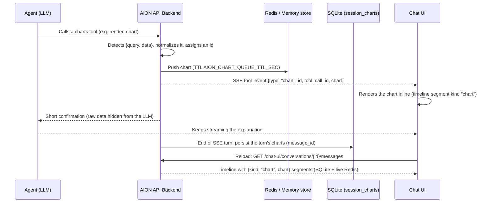

# Session Charts

Interactive BI (Business Intelligence) charts in the **chat-ui** are produced by the `charts` MCP tools. A chart is shown **as soon as the tool returns**, inline in the assistant turn right after the tool step, while the model keeps streaming its explanation. It is kept live in Redis and copied to SQLite at the end of the SSE turn, so it is rendered again, at the same position, after a page reload or a chat switch.

---

## Overview of the Flow



---

## Interception and Live Delivery

During tool execution inside [`src/main.py`](../../src/main.py) (`_aion_mcp_tool_run`), the backend tries to parse the tool's return string as JSON:

- If it is a dictionary with both **`"query"`** and **`"data"`**, it is a chart payload.
- The payload is normalized ([`src/chart_payload.py`](../../src/chart_payload.py)), receives an `id` (UUID) and the `tool_call_id` of the step, and is pushed to the live store ([`src/chart_queue.py`](../../src/chart_queue.py)).
- A `chart` event is put on the session tool-event bus and forwarded immediately as an SSE chunk:
  ```json
  {"type": "tool_event", "event": {"type": "chart", "id": "<uuid>", "tool_call_id": "<call id>", "name": "render_chart", "chart": {"query": "...", "data": []}}}
  ```
  Chart events are display-only: they do not count towards the tool-event guards and skip the tool hooks.
- The raw JSON output is **replaced** in the tool response returned to the LLM with `[Grafico generato con successo per la query: <query_text>]`, so large datasets never bloat the context window.

Custom Python tools can push directly with `chart_queue.push(session_id, chart_data)` (returns the serialized chart with its `id`). Such charts reach the legacy endpoint and the history only through the live store, not the SSE stream.

---

## Timeline Position and Persistence

- `TimelineBuilder` ([`src/runtime/timeline_builder.py`](../../src/runtime/timeline_builder.py)) appends a **reference** segment `{"kind": "chart", "id", "toolCallId"}` to the assistant timeline (`messages.timeline_json`). The dataset is never duplicated in the timeline; the chat-ui backup (`PATCH .../timeline`, `POST .../messages`) is stripped server-side too.
- At the end of the SSE turn (also on error or cancel) the pipeline writes the turn's charts to the **`session_charts`** table ([`src/charts_store.py`](../../src/charts_store.py)) with the assistant `message_id`. Writes are idempotent on the chart id.
- `GET /chat-ui/conversations/{id}/messages` re-injects the payload into each chart segment (`segment.chart`). Sources: SQLite rows plus live Redis entries (a turn still streaming). Charts without a segment are placed right after their tool step (`toolCallId`), otherwise at the end of the message; segments whose chart no longer exists are dropped.
- Forking a conversation copies the charts of the copied turns.

### Cleanup

| Action | Effect on charts |
| :--- | :--- |
| Delete conversation (`DELETE /chat-ui/conversations/{id}`, `DELETE /v1/conversations/{id}`) | SQLite rows of the conversation (and its side threads) and the live Redis key are removed. Conversations are soft-deleted, so this is explicit. |
| Delete last turn (`DELETE /chat-ui/conversations/{id}/messages/{mid}`) | Rows linked to the removed messages are deleted; the live key is cleared. |
| Hard purge of a conversation row | `ON DELETE CASCADE` on `session_charts.conversation_id`. |

---

## REST API Endpoints

### Legacy: get and consume session charts

`GET /sessions/{session_id}/charts`

Kept for API clients (e.g. AION SRE). **chat-ui no longer calls it.**

- **Authentication**: Chat Bearer JWT or BFF Shared Secret (`X-AION-Chat-Ui-Secret`). The session must belong to the caller, otherwise 404.
- **Behavior**: **destructive read** of the live store (flush). Persisted SQLite charts are not affected.
- **Response Example (200 OK)**:
  ```json
  {
    "charts": [
      {
        "id": "0f8e7c1e-1f7a-4c55-9f3e-0b1c2d3e4f50",
        "tool_call_id": "call_abc",
        "query": "rate(http_requests_total[5m])",
        "chart_kind": "area",
        "stacked": false,
        "x_key": "index",
        "data": [
          {"index": "2025-01-01T10:00:00", "job/api": 12.4, "job/web": 3.1},
          {"index": "2025-01-01T10:05:00", "job/api": 14.2, "job/web": 2.9}
        ]
      }
    ]
  }
  ```

---

## JSON Payload Schema

Chart dictionaries are validated and normalized by [`src/chart_payload.py`](../../src/chart_payload.py) before being stored.

### Minimum Required Payload

| Field | Type | Required | Description |
| :--- | :--- | :---: | :--- |
| `query` | string | **Yes** | Title or PromQL query shown in the header of the chart in the UI. |
| `data` | array of objects | **Yes** | Dataset to plot. Each object represents a data row. Columns are plotted as series. |

### Added by the backend

| Field | Type | Description |
| :--- | :--- | :--- |
| `id` | string (UUID) | Chart id shared by the SSE event, the timeline segment and the `session_charts` row. |
| `tool_call_id` | string | Id of the tool step that produced the chart. |

### Visual Layout Extensions

| Field | Type | Default | Description |
| :--- | :--- | :--- | :--- |
| `chart_kind` | string | `"line"` | Visualization style: `"line"`, `"area"`, or `"bar"`. Invalid values fallback to `"line"`. |
| `x_key` | string | `"index"` | The column name representing the X-axis values (usually a timestamp or sequential index). |
| `series_keys` | string[] | *All other columns* | A list of specific column names to render. Missing keys are automatically omitted. |
| `stacked` | boolean | `false` | If `true`, stacks area segments or bar groups (relevant for `area` and `bar` kinds). |
| `y_label` | string | — | Label for the Y-axis (truncated to a maximum of 120 characters by the backend). |
| `legend_off` | boolean | `false` | If `true`, hides the chart legend in the user interface. |

### Legacy Fields

| Field | Type | Description |
| :--- | :--- | :--- |
| `range_seconds` | integer | Query range duration window (legacy Prometheus queries). |
| `step_seconds` | integer | Query range step duration (legacy Prometheus queries). |

---

## Backend Storage Architecture

1. **Live store** ([`src/chart_queue.py`](../../src/chart_queue.py), `SessionChartQueue`):
   - **Redis list** when `AION_REDIS_URL` is set. Key `{AION_REDIS_NAMESPACE}:charts:{session_id}`, TTL `AION_CHART_QUEUE_TTL_SEC` (default 1 hour), refreshed on every push.
   - **In-memory fallback** (thread-safe dict, same TTL) when Redis is unavailable.
   - `peek()` is non-destructive (history endpoint); `flush()` keeps the legacy destructive contract; `clear()` runs on conversation or turn deletion.
2. **Durable store**: SQLite table `session_charts` (`id`, `conversation_id` FK cascade, `message_id`, `tool_call_id`, `payload_json`, `created_at`), Alembic migration `c4a7r8t035`.

---

## Environment Variables

| Variable | Default | Description |
| :--- | :---: | :--- |
| `AION_CHART_KIND_ENABLED` | `1` | Set to `0` to disable layout customizations. When disabled, all charts are forced to `line` and extra formatting options (`x_key`, `series_keys`, etc.) are stripped. |
| `AION_CHART_QUEUE_TTL_SEC` | `3600` | TTL in seconds of the live chart store (Redis and in-memory). |
| `AION_REDIS_NAMESPACE` | `aion` | Redis key namespace prefix. |

---

## Frontend Integration (`chat-ui`)

- The SSE reducer ([`lib/sse/reducer.ts`](../../chat-ui/lib/sse/reducer.ts)) turns the `chart` event into a `{kind: "chart"}` timeline segment, so the chart appears mid-stream right after the tool step and stays part of the message body (sending a new message no longer resets it).
- [`TurnTimeline.tsx`](../../chat-ui/components/chat/TurnTimeline.tsx) renders each chart segment with `ChartBlock` from [`SessionCharts.tsx`](../../chat-ui/components/chat/SessionCharts.tsx) (Recharts line/area/bar), inside an error boundary.
- **Layout**: the card is centered on the chat column and spans its full width (CSS container `aion-chat-column` in `app/globals.css`), so it follows the column when side panels open or close. The plot height follows the card width (about 2:1, clamped to 220–420 px).
- **Colors**: `--chart-1` … `--chart-8` in `styles/theme-tokens.css`: fixed categorical order (brand red, blue, aqua, yellow, magenta, green, violet, orange) with light and dark variants, validated for colorblind-safe separation of adjacent series. Series beyond 8 fall back to muted ink.
- **Accessibility**: legend for 2+ series, hover tooltip, and a **Table** toggle with the raw data.
- **Empty state**: "No data" placeholder when the data array is empty.
