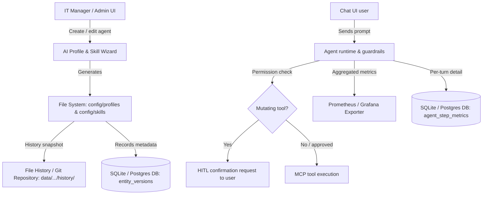

# Governance and Deployment of Individual Agents for IT Managers

:::info Design note
Functional proposal for the tooling that lets company IT managers create, monitor, version and test individual agents. Status: partially implemented — a tool approval mechanism exists (`src/security/approval_manager.py`), while the `entity_versions` and `agent_step_metrics` tables described below are not in the code yet.
:::

This document summarizes the features and the technical structure designed to let **company IT managers** create, configure, monitor and evaluate individual agents (with their profiles, skills and MCP servers) autonomously and safely, in an environment based on **local LLM models**.

---

## 🎯 Main goals

1. **IT manager autonomy**: enable guided creation and customization of profiles and the binding of skills and MCP servers without manually touching low-level YAML/JSON syntax.
2. **Control & security (human-in-the-loop)**: prevent unwanted actions by agents on company systems through a system of prior approval of calls to mutating tools.
3. **Quality & measurability (local LLM performance)**: track latencies, generation throughput (tokens/sec), context saturation and MCP error rates.
4. **Resilience (document-based versioning)**: keep a complete history of profiles and skills to allow 1-click rollback without weighing down the database.

---

## 📋 Feature list (revised scope)

### 1. 📊 Statistics & metrics per profile and per MCP server
Focused on the performance of local models (no tracking of API costs or cloud rate limits):
* **Response latency:** time to first token (TTFT) and total generation time.
* **Model throughput:** generation speed in **tokens/second**.
* **MCP reliability & latency:** execution time and error rate of the individual MCP servers invoked by the agent.
* **Context window saturation:** monitoring of the percentage of the local model's context window used during each conversation turn.

### 2. 🪄 AI-assisted building (AI Profile & Skill Wizard)
* **Prompt-to-agent:** the IT manager describes the goal in natural language (e.g. *"Agent for managing Jira tickets and running SQL queries on the customer DB"*).
* **Automatic generation:** the AI synthesizes:
  * System prompt and behavioural instructions.
  * Structure of the required **skills**.
  * **MCP auto-assignment:** automatic selection and attachment of the relevant MCP servers available in the AION catalogue.

### 3. 🛡️ Agent guardrail system
* **Input guardrails (pre-LLM):**
  * *Prompt injection / jailbreak defense:* detection and blocking of attempts to override the instructions.
  * *PII masking & anonymization:* automatic masking of sensitive data, credentials and personal information before they reach the model.
* **Execution guardrails (in-tool):**
  * Limits on the parameters sent to MCP tools (e.g. maximum number of rows returned, query sanitization, strict timeouts).

### 4. ✋ Human-in-the-loop (HITL) & tool approvals
* **Classification of MCP tools:**
  * 🟢 **Auto-approve (read-only):** read queries (SELECT), documentation search, web search.
  * 🟡 **Requires confirmation (write/mutations):** file changes, UPDATE/INSERT on the DB, sending messages/emails.
* **Confirmation flow in chat:**
  * The agent suspends the tool execution and sends a request to the user.
  * If the user **approves**, the action is executed.
  * If the user **rejects** (optionally with a reason), the agent receives the feedback and looks for an alternative way to complete the task.

### 5. 🧪 Agent evaluation suite (pre-deploy test bench)
* **Test dataset ("golden cases"):** a suite of sample prompts specific to the profile that was created.
* **Automatic evaluation (LLM-as-a-judge):** automated execution in a sandbox environment to check:
  * Correctness of the answer.
  * Selection of the appropriate MCP tools.
  * Compliance with the instructions and guardrails before release to production.

### 6. 🔄 Versioning & rollback of profiles and skills (document-based)
* **Version history:** recording of every save/change made by an administrator to a YAML profile or a Markdown skill.
* **1-click rollback:** immediate restore of any previous version with on-the-fly hot reload of the runtime, without restarting the AION services.

---

## 🛠️ Technical architecture of the solutions

### 1. Metrics management: hybrid approach
* **Prometheus:** used for system-level, time-aggregated metrics (tokens/sec throughput, P95 latency, MCP error counter for the Grafana/Admin UI exporter).
* **DB table `agent_step_metrics`:** used for detailed lookups from the Admin UI of the runs per session/profile:
  `session_id`, `profile_slug`, `timestamp`, `tokens_prompt`, `tokens_completion`, `generation_ms`, `mcp_tool_used`, `mcp_status`, `error_details`.

### 2. Document-based versioning (no DB overhead)
* **File system storage:** the profile YAML files and the skill Markdown files remain the source of truth, with history snapshots saved under `data/profiles/history/` and `data/skills/history/`.
* **Ultra-light metadata table `entity_versions`:** stores only the index of changes: `(entity_type, slug, version, created_at, created_by, change_summary, file_path)`.
* **Rollback mechanism:** restoring a version reads the corresponding snapshot and overwrites the file in `config/profiles/` or `config/skills/`, notifying the cache invalidation to `ProfileManager` and `SkillRegistry`.
