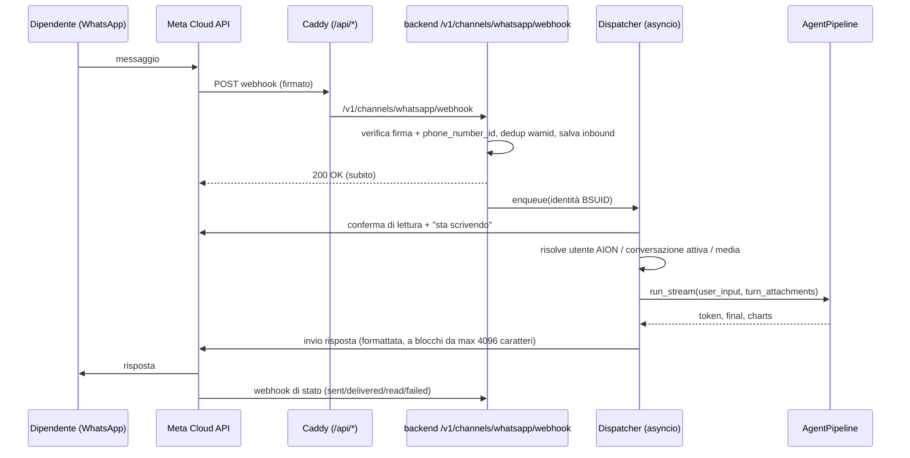

# Piano di implementazione — Canale WhatsApp

> Documento di pianificazione. Stato delle API e delle policy Meta verificato
> il **28/10/2026**; le fonti sono in fondo. Le date Meta cambiano spesso:
> ricontrollarle prima di ogni rilascio.
>
> **Stato:** la Fase 1 (solo testo) è implementata. La guida operativa
> (setup admin, collegamento dei dipendenti, endpoint, troubleshooting) è in
> [`docs/integrations/whatsapp.md`](../integrations/whatsapp.md). Dove questo
> piano e il codice differiscono, vale il codice; le differenze principali
> sono segnalate nelle sezioni 3, 4, 8 e 9.

## Obiettivo

Un'azienda che usa AION deve poter attivare, dall'admin-ui, un numero
WhatsApp aziendale. I dipendenti scrivono a quel numero da WhatsApp e parlano
con lo stesso agente (stessi profili, memoria STM/LTM, tool MCP, permessi)
che usano dalla chat-ui. Le conversazioni WhatsApp compaiono anche nello
storico della chat-ui.

Fuori scope nella prima versione: gruppi WhatsApp, chiamate vocali, messaggi
proattivi (template), più numeri per tenant.

## 1. Quadro Meta al 2026 (cosa usare e cosa evitare)

| Tema | Stato ottobre 2026 | Impatto su AION |
|------|--------------------|-----------------|
| **API da usare** | **WhatsApp Cloud API** (ospitata da Meta, Graph API). L'On-Premises API è stata dismessa il 23/10/2025. | Unica opzione ufficiale. Niente librerie "WhatsApp Web" non ufficiali (Baileys, WAHA, whapi…): violano i termini e portano al ban del numero. |
| **Versione Graph API** | Ultima: **v26.0** (29/07/2026). La documentazione WhatsApp usa ancora v25.0 negli esempi. | Versione configurabile, default `v26.0`. |
| **Policy "AI Providers"** | Dal 15/01/2026 i termini escludono i fornitori di assistenti AI *general-purpose*, salvo dove Meta è obbligata per legge a permetterli. In **Italia** (misura cautelare AGCM, 22/12/2025) e nel resto del **SEE** (misure provvisorie della Commissione UE, 09/06/2026) l'accesso è ripristinato **fino alla decisione finale**. Dal 13/05/2026 Meta non addebita più costi extra agli AI Provider nei mercati UE/SEE. | **Rischio principale del progetto**: vedi §2. |
| **Prezzi** | Prezzo per singolo messaggio dal 01/07/2025. **Dal 01/10/2026 i messaggi di servizio (risposte entro le 24h) si pagano**: i primi **1.000 al mese per numero** sono gratuiti. Serve un metodo di pagamento nel Billing Hub. I messaggi in arrivo dagli utenti sono gratuiti. Esiste la nuova categoria "Meta Business Agent" (l'agente AI di Meta, a token), che non riguarda noi. | Ogni messaggio inviato conta: niente spezzare le risposte in tanti messaggi senza motivo. |
| **Finestra di servizio** | Per 24h dall'ultimo messaggio dell'utente si possono inviare messaggi liberi. Fuori finestra solo template approvati. | La v1 risponde soltanto: nessun template necessario. |
| **Identità utente (BSUID)** | Da aprile 2026 i webhook includono sempre `user_id` (Business-Scoped User ID, es. `IT.1234…`). Con i **nomi utente WhatsApp** (prenotabili dal 29/06/2026) il numero di telefono (`from`, `wa_id`) **può mancare**. Da luglio 2026 si può inviare al BSUID con il campo `recipient`. Se l'utente cambia numero, il BSUID cambia: arriva un messaggio `system` con `previous_user_id`. | Chiave primaria dell'identità WhatsApp = **BSUID**, non il numero. Il collegamento all'utente AION non può contare sul numero. |
| **Webhook** | Verifica con GET (`hub.mode`, `hub.verify_token`, `hub.challenge`). POST firmati con `X-Hub-Signature-256` (HMAC-SHA256 del body grezzo con l'app secret). Payload fino a 3 MB. Nuovi tentativi fino a **7 giorni**, con **duplicati possibili**. mTLS supportato. Gli IP Meta cambiano: sconsigliata l'allowlist. | Rispondere 200 subito, elaborare in background, deduplicare per `wamid`. |
| **UX** | Indicatore "sta scrivendo" (dal 2025, si invia insieme alla conferma di lettura). Messaggi interattivi (pulsanti, liste). Testo max 4.096 caratteri. I link ai media scaricati scadono in pochi minuti. | Spunte blu + "sta scrivendo" mentre l'agente lavora; comandi tramite liste interattive. |
| **Onboarding** | Self-service: app Meta + System User token. Per partner: Tech Provider + **Embedded Signup** (v4 in public preview da maggio 2026). Esiste "Coexistence" per riusare un numero dell'app WhatsApp Business. | v1: ogni cliente porta la propria app Meta. Embedded Signup è nella fase 4. |

## 2. Compliance e policy (prima di scrivere codice)

1. **Posizionamento rispetto alla clausola "AI Providers".** Il caso d'uso è
   un'azienda che offre ai **propri dipendenti** un assistente legato ai
   propri dati, processi e strumenti. Non è un assistente generico offerto al
   pubblico. Per restare in questo perimetro:
   - risponde solo a utenti **collegati** a un account AION (gli altri
     ricevono soltanto il messaggio di collegamento);
   - profili usati su WhatsApp configurati sulle funzioni aziendali;
   - mai presentarlo come "ChatGPT su WhatsApp";
   - un **kill switch** (`AION_WHATSAPP_ENABLED=0`) per spegnere il canale
     subito se Meta o un'autorità cambiano le regole.
2. **Revisione legale** dei *Meta Terms for WhatsApp Business Platform*
   (versione del 15/01/2026) da parte di AION-ASA e del cliente, perché:
   - le misure AGCM e UE sono **cautelari**: una decisione finale potrebbe
     cambiare il quadro;
   - AION-ASA, se distribuisse il canale come Tech Provider (fase 4),
     potrebbe ricadere più facilmente nella definizione di "AI Provider".
3. **GDPR / lavoro.**
   - I messaggi transitano dai server Meta (Cloud API). Valutare la
     *local storage* della Cloud API per una regione UE (da verificare sulla
     documentazione aggiornata).
   - Aggiornare l'informativa ai dipendenti e la policy BYOD (WhatsApp sul
     telefono personale).
   - DPIA se l'agente accede a dati sensibili.
   - L'uso del canale deve essere **volontario** (opt-in tramite il
     collegamento dell'account).
4. **Prerequisiti Meta per ogni cliente:**
   - Business portfolio verificato;
   - WABA;
   - numero dedicato;
   - nome visualizzato approvato;
   - app Meta con prodotto WhatsApp;
   - System User con token permanente (`whatsapp_business_messaging`,
     `whatsapp_business_management`);
   - app secret;
   - sottoscrizione al campo webhook `messages`;
   - metodo di pagamento;
   - app in modalità **Live**.

## 3. Architettura proposta



Vincoli dell'architettura attuale da rispettare:

- **`--workers 1`**: la coda in-process (`asyncio`) va bene e segue lo
  schema di `src/runtime/cron_runner.py:129` (`execute_job`) e del task in
  background di `src/api/v1/chat.py:797`.
- **Nessuna task queue**. Per non perdere messaggi a un riavvio, l'inbound
  viene salvato su DB con `status=received` prima del 200. All'avvio (nel
  lifespan) si riprendono i pendenti con meno di 24h.
- **Caddy** già inoltra `/api/*` al backend togliendo il prefisso. Il webhook
  è pubblico (nessuna dipendenza di auth): la sicurezza viene dalla firma
  HMAC.

### 3.1 Nuovi moduli

Moduli effettivi della Fase 1:

```
src/channels/__init__.py
src/channels/whatsapp/
├── config_service.py  # config per tenant (DB, segreti cifrati, cache 30s) + kill switch env
├── signature.py       # verify_signature(raw_body, header, app_secret) — confronto a tempo costante
├── payload.py         # parse webhook -> InboundMessage / StatusUpdate / SystemChange (dataclass)
├── graph_client.py    # Graph API via httpx: get_phone_info, get_subscribed_apps,
│                      # subscribe_app, send_text, mark_read_typing
├── formatting.py      # Markdown AION -> sintassi WhatsApp, split a 4096, tabelle, link
├── linking.py         # codici COLLEGA monouso, BSUID -> User, cambio numero
├── store.py           # whatsapp_messages: insert con dedup, stati, ripresa
└── dispatcher.py      # lock per mittente, comandi, run del turno, invio risposta, resume_pending
src/api/v1/whatsapp.py     # webhook pubblico + /v1/me/whatsapp* (require_chat_auth)
src/api/admin_whatsapp.py  # /admin/whatsapp/* (require_admin_role)
```

I comandi sono gestiti direttamente nel dispatcher (niente `commands.py`) e
non esiste un `router.py`: il router pubblico è `src/api/v1/whatsapp.py`,
incluso in `src/api/v1/__init__.py`; quello admin è incluso in
`src/api/admin.py`. Il client per media e messaggi interattivi arriva con la
Fase 2.

### 3.2 Modello dati (migrazione Alembic)

Nuova revisione in `migrations/versions/`, dopo l'head attuale `z8a9b0c028`.
Il nome segue la convenzione, es. `a9b0c1d029_whatsapp_channel.py`.

| Tabella | Colonne principali | Note |
|---------|--------------------|------|
Tabelle effettive della Fase 1 (`a9b0c1d029_whatsapp_channel.py`):

| Tabella | Colonne principali | Note |
|---------|--------------------|------|
| `whatsapp_channels` | `id`, `tenant_id` (unique), `enabled`, `waba_id`, `phone_number_id`, `display_phone_number`, `verified_name`, `access_token_encrypted`, `app_secret_encrypted`, `verify_token_encrypted`, `default_profile_slug`, `validated_at`, `validated_by_user_id`, `webhook_verified_at`, `last_webhook_at`, `last_error`, `created_at`, `updated_at` | Segreti cifrati con `src/runtime/credential_store.py` (`encrypt_value`/`decrypt_value`), come `SsoProvider.client_secret_encrypted`. |
| `whatsapp_identities` | `id`, `tenant_id`, `bsuid`, `phone_e164` (nullable), `wa_profile_name`, `user_id` FK `users.id` (cascade), `active_conversation_id`, `linked_at`, `last_inbound_at` | Unique `(tenant_id, bsuid)` e `(tenant_id, user_id)`: un WhatsApp per utente. |
| `whatsapp_link_codes` | `id`, `tenant_id`, `user_id`, `code_hash`, `expires_at` (10 min), `used_at`, `created_at` | Monouso; nel DB si salva solo l'hash. |
| `whatsapp_messages` | `wamid` (unique), `tenant_id`, `direction` (`in`/`out`), `bsuid`, `conversation_id`, `status` (`received`/`processing`/`done`/`failed`/`sent`/`delivered`/`read`), `error_code`, `payload_json`, `created_at`, `updated_at` | Dedup, ripresa dopo riavvio, stato delle consegne. `payload_json` solo in ingresso, svuotato a fine elaborazione. |

Rimandati: override del profilo per identità, `graph_api_version` per
tenant (oggi è una env), reset per inattività, messaggio di benvenuto
personalizzabile.

## 4. Identità: collegare WhatsApp ↔ utente AION

> **Implementazione Fase 1:** il collegamento parte dalla chat-ui, non da
> WhatsApp. Il dipendente genera in Impostazioni → WhatsApp un codice
> monouso (QR / link `wa.me` con `COLLEGA <codice>` precompilato) e lo invia
> al numero aziendale. Niente magic link né `link_mode`; il login resta
> quello della chat-ui, quindi password, 2FA e SSO valgono comunque. A chi
> non è collegato il bot risponde con il link alla scheda WhatsApp delle
> impostazioni. Il flusso sotto resta come alternativa valutata.

Il numero non è affidabile come chiave: con i nomi utente può mancare dal
webhook. Il meccanismo principale è quindi un **collegamento tramite login**.

1. Arriva un messaggio da un BSUID sconosciuto. Il bot risponde **una sola
   volta ogni 10 minuti** per BSUID (ogni risposta costa) con:
   *"Per usare AION collega il tuo account: https://DOMINIO/whatsapp/link?t=…"*.
2. Il link apre una pagina della chat-ui (`chat-ui/app/whatsapp/link`). Il
   login avviene col flusso normale (password + 2FA o SSO, quindi tutte le
   policy esistenti valgono). Poi l'utente conferma
   "Collega questo WhatsApp (nome profilo, ultime cifre se presenti)".
3. `POST /v1/channels/whatsapp/link/confirm` (con `require_chat_auth`):
   - consuma il token;
   - crea la riga `whatsapp_identities`;
   - scrive un audit log;
   - il bot invia un messaggio di benvenuto con i comandi.
4. **Opzionale (`link_mode=magic_link+phone`)**: se l'admin ha registrato il
   numero del dipendente e il webhook contiene `wa_id`, il collegamento è
   automatico. Il numero è già verificato da WhatsApp, ma il collegamento va
   comunque confermato con un messaggio interattivo "Sei Mario Rossi? Sì/No".

Regole:

- WhatsApp **non crea mai account**: vale anche con la signup policy SSO
  `open`.
- A ogni turno si ricontrolla che l'utente esista, non sia disattivato e
  abbia accesso al profilo (`enforce_profile_access`).
- Messaggio `system` `user_changed_number` / `user_changed_user_id`: si
  aggiorna `bsuid` usando `previous_user_id`.
- Scollegamento possibile:
  - dall'utente (comando `/scollega` o impostazioni della chat-ui);
  - dall'admin (pagina utenti).
- Identità per la pipeline: un nuovo `ChatAuthIdentity(via="whatsapp", …)`.
  Lo `user_id` della conversazione è `sanitize_user_id(user.identifier)`,
  come per `chat_token` (`src/api/ownership.py:51`), così le conversazioni
  appaiono nello storico della chat-ui dell'utente.

## 5. Esecuzione del turno

Il dispatcher replica lo schema di `cron_runner.execute_job`:

1. **Lock per identità.** Se arriva un messaggio mentre un turno è in corso,
   lo si mette in coda e lo si elabora dopo. Si possono raggruppare più
   messaggi ravvicinati in un solo turno: l'infrastruttura
   `redis_enqueue_session_event` esiste già.
2. **Conferma di lettura + "sta scrivendo"** sul `wamid` ricevuto. L'indicatore
   dura circa 25s: va rinviato periodicamente durante i turni lunghi (da
   verificare se Meta lo consente sullo stesso `message_id`). Se il turno
   supera ~60s si invia un solo messaggio "Ci sto lavorando…".
3. **Conversazione.** Si usa `active_conversation_id`. Se manca, è
   archiviata, o se l'ultimo messaggio supera `idle_reset_hours`, si crea una
   nuova `Conversation` con `metadata.source="whatsapp"`, `profile_slug` (=
   override dell'identità o `default_profile_slug`) e titolo
   `WhatsApp — <data>`. Il filtro della chat-ui (`chat_ui.py:138`) **non** la
   nasconde; meglio aggiungere un badge WhatsApp nella lista.
4. **Media in ingresso.**
   - `GET /{media-id}` → `url`; poi download con il bearer token.
   - `save_upload(session_id, …)` (`src/session_workspace.py:289`) +
     `apply_legacy_word_conversion` + `schedule_auto_ingest`, come in
     `session_uploads.py`.
   - Il risultato diventa `AttachmentRef` passato come `turn_attachments`.
   - La didascalia diventa `user_input`.
   - Nota: `chat_sync` (`/v1/chat`) **non** passa gli allegati, quindi si
     chiama direttamente `AgentPipeline`.
5. **Run.**
   - `get_agent(profile, session_id, user_id, …)` + `AgentPipeline(…)`;
   - `run_stream(user_input, turn_attachments=…, message_source="user_input",
     metadata={"channel": "whatsapp", "wamid": …})`;
   - registrazione in `_background_runs` + `redis_set_stream_active`, così il
     turno si può seguire live dalla chat-ui;
   - `agent_mode="normal"`, con plan mode e deep research disattivati in v1.
6. **Tool che chiedono conferma all'utente (HITL):** in v1 si rifiutano con
   un messaggio che rimanda alla chat-ui. In fase 3 si gestiscono con
   pulsanti interattivi (`button_reply`).
7. **Invio della risposta** (`formatting.py`):
   - `**x**` → `*x*`; i titoli diventano righe in grassetto; i blocchi di
     codice restano tra ```` ``` ````; `[t](u)` → `t: u`;
   - tabelle → elenco puntato o blocco monospazio (oltre 4 colonne si
     rimanda alla chat-ui);
   - split a 4.096 caratteri sui confini di paragrafo, con un limite di
     blocchi per risposta (es. 3). Oltre il limite: riassunto + link
     "Apri la risposta completa" alla conversazione nella chat-ui;
   - `charts` → PNG renderizzato e inviato come `image`, oppure link alla
     chat-ui;
   - file generati nel workspace → `document` (upload media).
8. **Persistenza.** I messaggi utente e assistente li salva già la pipeline.
   Si registrano i `wamid` in uscita in `whatsapp_messages` e si aggiornano
   gli stati dai webhook di stato. Su `failed` si logga il codice errore Meta
   (es. 131047 = finestra di 24h scaduta).

### Comandi (testo o lista interattiva)

| Comando | Effetto |
|---------|---------|
| `/nuova` | Nuova conversazione |
| `/profilo` | Lista interattiva dei profili consentiti all'utente → override sull'identità |
| `/aiuto` | Elenco comandi |
| `/scollega` | Scollega il numero (con conferma) |

## 6. Esempi API (Cloud API, v26.0)

Webhook in ingresso (estratto, con BSUID):

```json
{
  "object": "whatsapp_business_account",
  "entry": [{ "id": "<WABA_ID>", "changes": [{ "field": "messages", "value": {
    "messaging_product": "whatsapp",
    "metadata": { "display_phone_number": "39021234567", "phone_number_id": "<PHONE_NUMBER_ID>" },
    "contacts": [{ "profile": { "name": "Mario" }, "wa_id": "39333…", "user_id": "IT.1349…" }],
    "messages": [{ "from": "39333…", "from_user_id": "IT.1349…", "id": "wamid.HBg…",
                   "timestamp": "1761…", "type": "text", "text": { "body": "Ciao" } }]
  }}]}]
}
```

`from`/`wa_id` possono mancare, `user_id`/`from_user_id` sono sempre presenti.

Invio di una risposta (al BSUID):

```http
POST https://graph.facebook.com/v26.0/<PHONE_NUMBER_ID>/messages
Authorization: Bearer <SYSTEM_USER_TOKEN>

{ "messaging_product": "whatsapp", "recipient_type": "individual",
  "recipient": "IT.1349…", "type": "text",
  "text": { "body": "…", "preview_url": false } }
```

Se si passano sia `to` che `recipient`, prevale `to`.

Conferma di lettura + "sta scrivendo":

```json
{ "messaging_product": "whatsapp", "status": "read",
  "message_id": "wamid.HBg…", "typing_indicator": { "type": "text" } }
```

Media: `GET /v26.0/<MEDIA_ID>` → `{url, mime_type, sha256, file_size}`, poi
`GET <url>` con lo stesso bearer token.

Meta non mantiene un SDK Python ufficiale per la Cloud API: si usa `httpx`
(già nel progetto) con un client sottile e testabile.

## 7. Sicurezza

- **Firma**: HMAC-SHA256 sul **body grezzo** (letto con
  `await request.body()` prima del parsing), confronto con
  `hmac.compare_digest`. Firma non valida → 403, niente elaborazione.
- Si accettano solo payload con `metadata.phone_number_id` uguale a quello
  configurato. Quando il canale è disabilitato si risponde 200 senza fare
  nulla, così Meta non continua a ritentare.
- `verify_token` generato casualmente dall'admin-ui, salvato cifrato.
- Limite dimensione body (3 MB + margine) e rate limit per BSUID con
  contatore Redis (oggi non c'è nessun limiter). Throttling separato e più
  severo per i BSUID non collegati, contro gli abusi di costo.
- mTLS facoltativo su Caddy per il path del webhook (documentarlo, non
  obbligatorio in v1).
- Log senza contenuto dei messaggi. Audit di collegamento/scollegamento e
  cambi di configurazione.
- Media: limite `AION_UPLOAD_MAX_BYTES`, MIME consentiti, stessi controlli
  dell'upload della chat-ui.

## 8. Admin UI e chat-ui

> **Implementazione Fase 1:** pagina `admin-ui/app/whatsapp` (gruppo
> Piattaforma) con guida, credenziali, checklist "Verifica" e attivazione
> solo dopo una verifica riuscita; scheda WhatsApp nelle impostazioni della
> chat-ui con QR. Endpoint effettivi: `GET/PUT /admin/whatsapp`,
> `POST /admin/whatsapp/verify-token`, `POST /admin/whatsapp/validate`,
> `POST /admin/whatsapp/enable`, `GET/DELETE /admin/whatsapp/identities`,
> `GET/DELETE /v1/me/whatsapp`, `POST /v1/me/whatsapp/link-code`. Elenco
> completo in [`docs/integrations/whatsapp.md`](../integrations/whatsapp.md#endpoint).

**admin-ui** — nuova pagina `admin-ui/app/integrations/whatsapp/page.tsx`
(o sezione in `settings`), testi i18n in `admin-ui/lib/i18n/locales/{it,en,de,fr,es}.json`:

- interruttore attivo/disattivo;
- campi WABA ID, Phone Number ID, access token, app secret (in sola
  scrittura, mascherati);
- verify token con pulsante "genera";
- **URL del webhook da copiare** (`https://DOMINIO/api/v1/channels/whatsapp/webhook`);
- **"Verifica connessione"**: `GET /<PHONE_NUMBER_ID>?fields=display_phone_number,verified_name,quality_rating`
  mostra nome verificato e qualità;
- profilo predefinito, modalità di collegamento, reset per inattività,
  messaggio di benvenuto;
- tabella delle identità collegate (utente, nome profilo WA, ultimo
  messaggio, scollega);
- stato del canale: ultimo webhook ricevuto, errori recenti, messaggi
  inviati nel mese rispetto ai 1.000 gratuiti;
- guida passo-passo alla configurazione su Meta, con link a
  `docs/integrations/whatsapp.md`.

API admin:

- `GET/PUT /admin/whatsapp/settings`
- `POST /admin/whatsapp/test`
- `GET /admin/whatsapp/identities`
- `DELETE /admin/whatsapp/identities/{id}`

**chat-ui:**

- pagina `/whatsapp/link`;
- in impostazioni → "Account collegati": WhatsApp con stato e pulsante
  scollega;
- badge WhatsApp nella lista conversazioni.

## 9. Configurazione (env)

La configurazione funzionale vive nel DB (modificabile dall'admin-ui).
Le env servono come override e kill switch, da aggiungere a `.env.example`
e `.env.docker.example`:

| Variabile | Default | Scopo |
|-----------|---------|-------|
| `AION_WHATSAPP_FORCE_DISABLE` | `0` | Kill switch globale (`1` = canale spento, come `AION_SSO_FORCE_PASSWORD`); l'attivazione normale è dall'admin-ui |
| `AION_WHATSAPP_GRAPH_VERSION` | `v26.0` | Versione Graph API |
| `AION_WHATSAPP_MAX_CHUNKS` | `3` | Blocchi massimi per risposta |
| `AION_WHATSAPP_TURN_TIMEOUT_S` | `600` | Timeout del turno |
| `AION_WHATSAPP_UNLINKED_REPLY_COOLDOWN_S` | `600` | Anti-spam del messaggio di collegamento (Fase 1: fisso a 10 min) |
| `AION_WHATSAPP_MEDIA` | `1` | Accetta media in ingresso (Fase 2) |

## 10. Fasi di rilascio

| Fase | Contenuto | Stima |
|------|-----------|-------|
| **0 — Prerequisiti** | Revisione legale (§2); app Meta di test con numero di test gratuito; tunnel (cloudflared/ngrok) per lo sviluppo locale; raccolta di payload reali come fixture. | 2–3 gg + tempi legali |
| **1 — Solo testo** ✅ | Migrazione; `config_service`/`signature`/`payload`/`graph_client`; webhook + dedup + ripresa pendenti; collegamento con codice/QR dalla chat-ui; pagina admin con verifica e attivazione; dispatcher con conferma di lettura e "sta scrivendo"; formattazione e split; comandi base; kill switch; doc `docs/integrations/whatsapp.md`. | 8–10 gg |
| **2 — Admin & media** | Pagina admin completa con test di connessione e identità; media in ingresso (immagini, PDF, documenti Office); media in uscita (grafici, file); webhook di stato e metriche; rate limit. | 6–8 gg |
| **3 — UX avanzata** | Messaggi vocali tramite endpoint STT OpenAI-compatible (`AION_STT_API_URL`, es. Whisper su vLLM; oggi in AION non esiste STT); HITL con pulsanti; auto-match tramite numero; raggruppamento di messaggi ravvicinati. | 5–7 gg |
| **4 — Distribuzione** | Messaggi proattivi tramite template utility (es. risultati dei job cron), fuori dalla finestra di 24h; AION-ASA come **Tech Provider** con **Embedded Signup** (onboarding con un clic dall'admin-ui, `override_callback_uri` per WABA verso il dominio del cliente). Richiede App Review e una nuova valutazione della policy AI Providers. | da stimare |

## 11. Test

- **Unit**:
  - firma (valida, alterata, header mancante);
  - parsing di fixture reali: testo, immagine, documento, audio,
    interattivi, reazioni, `system` (cambio numero), stati, payload **senza
    `wa_id`**, duplicati;
  - formatter Markdown → WhatsApp e split;
  - token di collegamento (scadenza, riuso).
- **Integrazione**:
  - Graph API simulata con `httpx.MockTransport` (niente dipendenza `respx`);
  - dispatcher end-to-end con pipeline stub;
  - ripresa dopo riavvio;
  - lock per identità con messaggi concorrenti.
- **Manuale / staging**:
  - numero di test Meta (fino a 5 destinatari) dietro Caddy di staging;
  - verifica del costo reale dei messaggi nel Billing Hub;
  - verifica dell'indicatore "sta scrivendo" sui turni lunghi.
- I test vanno in `src/test/` (`python -m pytest src/test/ -v`).

## 12. Rischi

| Rischio | Probabilità | Mitigazione |
|---------|-------------|-------------|
| Meta o un'autorità cambiano la policy AI Providers (le decisioni cautelari diventano finali) | Media | Posizionamento "assistente aziendale interno", kill switch, revisione legale, canale facoltativo |
| Numero di telefono assente (nomi utente) | Alta dal 2026 | Identità su BSUID + collegamento tramite login |
| Costi oltre i 1.000 messaggi/mese | Media | Limite di blocchi, risposte compatte, contatore nell'admin, rate limit |
| Turni lunghi / riavvio con `--workers 1` | Media | Inbound persistito + ripresa all'avvio, messaggio "ci sto lavorando" |
| Ban o calo di qualità del numero (segnalazioni degli utenti) | Bassa (utenti interni) | Solo utenti collegati, niente messaggi non richiesti |
| Cambi di versione o di campi Graph API | Media | Versione configurabile, parser tollerante ai campi sconosciuti, fixture aggiornate |

## Fonti

- [Business-scoped user IDs — Meta for Developers](https://developers.facebook.com/documentation/business-messaging/whatsapp/business-scoped-user-ids)
- [Pricing — WhatsApp Business Platform](https://developers.facebook.com/documentation/business-messaging/whatsapp/pricing)
- [Pricing policy for AI Providers](https://developers.facebook.com/documentation/business-messaging/whatsapp/pricing/ai-providers/)
- [WhatsApp Business Platform changelog](https://developers.facebook.com/documentation/business-messaging/whatsapp/changelog/)
- [Webhooks overview](https://developers.facebook.com/documentation/business-messaging/whatsapp/webhooks/overview)
- [Introducing Graph API v26](https://developers.facebook.com/blog/post/2026/07/29/introducing-graph-api-v26-and-marketing-api-v26/)
- [On-Premises API changelog (sunset)](https://developers.facebook.com/docs/whatsapp/on-premises/changelog)
- [Commissione UE — misure provvisorie su Meta (IP/26/1276)](https://ec.europa.eu/commission/presscorner/api/files/document/print/en/ip_26_1276/IP_26_1276_EN.pdf)
- [AGCM — misure cautelari A576](https://www.agcm.it/dotcmsdoc/allegati-news/A576_adoz%20misure%20cautelari_omi_signed_signed.pdf)
- [TechCrunch — WhatsApp changes its terms to bar general-purpose chatbots](https://techcrunch.com/2025/10/18/whatssapp-changes-its-terms-to-bar-general-purpose-chatbots-from-its-platform/)
