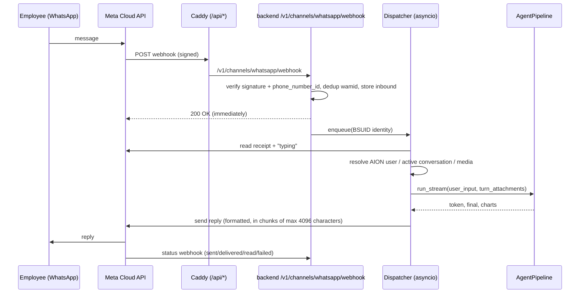

# Implementation plan — WhatsApp channel

:::info Design note
Implementation plan for the WhatsApp channel (Meta Cloud API). Status: partially implemented — Phase 1 (text) is live in `src/channels/whatsapp/`, inbound/outbound media from Phase 2 is partly done; for the current behaviour see [WhatsApp integration](../integrations/whatsapp.md).
:::

:::note
Planning document. The state of Meta's APIs and policies was verified
on **28/10/2026**; the sources are at the bottom. Meta's dates change often:
re-check them before every release.

**Status:** Phase 1 (text only) is implemented. The operational guide
(admin setup, employee linking, endpoints, troubleshooting) is in
[`docs/integrations/whatsapp.md`](../integrations/whatsapp.md). Where this
plan and the code differ, the code wins; the main differences
are flagged in sections 3, 4, 8 and 9.
:::

## Goal

A company using AION must be able to activate a company WhatsApp number
from the admin-ui. Employees write to that number from WhatsApp and talk
to the same agent (same profiles, STM/LTM memory, MCP tools, permissions)
they use from the chat-ui. WhatsApp conversations also appear in the
chat-ui history.

Out of scope for the first version: WhatsApp groups, voice calls, proactive
(template) messages, multiple numbers per tenant.

## 1. The Meta landscape in 2026 (what to use and what to avoid)

| Topic | Status, October 2026 | Impact on AION |
|-------|----------------------|----------------|
| **API to use** | **WhatsApp Cloud API** (hosted by Meta, Graph API). The On-Premises API was sunset on 23/10/2025. | The only official option. No unofficial "WhatsApp Web" libraries (Baileys, WAHA, whapi…): they violate the terms and lead to the number being banned. |
| **Graph API version** | Latest: **v26.0** (29/07/2026). The WhatsApp documentation still uses v25.0 in its examples. | Configurable version, default `v26.0`. |
| **"AI Providers" policy** | Since 15/01/2026 the terms exclude providers of *general-purpose* AI assistants, except where Meta is required by law to allow them. In **Italy** (AGCM interim measure, 22/12/2025) and in the rest of the **EEA** (interim measures by the EU Commission, 09/06/2026) access is restored **until the final decision**. Since 13/05/2026 Meta no longer charges AI Providers extra fees in EU/EEA markets. | **Main project risk**: see §2. |
| **Pricing** | Per-message pricing since 01/07/2025. **From 01/10/2026 service messages (replies within 24h) are paid**: the first **1,000 per month per number** are free. A payment method is needed in the Billing Hub. Incoming messages from users are free. There is a new "Meta Business Agent" category (Meta's AI agent, billed per token), which does not concern us. | Every message sent counts: do not split replies into many messages without a reason. |
| **Service window** | For 24h after the user's last message, free-form messages can be sent. Outside the window, only approved templates. | v1 only replies: no templates needed. |
| **User identity (BSUID)** | Since April 2026 webhooks always include `user_id` (Business-Scoped User ID, e.g. `IT.1234…`). With **WhatsApp usernames** (bookable since 29/06/2026) the phone number (`from`, `wa_id`) **may be missing**. Since July 2026 messages can be sent to the BSUID with the `recipient` field. If the user changes number, the BSUID changes: a `system` message arrives with `previous_user_id`. | Primary key of the WhatsApp identity = **BSUID**, not the number. Linking to the AION user cannot rely on the number. |
| **Webhook** | Verification via GET (`hub.mode`, `hub.verify_token`, `hub.challenge`). POSTs signed with `X-Hub-Signature-256` (HMAC-SHA256 of the raw body with the app secret). Payload up to 3 MB. Retries for up to **7 days**, with **possible duplicates**. mTLS supported. Meta IPs change: an allowlist is discouraged. | Reply 200 immediately, process in the background, deduplicate by `wamid`. |
| **UX** | "Typing" indicator (since 2025, sent together with the read receipt). Interactive messages (buttons, lists). Text max 4,096 characters. Links to downloaded media expire within a few minutes. | Blue ticks + "typing" while the agent works; commands via interactive lists. |
| **Onboarding** | Self-service: Meta app + System User token. For partners: Tech Provider + **Embedded Signup** (v4 in public preview since May 2026). "Coexistence" exists to reuse a number from the WhatsApp Business app. | v1: each customer brings their own Meta app. Embedded Signup is in phase 4. |

## 2. Compliance and policy (before writing code)

1. **Positioning with respect to the "AI Providers" clause.** The use case is
   a company that offers **its own employees** an assistant tied to its
   own data, processes and tools. It is not a generic assistant offered to the
   public. To stay within this perimeter:
   - it replies only to users **linked** to an AION account (everyone else
     only receives the linking message);
   - profiles used on WhatsApp are configured around business functions;
   - never present it as "ChatGPT on WhatsApp";
   - a **kill switch** (`AION_WHATSAPP_ENABLED=0`) to turn the channel off
     immediately if Meta or an authority changes the rules.
2. **Legal review** of the *Meta Terms for WhatsApp Business Platform*
   (version of 15/01/2026) by AION-ASA and the customer, because:
   - the AGCM and EU measures are **interim**: a final decision could
     change the picture;
   - AION-ASA, if it distributed the channel as a Tech Provider (phase 4),
     could more easily fall under the definition of "AI Provider".
3. **GDPR / employment.**
   - Messages transit through Meta's servers (Cloud API). Evaluate Cloud API
     *local storage* for an EU region (to be verified against the
     up-to-date documentation).
   - Update the privacy notice for employees and the BYOD policy (WhatsApp on
     a personal phone).
   - DPIA if the agent accesses sensitive data.
   - Use of the channel must be **voluntary** (opt-in through
     account linking).
4. **Meta prerequisites for each customer:**
   - verified Business portfolio;
   - WABA;
   - dedicated number;
   - approved display name;
   - Meta app with the WhatsApp product;
   - System User with a permanent token (`whatsapp_business_messaging`,
     `whatsapp_business_management`);
   - app secret;
   - subscription to the `messages` webhook field;
   - payment method;
   - app in **Live** mode.

## 3. Proposed architecture



Constraints of the current architecture to respect:

- **`--workers 1`**: the in-process (`asyncio`) queue is fine and follows the
  pattern of `src/runtime/cron_runner.py:129` (`execute_job`) and of the
  background task in `src/api/v1/chat.py:797`.
- **No task queue**. To avoid losing messages on a restart, the inbound
  message is saved to the DB with `status=received` before the 200. At startup (in the
  lifespan) pending messages younger than 24h are resumed.
- **Caddy** already forwards `/api/*` to the backend, stripping the prefix. The webhook
  is public (no auth dependency): security comes from the HMAC
  signature.

### 3.1 New modules

Actual Phase 1 modules:

```
src/channels/__init__.py
src/channels/whatsapp/
├── config_service.py  # per-tenant config (DB, encrypted secrets, 30s cache) + env kill switch
├── signature.py       # verify_signature(raw_body, header, app_secret) — constant-time comparison
├── payload.py         # parse webhook -> InboundMessage / StatusUpdate / SystemChange (dataclass)
├── graph_client.py    # Graph API via httpx: get_phone_info, get_subscribed_apps,
│                      # subscribe_app, send_text, mark_read_typing
├── formatting.py      # AION Markdown -> WhatsApp syntax, split at 4096, tables, links
├── linking.py         # one-time COLLEGA codes, BSUID -> User, number change
├── store.py           # whatsapp_messages: insert with dedup, statuses, resume
└── dispatcher.py      # per-sender lock, commands, turn run, reply sending, resume_pending
src/api/v1/whatsapp.py     # public webhook + /v1/me/whatsapp* (require_chat_auth)
src/api/admin_whatsapp.py  # /admin/whatsapp/* (require_admin_role)
```

Commands are handled directly in the dispatcher (no `commands.py`) and
there is no `router.py`: the public router is `src/api/v1/whatsapp.py`,
included in `src/api/v1/__init__.py`; the admin one is included in
`src/api/admin.py`. The client for media and interactive messages comes with
Phase 2.

### 3.2 Data model (Alembic migration)

New revision in `migrations/versions/`, after the current head `z8a9b0c028`.
The name follows the convention, e.g. `a9b0c1d029w_whatsapp_channel.py`.

Actual Phase 1 tables (`a9b0c1d029w_whatsapp_channel.py`):

| Table | Main columns | Notes |
|-------|--------------|-------|
| `whatsapp_channels` | `id`, `tenant_id` (unique), `enabled`, `waba_id`, `phone_number_id`, `display_phone_number`, `verified_name`, `access_token_encrypted`, `app_secret_encrypted`, `verify_token_encrypted`, `default_profile_slug`, `validated_at`, `validated_by_user_id`, `webhook_verified_at`, `last_webhook_at`, `last_error`, `created_at`, `updated_at` | Secrets encrypted with `src/runtime/credential_store.py` (`encrypt_value`/`decrypt_value`), like `SsoProvider.client_secret_encrypted`. |
| `whatsapp_identities` | `id`, `tenant_id`, `bsuid`, `phone_e164` (nullable), `wa_profile_name`, `user_id` FK `users.id` (cascade), `active_conversation_id`, `linked_at`, `last_inbound_at` | Unique `(tenant_id, bsuid)` and `(tenant_id, user_id)`: one WhatsApp per user. |
| `whatsapp_link_codes` | `id`, `tenant_id`, `user_id`, `code_hash`, `expires_at` (10 min), `used_at`, `created_at` | Single use; only the hash is stored in the DB. |
| `whatsapp_messages` | `wamid` (unique), `tenant_id`, `direction` (`in`/`out`), `bsuid`, `conversation_id`, `status` (`received`/`processing`/`done`/`failed`/`sent`/`delivered`/`read`), `error_code`, `payload_json`, `created_at`, `updated_at` | Dedup, resume after restart, delivery status. `payload_json` inbound only, cleared at the end of processing. |

Deferred: per-identity profile override, per-tenant `graph_api_version`
(today it is an env var), reset on inactivity, customizable welcome
message.

## 4. Identity: linking WhatsApp ↔ AION user

:::note Phase 1 implementation
Linking starts from the chat-ui, not from
WhatsApp. In Settings → WhatsApp the employee generates a one-time
code (QR / `wa.me` link with `COLLEGA <code>` pre-filled) and sends it
to the company number. No magic link and no `link_mode`; login remains
the chat-ui one, so password, 2FA and SSO apply anyway. To users who are
not linked, the bot replies with the link to the WhatsApp tab of the
settings. The flow below remains as an evaluated alternative.
:::

The number is not reliable as a key: with usernames it may be missing from the
webhook. The main mechanism is therefore **linking via login**.

1. A message arrives from an unknown BSUID. The bot replies **only once
   every 10 minutes** per BSUID (every reply costs money) with:
   *"To use AION, link your account: https://DOMAIN/whatsapp/link?t=…"*.
2. The link opens a chat-ui page (`chat-ui/app/whatsapp/link`). Login
   happens through the normal flow (password + 2FA or SSO, so all the
   existing policies apply). Then the user confirms
   "Link this WhatsApp (profile name, last digits if present)".
3. `POST /v1/channels/whatsapp/link/confirm` (with `require_chat_auth`):
   - consumes the token;
   - creates the `whatsapp_identities` row;
   - writes an audit log;
   - the bot sends a welcome message with the commands.
4. **Optional (`link_mode=magic_link+phone`)**: if the admin has registered the
   employee's number and the webhook contains `wa_id`, linking is
   automatic. The number is already verified by WhatsApp, but the link must
   still be confirmed with an interactive message "Are you Mario Rossi? Yes/No".

Rules:

- WhatsApp **never creates accounts**: this holds even with the SSO signup policy
  `open`.
- On every turn the system re-checks that the user exists, is not disabled and
  has access to the profile (`enforce_profile_access`).
- `system` message `user_changed_number` / `user_changed_user_id`: the
  `bsuid` is updated using `previous_user_id`.
- Unlinking is possible:
  - by the user (`/scollega` command or chat-ui settings);
  - by the admin (users page).
- Identity for the pipeline: a new `ChatAuthIdentity(via="whatsapp", …)`.
  The conversation's `user_id` is `sanitize_user_id(user.identifier)`,
  as for `chat_token` (`src/api/ownership.py:51`), so the conversations
  appear in the user's chat-ui history.

## 5. Turn execution

The dispatcher replicates the pattern of `cron_runner.execute_job`:

1. **Per-identity lock.** If a message arrives while a turn is in progress,
   it is queued and processed afterwards. Several messages arriving close together can be
   grouped into a single turn: the
   `redis_enqueue_session_event` infrastructure already exists.
2. **Read receipt + "typing"** on the received `wamid`. The indicator
   lasts about 25s: it must be re-sent periodically during long turns (to be
   verified whether Meta allows this on the same `message_id`). If the turn
   exceeds ~60s a single "Working on it…" message is sent.
3. **Conversation.** `active_conversation_id` is used. If it is missing, is
   archived, or if the last message is older than `idle_reset_hours`, a
   new `Conversation` is created with `metadata.source="whatsapp"`, `profile_slug` (=
   the identity override or `default_profile_slug`) and title
   `WhatsApp — <date>`. The chat-ui filter (`chat_ui.py:138`) does **not**
   hide it; it would be better to add a WhatsApp badge in the list.
4. **Inbound media.**
   - `GET /{media-id}` → `url`; then download with the bearer token.
   - `save_upload(session_id, …)` (`src/session_workspace.py:289`) +
     `apply_legacy_word_conversion` + `schedule_auto_ingest`, as in
     `session_uploads.py`.
   - The result becomes an `AttachmentRef` passed as `turn_attachments`.
   - The caption becomes `user_input`.
   - Note: `chat_sync` (`/v1/chat`) does **not** pass attachments, so
     `AgentPipeline` is called directly.
5. **Run.**
   - `get_agent(profile, session_id, user_id, …)` + `AgentPipeline(…)`;
   - `run_stream(user_input, turn_attachments=…, message_source="user_input",
     metadata={"channel": "whatsapp", "wamid": …})`;
   - registration in `_background_runs` + `redis_set_stream_active`, so the
     turn can be followed live from the chat-ui;
   - `agent_mode="normal"`, with plan mode and deep research disabled in v1.
6. **Tools that ask the user for confirmation (HITL):** in v1 they are refused with
   a message that points to the chat-ui. In phase 3 they are handled with
   interactive buttons (`button_reply`).
7. **Sending the reply** (`formatting.py`):
   - `**x**` → `*x*`; headings become bold lines; code
     blocks stay between ```` ``` ````; `[t](u)` → `t: u`;
   - tables → bulleted list or monospace block (beyond 4 columns, the reply
     points to the chat-ui);
   - split at 4,096 characters on paragraph boundaries, with a limit of
     chunks per reply (e.g. 3). Beyond the limit: summary + an
     "Open the full reply" link to the conversation in the chat-ui;
   - `charts` → PNG rendered and sent as `image`, or a link to the
     chat-ui;
   - files generated in the workspace → `document` (media upload).
8. **Persistence.** User and assistant messages are already saved by the pipeline.
   Outbound `wamid`s are recorded in `whatsapp_messages` and statuses are updated
   from the status webhooks. On `failed` the Meta error code is logged
   (e.g. 131047 = 24h window expired).

### Commands (text or interactive list)

| Command | Effect |
|---------|--------|
| `/nuova` | New conversation |
| `/profilo` | Interactive list of the profiles allowed for the user → override on the identity |
| `/aiuto` | List of commands |
| `/scollega` | Unlink the number (with confirmation) |

## 6. API examples (Cloud API, v26.0)

Inbound webhook (excerpt, with BSUID):

```json
{
  "object": "whatsapp_business_account",
  "entry": [{ "id": "<WABA_ID>", "changes": [{ "field": "messages", "value": {
    "messaging_product": "whatsapp",
    "metadata": { "display_phone_number": "39021234567", "phone_number_id": "<PHONE_NUMBER_ID>" },
    "contacts": [{ "profile": { "name": "Mario" }, "wa_id": "39333…", "user_id": "IT.1349…" }],
    "messages": [{ "from": "39333…", "from_user_id": "IT.1349…", "id": "wamid.HBg…",
                   "timestamp": "1761…", "type": "text", "text": { "body": "Ciao" } }]
  }}]}]
}
```

`from`/`wa_id` may be missing; `user_id`/`from_user_id` are always present.

Sending a reply (to the BSUID):

```http
POST https://graph.facebook.com/v26.0/<PHONE_NUMBER_ID>/messages
Authorization: Bearer <SYSTEM_USER_TOKEN>

{ "messaging_product": "whatsapp", "recipient_type": "individual",
  "recipient": "IT.1349…", "type": "text",
  "text": { "body": "…", "preview_url": false } }
```

If both `to` and `recipient` are passed, `to` takes precedence.

Read receipt + "typing":

```json
{ "messaging_product": "whatsapp", "status": "read",
  "message_id": "wamid.HBg…", "typing_indicator": { "type": "text" } }
```

Media: `GET /v26.0/<MEDIA_ID>` → `{url, mime_type, sha256, file_size}`, then
`GET <url>` with the same bearer token.

Meta does not maintain an official Python SDK for the Cloud API: `httpx`
(already in the project) is used with a thin, testable client.

## 7. Security

- **Signature**: HMAC-SHA256 over the **raw body** (read with
  `await request.body()` before parsing), compared with
  `hmac.compare_digest`. Invalid signature → 403, no processing.
- Only payloads whose `metadata.phone_number_id` equals the configured one
  are accepted. When the channel is disabled the webhook replies 200 without doing
  anything, so Meta does not keep retrying.
- `verify_token` generated randomly from the admin-ui, stored encrypted.
- Body size limit (3 MB + margin) and per-BSUID rate limit with a
  Redis counter (today there is no limiter at all). Separate, stricter throttling
  for unlinked BSUIDs, against cost abuse.
- Optional mTLS on Caddy for the webhook path (to be documented, not
  mandatory in v1).
- Logs without message content. Audit of linking/unlinking and
  configuration changes.
- Media: `AION_UPLOAD_MAX_BYTES` limit, allowed MIME types, same checks
  as the chat-ui upload.

## 8. Admin UI and chat-ui

:::note Phase 1 implementation
Page `admin-ui/app/whatsapp` (Platform
group) with a guide, credentials, a "Verify" checklist and activation
only after a successful verification; WhatsApp tab in the chat-ui
settings with a QR code. Actual endpoints: `GET/PUT /admin/whatsapp`,
`POST /admin/whatsapp/verify-token`, `POST /admin/whatsapp/validate`,
`POST /admin/whatsapp/enable`, `GET/DELETE /admin/whatsapp/identities`,
`GET/DELETE /v1/me/whatsapp`, `POST /v1/me/whatsapp/link-code`. Full
list in [`docs/integrations/whatsapp.md`](../integrations/whatsapp.md#endpoint).
:::

**admin-ui** — new page `admin-ui/app/integrations/whatsapp/page.tsx`
(or a section in `settings`), i18n strings in `admin-ui/lib/i18n/locales/{it,en,de,fr,es}.json`:

- on/off switch;
- WABA ID, Phone Number ID, access token, app secret fields (write-only,
  masked);
- verify token with a "generate" button;
- **webhook URL to copy** (`https://DOMAIN/api/v1/channels/whatsapp/webhook`);
- **"Verify connection"**: `GET /<PHONE_NUMBER_ID>?fields=display_phone_number,verified_name,quality_rating`
  shows the verified name and quality;
- default profile, linking mode, reset on inactivity,
  welcome message;
- table of linked identities (user, WA profile name, last
  message, unlink);
- channel status: last webhook received, recent errors, messages
  sent this month against the 1,000 free ones;
- step-by-step guide to the configuration on Meta, with a link to
  `docs/integrations/whatsapp.md`.

Admin API:

- `GET/PUT /admin/whatsapp/settings`
- `POST /admin/whatsapp/test`
- `GET /admin/whatsapp/identities`
- `DELETE /admin/whatsapp/identities/{id}`

**chat-ui:**

- `/whatsapp/link` page;
- in settings → "Linked accounts": WhatsApp with status and an unlink
  button;
- WhatsApp badge in the conversation list.

## 9. Configuration (env)

The functional configuration lives in the DB (editable from the admin-ui).
Env vars serve as overrides and a kill switch, to be added to `.env.example`
and `.env.docker.example`:

| Variable | Default | Purpose |
|----------|---------|---------|
| `AION_WHATSAPP_FORCE_DISABLE` | `0` | Global kill switch (`1` = channel off, like `AION_SSO_FORCE_PASSWORD`); normal activation is from the admin-ui |
| `AION_WHATSAPP_GRAPH_VERSION` | `v26.0` | Graph API version |
| `AION_WHATSAPP_MAX_CHUNKS` | `3` | Maximum chunks per reply |
| `AION_WHATSAPP_TURN_TIMEOUT_S` | `600` | Turn timeout |
| `AION_WHATSAPP_UNLINKED_REPLY_COOLDOWN_S` | `600` | Anti-spam for the linking message (Phase 1: fixed at 10 min) |
| `AION_WHATSAPP_MEDIA` | `1` | Inbound photos/documents and outbound generated files (Phase 2) |
| `AION_WHATSAPP_MAX_OUTBOUND_FILES` | `5` | Generated files sent per reply (Phase 2) |
| `AION_WHATSAPP_MAX_OUTBOUND_BYTES` | `104857600` | Maximum size of a sent file (Phase 2) |

## 10. Release phases

| Phase | Content | Estimate |
|-------|---------|----------|
| **0 — Prerequisites** | Legal review (§2); test Meta app with a free test number; tunnel (cloudflared/ngrok) for local development; collection of real payloads as fixtures. | 2–3 days + legal lead time |
| **1 — Text only** ✅ | Migration; `config_service`/`signature`/`payload`/`graph_client`; webhook + dedup + resume of pending messages; linking with code/QR from the chat-ui; admin page with verification and activation; dispatcher with read receipt and "typing"; formatting and split; basic commands; kill switch; doc `docs/integrations/whatsapp.md`. | 8–10 days |
| **2 — Admin & media** (media ✅ partial) | Full admin page with connection test and identities; ✅ inbound media (images, PDF, Office documents; without a caption they wait for the next message); ✅ outbound generated files (`workspace/`, `derived/`); `charts` as PNG still to do; status webhooks and metrics; rate limit. Details in `docs/integrations/whatsapp.md` § Files and photos. | 6–8 days |
| **3 — Advanced UX** | Voice messages via an OpenAI-compatible STT endpoint (`AION_STT_API_URL`, e.g. Whisper on vLLM; today AION has no STT); HITL with buttons; auto-match by number; grouping of messages that arrive close together. | 5–7 days |
| **4 — Distribution** | Proactive messages via utility templates (e.g. cron job results), outside the 24h window; AION-ASA as **Tech Provider** with **Embedded Signup** (one-click onboarding from the admin-ui, `override_callback_uri` per WABA towards the customer's domain). Requires App Review and a new assessment of the AI Providers policy. | to be estimated |

## 11. Tests

- **Unit**:
  - signature (valid, tampered, missing header);
  - parsing of real fixtures: text, image, document, audio,
    interactive, reactions, `system` (number change), statuses, payloads **without
    `wa_id`**, duplicates;
  - Markdown → WhatsApp formatter and split;
  - linking token (expiry, reuse).
- **Integration**:
  - Graph API simulated with `httpx.MockTransport` (no `respx` dependency);
  - end-to-end dispatcher with a stub pipeline;
  - resume after restart;
  - per-identity lock with concurrent messages.
- **Manual / staging**:
  - Meta test number (up to 5 recipients) behind a staging Caddy;
  - check of the real cost of messages in the Billing Hub;
  - check of the "typing" indicator on long turns.
- Tests go in `src/test/` (`python -m pytest src/test/ -v`).

## 12. Risks

| Risk | Likelihood | Mitigation |
|------|------------|------------|
| Meta or an authority changes the AI Providers policy (the interim decisions become final) | Medium | "Internal company assistant" positioning, kill switch, legal review, optional channel |
| Phone number missing (usernames) | High from 2026 | Identity on BSUID + linking via login |
| Costs beyond 1,000 messages/month | Medium | Chunk limit, compact replies, counter in the admin, rate limit |
| Long turns / restart with `--workers 1` | Medium | Persisted inbound + resume at startup, "working on it" message |
| Ban or quality drop of the number (user reports) | Low (internal users) | Only linked users, no unsolicited messages |
| Graph API version or field changes | Medium | Configurable version, parser tolerant to unknown fields, updated fixtures |

## Sources

- [Business-scoped user IDs — Meta for Developers](https://developers.facebook.com/documentation/business-messaging/whatsapp/business-scoped-user-ids)
- [Pricing — WhatsApp Business Platform](https://developers.facebook.com/documentation/business-messaging/whatsapp/pricing)
- [Pricing policy for AI Providers](https://developers.facebook.com/documentation/business-messaging/whatsapp/pricing/ai-providers/)
- [WhatsApp Business Platform changelog](https://developers.facebook.com/documentation/business-messaging/whatsapp/changelog/)
- [Webhooks overview](https://developers.facebook.com/documentation/business-messaging/whatsapp/webhooks/overview)
- [Introducing Graph API v26](https://developers.facebook.com/blog/post/2026/07/29/introducing-graph-api-v26-and-marketing-api-v26/)
- [On-Premises API changelog (sunset)](https://developers.facebook.com/docs/whatsapp/on-premises/changelog)
- [EU Commission — interim measures on Meta (IP/26/1276)](https://ec.europa.eu/commission/presscorner/api/files/document/print/en/ip_26_1276/IP_26_1276_EN.pdf)
- [AGCM — interim measures A576](https://www.agcm.it/dotcmsdoc/allegati-news/A576_adoz%20misure%20cautelari_omi_signed_signed.pdf)
- [TechCrunch — WhatsApp changes its terms to bar general-purpose chatbots](https://techcrunch.com/2025/10/18/whatssapp-changes-its-terms-to-bar-general-purpose-chatbots-from-its-platform/)
