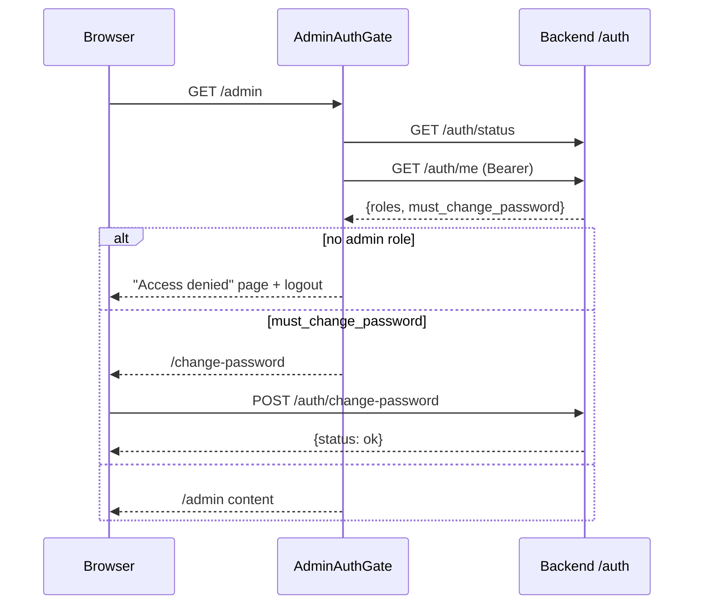
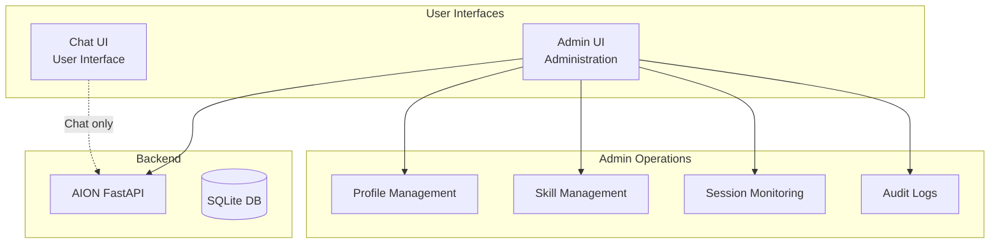

# Admin UI - Philosophy and Role

:::info Admin auth — always active (default)
Starting from the current release, the `/admin` panel is **always protected** (Grafana style): all `/admin/*` endpoints require a Bearer token and the `admin` role.
See the sections [Admin auth (always on)](#admin-auth-always-on),
[First login & default admin](#first-login--default-admin) and
[Change password flow](#change-password-flow) below.
:::

## Admin auth (always on)

The `FastAPI` backend applies a global guard to the `/admin/*` router
(`src/api/admin.py` + `src/api/admin_agent_db.py`):

```python
router = APIRouter(
    prefix="/admin",
    dependencies=[Depends(require_admin_role)],
)
```

`require_admin_role` (in `src/api/auth_login.py`):

1. Resolves identity by calling `require_chat_auth` (Bearer / internal BFF secret). API keys never carry the `admin` role and are rejected on every `/admin/*` endpoint (`403`); see [API keys](../security/api-keys.md).
2. Verifies that the token payload contains the `admin` role.
3. Responds with `401` if the token is missing, `403` if the `admin` role is not present.

Override variable (escape hatch in dev):

| Variable | Default | Description |
|-----------|---------|-------------|
| `AION_ADMIN_PASSWORD_AUTH` | `1` | `0` makes `require_admin_role` a no-op (opens `/admin/*`). Do not use in production. |
| `AION_CHAT_PASSWORD_AUTH`  | `0` | Independent: the admin remains protected even when the chat is open. |

Login works if at least one of the two auths (chat or admin) is active. The
token issued by `POST /auth/login` now includes `roles` (HMAC-signed CSV, no
DB lookup needed per request) and `must_change_password`:

```json
{
  "access_token": "<base64-urlsafe>",
  "user_id": "u_admin",
  "identifier": "admin",
  "roles": ["admin"],
  "must_change_password": true
}
```

User schema: new columns `users.roles` (`TEXT`, JSON list) and
`users.must_change_password` (`BOOLEAN`). Idempotent migration:
`migrations/versions/d1a23b4f0001_user_roles_must_change.py`. For existing DBs
already marked as `head` by Alembic, the columns are added by
`src/data/bootstrap.py::_patch_sqlite_columns`.

## First login & default admin

At `setup_aion_env.py` (or at the first boot when setup is automatic) the
backend creates a default admin if **no user with the `admin` role** is
yet present in the tenant (`src/data/user_password.py::admin_exists`).

Default credentials:

| Field       | Value (env override)                              |
|-------------|----------------------------------------------------|
| Identifier  | `AION_SETUP_ADMIN_DEFAULT_IDENTIFIER` (`admin`)    |
| Password    | `AION_SETUP_ADMIN_DEFAULT_PASSWORD` (`admin`)      |
| Roles       | `["admin"]`                                        |
| Flag        | `must_change_password=True`                        |

Disable with `AION_SETUP_ADMIN_BOOTSTRAP=0` in `.env` before setup.

The script prints a conspicuous warning when it creates the admin:

```
========================================================================
 DEFAULT ADMIN CREATED: identifier='admin' password='admin'
 At the first login, changing the password will be proposed (skippable 24h).
 Disable with AION_SETUP_ADMIN_BOOTSTRAP=0 in the .env before setup.
 ========================================================================
```

## Change password flow

The `must_change_password` flag is read by `GET /auth/me`. On the admin-ui side:

- The `AdminAuthGate` automatically redirects to `/change-password` if the flag is
  `true` and the user has not already "skipped".
- The password change page calls `POST /auth/change-password` with
  `{old_password, new_password}`. The backend revalidates the old password
  (bcrypt), updates the hash and clears the flag.
- "Remind me tomorrow" button → sets
  `localStorage.aion_admin_change_pw_skipped_until = now + 24h`.

On the chat-ui side there is a parallel flow (`chat-ui/app/change-password/page.tsx`).
Skip key: `localStorage.aion_chat_change_pw_skipped_until`.



## Why is the Admin UI separate from the Chat UI?

**Decision:** The system has **two separate interfaces**:
1. **Chat UI** - For end users (chat, conversation)
2. **Admin UI** - For administrators (management, configuration)

### Why separate?



**Why separate:**

| Reason | Explanation |
|--------|-------------|
| **Separation of responsibilities** | Users only use the chat, administrators manage the system |
| **Security** | Administration operations require elevated privileges and different roles |
| **User experience** | End users must not be confused by technical configuration options |
| **Access control** | The Admin UI requires a separate authentication and authorization policy |

### Distinct roles

| Interface | Who uses it | What they can do |
|-------------|------------|---------------|
| **Chat UI** | End users | Messaging, file upload, management of personal sessions and personal credentials |
| **Admin UI** | Administrators | Management of users (including the per-user API key policy), profiles, skills, cron jobs, global monitoring and security |

---

## What can an administrator do?

### 1. Dashboard (Overview)

**Path:** `/`

**Features:**
- Real-time summary view of system metrics.
- Count of active profiles, registered skills, and installed MCP servers.
- Visualization of the global system security score.
- Log of the latest system health checks.

### 2. User Management

**Path:** `/users`

**Features:**
- Create new user accounts (password mode only: with SSO active, accounts are
  created at first SSO sign-in and the "Add user" button is replaced by a link
  to the new-account policy).
- Modify user details (display name and email).
- Send a password **invite** or **reset link** by email (the admin never sees
  or sets passwords; see [Password setup by email](../security/password-setup-email.md)).
- Delete existing accounts (the user's API keys are deleted too).
- Set the per-user **API key policy** (see below).

**Passwords:** admins never see, choose or receive user passwords.
`POST /admin/users` requires an email and sends an **invite** link; the response
only says whether it was sent (`invite: {sent, expires_at}` or `{sent: false, error}`).
The edit dialog shows the password state and a "Send reset link" / "Resend
invite" button (`POST /admin/users/{id}/password-link`); the list shows
"Invite pending", "Reset pending" and "Send failed" badges with a mail action.
Without SMTP (Settings → SMTP) a banner links to the SMTP settings, the email
becomes optional and creation or reset generates a **temporary password**
shown once in a dialog (copy, CSV for batches): the user must change it at first
sign-in before doing anything else ("Temporary password" badge in the list).
The same dialog appears for SSO migration switches, setup links and unlinks.
The user chooses the password on chat-ui `/set-password`, which
enforces the policy (at least 8 characters, lowercase, uppercase, digit, symbol,
not containing the username; `src/data/user_password.py::password_policy_violations`).
See [Password setup by email](../security/password-setup-email.md).

**New accounts (SSO):** in the *Sign-in* tab, with an SSO mode active, the
*New accounts* section sets who can get an account at first SSO sign-in:
anyone in the organization, only listed emails/domains (one per line,
`name@company.com` or `@company.com`) or nobody. Existing accounts are not
affected. See [SSO migration](../security/sso-migration.md#3-new-accounts-in-sso-mode).

**API key policy:** admins do not create API keys; each user creates their own
from chat-ui → Settings → API keys. On the user form the admin sets:

| Field | Default | Range |
|-------|---------|-------|
| `can_create_api_keys` | `false` | Enables the feature for the user |
| `max_api_keys` | `5` | 1–100 active keys |
| `api_key_max_ttl_days` | `90` | 1–3650 days (maximum lifetime of a new key) |

The users list shows an "API key active/max" badge (`api_keys_active` from
`GET /admin/users`). Disabling `can_create_api_keys` immediately revokes all the
user's active keys; lowering the limits only affects new keys. See
[API keys](../security/api-keys.md).

### 3. Profile Management

**Path:** `/profiles`

**Features:**
- Create new agent profiles.
- Modify existing profiles (system instructions, description, parameters).
- Export individual profiles to YAML or all in bulk to a ZIP archive.
- Import profiles via YAML files with schema validation.
- Associate MCP servers and enable/disable skills for each profile.

### 4. Evaluation & Metrics (Agent Telemetry)

**Path:** `/metrics`

**Features:**
- **4 Real-Time KPI Cards & Sparklines:** Token consumption (input/output/reasoning breakdown and last turn stats), execution turn durations (average, last turn, P95 latency), total turns & failure rate, and total tool calls & success rate %.
- **Granular Temporal Sparklines:** Dynamic trendline area and mini-bar charts with local timezone hover tooltips (`1h`, `6h`, `24h`, `7d`, `30d`, `all`).
- **Agent Profile Breakdown Table:** Per-profile consumption table showing total tokens, input/output/reasoning split, turns, tool calls, success %, and average turn latency.
- **User Breakdown & Profile Distribution Table:** Expandable user usage view detailing token footprints, turn activity, and per-profile distribution % with specific tool invocation breakdowns.
- **Tool & MCP Execution Details:** Filterable and searchable table of tool executions across MCP servers with error counts and success rates.
- **LLM Model Token Consumption:** Visual bar breakdown of prompt vs completion vs reasoning tokens consumed per model.
- **MCP Error & Failure Diagnostics:** Chronological log of recent MCP errors with server origin, tool name, profile, local timestamp, and full error details.
- **Prometheus Dual-Mode Indicator:** Real-time badge indicating whether telemetry is being aggregated via Prometheus backend query APIs or via in-process fallback buffers.

### 5. Skill Management

**Path:** `/skills`

**Features:**
- View registered skills in the system (with usage metrics).
- Create new skills by directly editing Markdown code with YAML frontmatter metadata.
- Promote skills generated from drafts ("draft") to verified ("verified").
- Remove skills (preventing the deletion of those currently in use by active profiles).

### 6. MCP Hub (unified)

**Path:** `/hub`.

**Features:**
- Install servers from the marketplace and connector catalog.
- **Guided wizard:** installation → AI analysis → admin review → deployment (see [MCP Hub Wizard](../mcp/hub-wizard.md)).
- Configure registry (`command`, `env`, `aion_connector_id`).
- **User availability:** chat enablement, `credential_mode` (`none` | `org_shared` | `per_user`), schema preview from the catalog, application of suggested `${AION_USER_*}` env.
- Advisor: "Ask the assistant" button (`POST /admin/mcp-integrations/advise`) or `mcp_integration_advisor` chat profile.
- **Probe** (`POST /admin/mcp/{slug}/probe`): verifies MCP handshake and tool list after install/config.

**Post-install checklist (e.g. email):**

1. Wizard or Edit → correct `credential_mode` → **Apply suggested env**.
2. Enable chat for users.
3. **PROBE** on the installed card (≥1 tool, e.g. `search_emails`).
4. Agent profile: `mcp_servers` includes the slug + MCP skill (e.g. `email_imap_mcp` in `config/profiles/`).
5. Chat-ui: user credentials if `per_user`.

### 7. Chat privacy (no conversation access)

Admins cannot read users' chats. There is no conversation viewer in the admin UI, and the backend exposes no `/admin/*` endpoint that returns conversation content.

- **Removed:** `GET /admin/conversations/global`, `GET /admin/conversations/{id}/messages`, `GET /admin/conversations/{id}/render-audit` and `DELETE /admin/feedback/{message_id}`.
- **Feedback** (`GET /admin/feedback?days=7`) returns aggregate 👍/👎 counts only, in total, per profile and per model. It never returns message text, comments, prompts, user ids or conversation ids. The dashboard shows these counts in the *Feedback · 7 days* card.
- **Scheduled jobs:** see the section below. Run outputs and prompts of user-created jobs are never returned.
- **Security investigation** (`/admin/security/investigate`) refuses the data directory (DB, session workspaces), `*.db`/SQLite files and `.env*` files.

### 8. Scheduled Jobs (Scheduled tasks)

**Path:** `/schedules`

**Features:**
- Manage cron jobs for the scheduled sending of prompts to the agent (requires `AION_CRON_ENABLED=1` in the backend).
- Define cron expressions, time zones, associated profiles, and prompts to execute.
- Bind each job to a dedicated **SQL QueryMemory project** — required for memory-enabled profiles (the `default` drawer is blocked at runtime to prevent cross-project contamination). The selected project is persisted on the job and written into the scheduled-job conversation metadata so the run is scope-bound exactly like a chat-ui turn.
- Monitor the outcome of the latest executions and view the history of each run as **metadata only** (status, timestamps, duration, error messages). Run output, assistant previews and the linked conversation stay private to the job owner.
- For jobs created by users (`created_by != "admin"`), the API returns an empty `prompt` with `prompt_hidden: true`. Prompt and profile cannot be changed by admins; schedule, timezone, name, enable/disable and delete still can.
- Admins cannot set `session_id`: every job runs in its own conversation, never inside an existing user chat.
- Enable, disable, or force immediate execution of a job.

### 9. Memory Management

**Path:** `/memory`

**Features:**
- Monitor usage and status of the PromQL cache.
- Manage long-term memory (LTM) via MemPalace and Knowledge Graph.
- View detailed statistics on the number of entities and relationships inserted in the graph.
- Perform manual optimization or purging (purge) of the cache and memory nodes.

### 10. Logic Extension Hub (Plugins & Hooks)

**Path:** `/plugins`

**Features:**
- Monitor active runtime modules under `data/plugins/`.
- View the status of the execution pipeline hooks (e.g. `on_user_message`, `pre_llm_call`, `on_assistant_message`, `pre_tool_use`).
- Perform hot reloading (hot reload) of logical extensions without interrupting the main server process.

### 11. Audit and Security (Security Audit)

**Path:** `/security`

**Features:**
- Manage security audit logs and static scan reports.
- Initiate AI-driven security analyses (via profiles like "Security Officer") on specific code files.
- View, mark as trusted ("trust") or download detailed reports in JSON or Markdown format.

### 12. System Health (Infrastructure Integrity)

**Path:** `/system`

**Features:**
- Monitor the integrity of the underlying infrastructure in real time.
- Check the status and URL of the Redis cluster (detecting if the in-process fallback mechanism is active).
- Monitor the unified SQLite database (physical file size and connection string).
- View the active storage backend (local or hybrid) and its root directory for session files.

### 13. General Settings

**Path:** `/settings`

**Features:**
- Configure global environment variables by writing them directly to the `.env` file via an integrated visual editor.
- Automatic parameter validation (e.g. consistency between `AION_CHAT_MAX_TOKENS` and `AION_THINKING_TOKEN_BUDGET` for Anthropic models).
- **LLM provider CRUD** with **connection probe**: test endpoint credentials, discover models via `GET /v1/models`, pick from list or enter model id manually (`admin-ui/lib/llm-probe.ts` → `POST /admin/llm-providers/probe`).
- Same probe flow for **embeddings** and **remote OCR** (vision server) on the settings form.
- **Audio** section: like OCR, choose between a **remote** OpenAI-compatible transcription service (`AION_STT_BASE_URL`, `AION_STT_API_KEY`, model picked via the same connection probe, `AION_STT_TIMEOUT` / `AION_STT_CHUNK_SEC` limits) and the **on-server** engine; in local mode, choose the speech-to-text model (`AION_STT_LOCAL_MODEL`), the default language (`AION_STT_LANGUAGE`) and the transcription accuracy (`AION_STT_LOCAL_BEAM_SIZE`), explained in plain language without showing variable names; models not yet on disk can be downloaded ahead of time (`GET /admin/stt/local-models`, `POST /admin/stt/local-models/{name}/download`). See [Speech-to-text MCP](../mcp/speech-to-text.md#configurazione-da-admin-ui).
- Default provider save syncs `AION_CHAT_MAX_TOKENS` / `AION_THINKING_TOKEN_BUDGET` into `.env` and clears the agent cache.
- Automatic restart of the Docker container in case of changes (if the environment runs under Docker).
- **SMTP** (`/settings#smtp`): outgoing mail server used for invites, password
  resets and SSO-migration links (host, port, STARTTLS/SSL/none, credentials,
  sender, email language) with a "send test email" probe. The SMTP password is
  write-only and stored encrypted (`GET/PUT /admin/smtp`, `POST /admin/smtp/test`).

### 14. First setup wizard

**Path:** `/first-setup` (shown when the backend reports setup incomplete)

Multi-step wizard aligned with `/settings` and Docker/local `.env` parity:

| Step | Content |
|------|---------|
| LLM | Provider, API key, base URL → **Test connection & discover models** → model select (or manual id) → token budget validation |
| Embeddings | Service URL + key → probe → embedding model select |
| OCR | **Local** (PyMuPDF/Tesseract via MCP; clears `AION_OCR_*`) or **Remote** vision server → probe → model select |
| Web search | Tavily / other keys |
| Policy | Approval and feature toggles |
| Review | Writes merged keys to `.env` via settings API |

Probe requires a successful connection test before advancing LLM/embedding/OCR (remote) steps. Shared client helpers: `admin-ui/lib/llm-probe.ts`; backend: `src/runtime/llm_probe.py`, `src/api/llm_providers.py`.

---

## Next.js Architecture

### Why Next.js?

| Reason | Explanation |
|--------|-------------|
| **React** | Modern UI framework, flexible ecosystem |
| **SSR & App Router** | Fast rendering and clean management of routes and APIs |
| **API routes / BFF** | Secure proxying of requests to the FastAPI backend |
| **Type safety** | Type safety for a complex control panel |

### Project structure

```
admin-ui/
├── app/                    # Next.js App Router
│   ├── page.tsx            # Home dashboard
│   ├── users/              # User Management
│   ├── profiles/           # Profile Management
│   ├── metrics/            # Evaluation & Agent Metrics
│   ├── skills/             # Skill Management
│   ├── hub/                # MCP Hub (marketplace and wizard)
│   ├── schedules/          # Scheduled Cron Jobs
│   ├── memory/             # LTM & Memory Management
│   ├── security/           # Security Audit & Scans
│   ├── system/             # Infrastructure integrity (System health)
│   ├── first-setup/        # Initial setup wizard (LLM/embeddings/OCR probe)
│   └── settings/           # General Settings (.env editor + LLM providers)
├── public/                 # Static files
│   └── reports/            # Generated security audit reports
└── package.json            # Package scripts and dependencies
```

---

## Configuration

### Variables

| Variable | Default | Purpose |
|-----------|---------|-------|
| `NEXT_PUBLIC_AION_API_URL` | `http://localhost:8001` | FastAPI backend URL |

### Development

```bash
cd admin-ui
pnpm dev
# Access to the development interface on http://localhost:3870
```

### Production

```bash
cd admin-ui
pnpm build
pnpm start
# Access to the interface on http://localhost:3870 or via reverse proxy
```

---

## Security considerations

### Input validation

**The Admin UI must validate:**
- Profile creation (name uniqueness, validity of associated MCP servers).
- Skill creation (correctness of the frontmatter syntax).
- MCP configurations (security of commands, arguments, and environment).
- Global settings (validation of integers and token budgets).

### Audit logging

All administrative operations (user creation, configuration modification, key release) are logged in the audit system to ensure traceability and compliance.

---

## Troubleshooting

### "Cannot fetch profiles"

**Cause:** Incorrect `NEXT_PUBLIC_AION_API_URL` or backend offline.

**Fix:**
```bash
# Check that the backend is active
curl http://localhost:8001/health

# Verify that the environment variable contains the correct path
echo $NEXT_PUBLIC_AION_API_URL
```

### "403 Forbidden on /admin/*"

**Cause:** The user has not logged in or does not have the required `admin` role.

**Fix:**
1. Make sure you have logged in to the `/admin` portal with an enabled user.
2. Verify that the JWT token has not expired.
3. In development, if necessary, it is possible to bypass the protection by setting `AION_ADMIN_PASSWORD_AUTH=0` in the `.env` and restarting the FastAPI backend.

### "Cannot upload audit report"

**Cause:** Write permission error on the host's `admin-ui/public/reports/` folder.

**Fix:**
```bash
chmod 755 admin-ui/public/reports
chown -R $USER admin-ui/public/reports
```

---

## Related documents

- [REST API](../api-and-runtime/rest-api.md) - Backend FastAPI endpoints
- [Chat UI](./chat-ui.md) - Main chat user interface
- [Identity and Chat Auth](../security/identity-and-chat-auth.md) - Authentication and authorization
- [Agent profiles](../configuration/profiles.md) - Management and configuration of profiles
- [Hermes features](../learning/hermes-features.md) - Administrative operations for learning features
