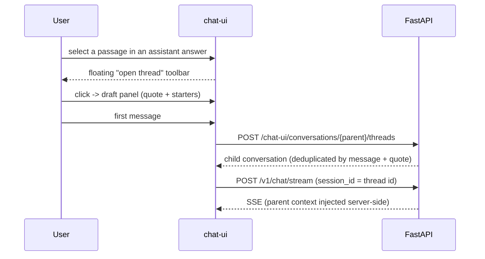

# Side threads

A **side thread** lets the user dig into a passage of an assistant answer without
cluttering the main conversation. The user selects text in an answer, clicks
**Approfondisci in un thread** and keeps chatting in a panel next to the main chat.

A side thread is **not temporary**: it is a regular conversation with its own id,
history, STM window, MCP session and stream. It can be reopened from the parent
(underline, chip, sidebar) or as a full page at `/c/{threadId}`.

:::note Naming
In the code, "thread" already means a conversation (`ThreadSidebar`,
`useConversationThreads`). The new concept is called **side thread**
(`sideThread`, `side-thread`). The user-facing label is "Thread".
:::

## User flow

- **Selection**: valid only when it sits inside the prose of one assistant message
  (no code blocks, user bubbles, buttons, cross-message ranges). Quotes over
  2000 characters are truncated and a hint is shown.
- **Lazy creation**: the panel opens as a *draft*; the conversation is created on
  the first send, so abandoned drafts leave nothing behind. Selecting a passage that
  already has a thread reopens it.
- **Parallel streaming**: the thread has its own engine (`useSideThreadChat`), so it can
  stream while the parent streams. Closing the panel does not stop the run, and
  reopening reconnects with `getChatStreamReconnect`.
- **Thread turns** always use `agent_mode: "normal"` (no plan / deep research). Profile,
  model, reasoning effort, thinking and runtime tunings come from the parent.

## Where threads appear

| Surface | Behaviour |
|---------|-----------|
| Parent feed | The passage is marked with the CSS Custom Highlight API (no DOM mutation): a soft brand wash plus a solid underline, stronger on hover and for the thread open in the panel. Clicking it opens the thread. |
| Message actions | A chip with the thread count under the source answer. It always works, even when the passage cannot be located (regenerated or edited answer). |
| Dock panel | New dock tab `"thread"`: quote (click to scroll to and flash the passage), title, switcher between the conversation's threads, "open as chat", messages, compact composer. Full-screen sheet on mobile. |
| Sidebar | Threads are hidden from the main list and nested under their parent (chevron + count, lazily loaded). The parent of the open thread expands automatically. |
| Full page `/c/{threadId}` | Breadcrumb "Thread from *parent*" with the quote; the back link `/c/{parent}?thread={id}` reopens the thread in the panel. |

## Data model

A side thread is a `Conversation` with three extra columns (migration
`w5x6y7z025_side_threads`, also patched by `bootstrap._patch_sqlite_columns`):

| Column | Meaning |
|--------|---------|
| `parent_conversation_id` | Parent conversation id (indexed, no FK). One level only: threads cannot be nested. |
| `parent_message_id` | Id of the source assistant message. |
| `anchor_json` | `{quote, prefix, suffix}` — a TextQuoteSelector-style anchor (prefix/suffix ~32 chars) used to find the passage again in the rendered markdown. |

## API

All endpoints use the usual chat-ui headers (`X-AION-User-Id`, `X-AION-Chat-Ui-Secret`).

- `GET /chat-ui/conversations` — excludes threads by default (`include_threads=1` to
  include them); every summary carries `thread_count`.
- `GET /chat-ui/conversations/{id}/threads` — non-archived threads of a conversation.
- `POST /chat-ui/conversations/{id}/threads` — body `{parent_message_id, quote, prefix, suffix}`.
  Returns `created: false` when a thread with the same message and quote exists.
  `404` if the parent or message is not the caller's, `409` if the parent is itself a thread.
  Parent uploads are synced into the thread workspace.
- `GET /chat-ui/conversations/{id}` — also returns `parent_conversation_id`,
  `parent_message_id`, `parent_title`, `anchor`.
- `DELETE /chat-ui/conversations/{id}` — archives the child threads too and releases
  their MCP sessions.
- `POST /v1/chat/stream` — now rejects (`404`) an existing `session_id` owned by another user.

## Agent context

`build_turn_context` adds the layer `side_thread_context`
(`src/runtime/turn/side_thread_context.py`) on every turn of a thread. It contains:

- the parent title;
- up to 4 parent messages before the source answer (≈2400 chars);
- the source answer, clipped to ≈6000 chars around the quote;
- the highlighted passage, with an instruction to answer in the parent's context.

The layer is recomputed each turn, never persisted and not passed to LTM extraction.

## Frontend map

| File | Role |
|------|------|
| `lib/side-thread/anchor.ts` | Anchor from a DOM range, and range from an anchor (best prefix/suffix match). |
| `lib/side-thread/use-text-selection-anchor.ts` | Tracks a valid prose selection in the feed. |
| `components/chat/side-thread/SelectionThreadPopover.tsx` | Floating action (above on desktop, below on touch). |
| `lib/side-thread/use-side-thread-highlights.ts` | Paints `::highlight(side-thread*)`, hit-tests clicks, `revealThread`. |
| `lib/side-thread/use-side-thread-chat.ts` | Independent streaming engine for one thread (draft → create on first send). |
| `components/dock/SideThreadPanel.tsx` | Presentational panel (the dock renders twice, desktop and mobile, so the engine lives in `ChatWorkspace`). |

Without the Custom Highlight API, the underline is not painted; the chip, the sidebar and
the panel keep working.
