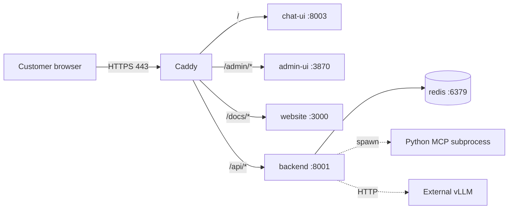

# Deploy with Docker Compose

This page explains how to run the whole AION Agents stack with Docker Compose,
either on your laptop for a quick try or on a customer server in production.
Everything is served from **one domain**: the Caddy reverse proxy routes each
URL path to the right service and gets HTTPS certificates automatically from
Let's Encrypt. It is written for administrators and operators who install and
maintain AION; onboarding a new customer needs only **one DNS A record** and an
`.env` file.

:::tip Already running on GHCR images?
This page covers the stack built from the repository clone
(`docker-compose.yml`). For the prebuilt images published on GitHub Container
Registry (GHCR), see
[Switch from docker-compose.yml to docker-compose.ghcr.yml](./migrate-compose-to-ghcr.md)
and [Update from the admin UI](./self-update.md).
:::

## Two supported scenarios

### A) Local (HTTP, no domain needed)

Use this to try the stack on your own laptop without configuring DNS or TLS.
**`DOMAIN` is not required**: if it is missing or set to `:80`, Caddy listens
on plain HTTP, port 80, for any hostname.

```bash
git clone https://github.com/AION-by-ASA-Computer/aion-agent.git
cd aion-agent
cp .env.example .env                    # copy the main template
# edit .env: set DOMAIN=:80 for local development and point AION_API_URL to your LLM
docker compose up -d --build
```

Where to find each service:

| URL                                  | Service    |
|--------------------------------------|------------|
| `http://localhost/`                  | chat-ui    |
| `http://localhost/admin`             | admin-ui   |
| `http://localhost/docs/`             | docs       |
| `http://localhost/api/health`        | backend    |

### B) Production (real customer, automatic TLS)

Onboarding a customer takes 3 steps:

1. **Clone and set up `.env`**
   ```bash
   git clone https://github.com/AION-by-ASA-Computer/aion-agent.git
   cd aion-agent
   ./scripts/setup-aion-env.sh            # interactive wizard: choose the 'docker' target
   # or, for a manual setup: cp .env.example .env
   vim .env                               # set DOMAIN, LETS_ENCRYPT_EMAIL, secrets and enable the Docker section at the bottom
   ```
   In `.env`, change:
   ```bash
   DOMAIN=cliente.example.com
   LETS_ENCRYPT_EMAIL=ops@tuoazienda.com
   # comment out the HTTP defaults and enable the HTTPS ones:
   AION_CORS_ORIGINS=https://${DOMAIN}
   AION_PUBLIC_API_URL=https://${DOMAIN}/api
   ```
   Do not set `AION_CORS_ORIGINS=*` in production. Without
   `AION_CORS_ALLOW_WILDCARD=1` the backend falls back to a restricted list
   anyway, but the explicit origin of your domain is the better choice.
2. **DNS record**: a single `A` record for `${DOMAIN}` pointing to the server's
   IP address (ports 80 and 443 open to the internet).
3. **Start**
   ```bash
   docker compose up -d --build
   ```
   On first start Caddy obtains the Let's Encrypt certificate automatically
   (about 30 seconds). The stack is then reachable at `https://${DOMAIN}/`.

## Everyday commands

```bash
# Production (full stack)
docker compose up -d --build         # build + start
docker compose ps                    # service status
docker compose logs -f caddy backend # follow logs of several services
docker compose down                  # stop + remove containers

# Development (essentials only, with hot reload)
docker compose -f docker-compose.dev.yml up

# In-place upgrade (rebuild images + restart + check Alembic state)
./scripts/upgrade-aion.sh --docker
# Adds missing tool-first keys to .env (e.g. AION_STREAM_LOOP_V2), removes AION_ARTIFACT_STRATEGY

# Profiles/skills/MCP from git only (no rebuild)
docker compose restart backend

# Promo PNG inside the container (Playwright is not in the default image)
docker compose exec backend bash -c \
  'python -m pip install "playwright>=1.49.0" && python -m playwright install chromium'

# Back up the persistent volumes
docker compose exec backend python scripts/aion_backup.py --output /app/data/_backups
```

## Architecture



| Path                          | Service                   | Internal port |
|-------------------------------|---------------------------|---------------|
| `https://${DOMAIN}/`          | chat-ui Next.js           | 8003          |
| `https://${DOMAIN}/admin`     | admin-ui Next.js          | 3870 (`basePath=/admin`) |
| `https://${DOMAIN}/docs/`     | website Docusaurus        | 3000 (nginx, `baseUrl=/docs/`) |
| `https://${DOMAIN}/api/*`     | backend FastAPI           | 8001 (prefix stripped by Caddy) |

All services talk to each other on the internal bridge network `aion_net`.
Only Caddy exposes ports 80/443 to the customer.

## Containerized components

| Container  | Base image          | Notes                                       |
|------------|---------------------|---------------------------------------------|
| `caddy`    | `caddy:2.8-alpine`  | Reverse proxy + Let's Encrypt ACME          |
| `backend`  | `python:3.13-slim`  | FastAPI + spawns MCP (Model Context Protocol) server subprocesses |
| `chat-ui`  | `node:22-alpine` + `pnpm@10.30.1` | Next.js 16 standalone (one build = all customers) |
| `admin-ui` | `node:22-alpine` + `pnpm@10.30.1` | Next.js 16 standalone + `basePath=/admin`   |
| `website`  | `nginx:alpine`      | Static Docusaurus build                     |
| `redis`    | `redis:7.4-alpine`  | Rate limiting, locks, chart queue           |

### Pinned runtime versions

The Dockerfiles expose versions as `ARG` so upgrades stay under control.
Current defaults (aligned with the versions used in development; in the
Dockerfiles they are additionally pinned by `sha256` digest):

| Component  | ARG                           | Default       | Where                       |
|------------|-------------------------------|---------------|-----------------------------|
| Python     | `PYTHON_VERSION`              | `3.13-slim`   | `docker/Dockerfile.backend` builder + runtime |
| uv         | `UV_VERSION`                  | `latest`      | `docker/Dockerfile.backend` (image `ghcr.io/astral-sh/uv`; optional pin in `.env`) |
| Node.js    | `NODE_VERSION`                | `22-alpine`   | `docker/Dockerfile.chat-ui`, `Dockerfile.admin-ui`, `Dockerfile.website` |
| pnpm       | `PNPM_VERSION` (corepack)     | `10.30.1`     | `docker/Dockerfile.chat-ui`, `Dockerfile.admin-ui`, `Dockerfile.website` |

To try a temporary override, for example Python 3.14:

```bash
docker compose build --build-arg PYTHON_VERSION=3.14-slim backend
```

#### `UV_VERSION`: `latest` vs a pinned tag

| Strategy | When to use it |
|----------|----------------|
| **`latest`** (default) | Dev, staging, periodic rebuilds: every `docker compose build` picks up the newest uv binary (fixes and security patches of the installer tool). |
| **Pinned tag** (e.g. `0.6.17`) | Production with strict auditing: byte-identical builds until you change the pin on purpose. |

`latest` only affects the **uv binary** in the build layer, not the Python
wheels: those still come from `requirements.txt` (updating dependencies means a
rebuild, plus a requirements bump if needed). For vulnerabilities in Python
packages, use your usual process (`pip-audit`, Dependabot, etc.) on the
requirements file; do not confuse it with the uv version.

#### Why uv instead of pip

`Dockerfile.backend` uses [**uv**](https://github.com/astral-sh/uv) (by Astral)
to install Python packages:

- About 10–50× faster than `pip` on requirement sets with more than 30
  dependencies (haystack-ai, mempalace and mcp pull in extra transitive packages).
- Deterministic resolver (no pip metadata-caching issues).
- Static binary copied from `ghcr.io/astral-sh/uv:${UV_VERSION}` (no Rust
  toolchain needed in the builder; version configurable in `.env` →
  `docker-compose.yml`).
- BuildKit cache mount (`--mount=type=cache,target=/tmp/uv-cache`) reuses wheels
  across builds without bloating the final image.

The pattern follows the one [recommended by Astral](https://docs.astral.sh/uv/guides/integration/docker/):

```dockerfile
COPY --from=ghcr.io/astral-sh/uv:${UV_VERSION} /uv /uvx /usr/local/bin/
RUN uv venv /opt/venv
ENV VIRTUAL_ENV=/opt/venv PATH="/opt/venv/bin:$PATH"
RUN --mount=type=cache,target=/tmp/uv-cache \
    uv pip install --python /opt/venv/bin/python -r requirements.txt
```

`docker compose build` passes `UV_VERSION` and `PYTHON_VERSION` from the build
args in `.env` (see `.env.example`). It requires **BuildKit**
(`DOCKER_BUILDKIT=1`, the default on Docker Desktop).

The runtime stage copies the whole venv (`COPY --from=builder /opt/venv /opt/venv`)
without depending on a hard-coded Python path.

#### Other things baked into the backend image

- **MemPalace / embeddings:** the backend image pre-downloads the Chroma ONNX
  model into `/app/data/chroma_embedding_cache` (at build time, plus a warm-up at
  boot). If the `aion_data` volume is empty on first deploy, the lifespan
  warm-up refills the cache on the persistent volume. Related variables:
  `AION_MEMPALACE_WARMUP`, `AION_CHROMA_SHARED_EMBEDDING_CACHE`,
  `AION_SSE_KEEPALIVE_SEC`.
- **Legacy Word (.doc):** the backend image includes `libreoffice-writer-nogui`
  for automatic conversion on upload (`derived/converted/*.docx`). See
  [Office and legacy Word](../configuration/office-and-legacy-word.md).

#### Config, MCP servers and office skills (synced at boot)

The backend **no longer** copies `config/` or `mcp_servers/` from the build
context (they are gitignored). The flow is:

1. **Build** (`Dockerfile.backend`): `COPY config_std/` + `mcp_servers_std/`;
   `ensure_skill_packages.py` bootstraps them as a fallback if the volumes are missing.
2. **Runtime** (`docker/backend-entrypoint.sh`): with `AION_SYNC_ON_BOOT=1`
   (default) it runs `sync_config.py --force` and `sync_mcp_servers.py --force`
   before starting uvicorn.
3. **Compose** mounts `./config_std` and `./mcp_servers_std` (read-only, from
   the repo) plus `./config` and `./mcp_servers` (writable overlay on the host).

After a `git pull` that only updates standard profiles, skills or MCP servers:

```bash
docker compose restart backend    # prod or dev — no image rebuild
```

A rebuild is only needed for changes to `src/`, `requirements.txt` or the
Dockerfiles. `sync_config --force` does not overwrite `mcp_registry.yaml` /
`mcp_registry.local.yaml` (local overlay). To add **new** MCP servers from
`config_std` (e.g. `geocoding`) without touching custom ones, the entrypoint
also runs `scripts/merge_mcp_registry_from_std.py`.

**Profiles (dev and Docker):** there is a single location, `config/profiles/`
(bind mount of `./config` in compose). The admin UI writes there, so you see the
same files locally and in the container.

At startup, `sync_config --force` updates the standard profiles from
`config_std/profiles/` but **does not overwrite** YAML files you have
customized. The state is tracked in `config/profiles/.aion-sync-state.json`
(one hash per file). After you save a profile from the admin UI, it stays
untouched across `git pull` + `docker compose restart`.

To restore a profile from its template: delete the file in `config/profiles/`
and restart the backend (or run `sync_config --force` again).

`AION_PROFILES_WRITE_DIR` is still available as an advanced escape hatch
(overlay on a separate volume); the standard deploy does not need it.

To update the skill packages in the repo before deploying:
`python scripts/sync_local_skill_packages_to_std.py`.

:::warning Lockfiles are not versioned
The `package-lock.json` and `pnpm-lock.yaml` files are in `.gitignore`. For this
reason the Dockerfiles use `pnpm install` (not `npm ci` or
`--frozen-lockfile`): if a lockfile is present in the working tree it is used
to speed up the build, otherwise it is regenerated on the fly. Instead, the
package manager version is pinned (Node 22 + pnpm 10.30.1) to keep builds
deterministic.
:::

### Database migrations (Alembic)

Migrations of the unified database (`AION_DB_URL`) are applied
**automatically when the backend starts**, by `src/data/migrations.py`.
The exact sequence is:

1. `ensure_bootstrap_schema()` creates the tables from the current model
   (`Base.metadata.create_all()`), plus FTS5 (full-text search) and triggers.
2. `run_migrations()` decides what to do:
   - if the DB has the core tables but `alembic_version` is empty (typical case:
     a DB created by the bootstrap), it runs `alembic stamp head` and records
     the current revision without running the baseline (which would use
     `ALTER COLUMN`, not natively supported by SQLite);
   - otherwise it runs `alembic upgrade head` as usual (future upgrades).
3. `backfill_message_timelines()` fills `messages.timeline_json` for existing
   assistant messages (idempotent; chat-ui display order, see
   [chat-ui](../clients/chat-ui.md)).

`upgrade-aion.sh --docker` only runs a read-only `alembic current` check to
confirm the DB is up to date. To inspect it manually:

```bash
docker compose logs backend | grep -iE 'alembic|migrat'
docker compose exec backend alembic current
```

:::info Async vs sync driver
`AION_DB_URL` uses the async driver (`sqlite+aiosqlite`, `postgresql+asyncpg`).
Alembic is synchronous: the URL is converted to the matching sync driver
**only for migrations**; the app keeps using the async driver at runtime.
:::

## Relevant files

```
docker/
├── Dockerfile.backend     # Python 3.13 + tesseract + poppler + libreoffice-writer-nogui + tini; COPY *_std + entrypoint sync
├── backend-entrypoint.sh  # sync config_std/mcp_servers_std → runtime dirs at boot
├── Dockerfile.chat-ui     # Next.js standalone (output: 'standalone')
├── Dockerfile.admin-ui    # Next.js standalone + basePath=/admin
├── Dockerfile.website     # Docusaurus build + nginx static
├── Caddyfile              # path-based routing + SSE-friendly /api/*
└── nginx-website.conf     # cache headers for Docusaurus assets

docker-compose.yml         # production: caddy + 4 apps + redis
docker-compose.dev.yml     # dev: backend + chat-ui + redis (hot reload)
.dockerignore              # excludes .venv, node_modules, data/, *.db
.env.example               # env template with a Docker section at the bottom (DOMAIN + AION_* overrides)
```

See also:
- [`docker-compose.yml`](https://github.com/AION-by-ASA-Computer/aion-agent/blob/main/docker-compose.yml)
- [`docker/Caddyfile`](https://github.com/AION-by-ASA-Computer/aion-agent/blob/main/docker/Caddyfile)

## Docker-specific environment variables

These keys are read **only** by Compose/Caddy (not by the Python code):

| Variable              | Example                  | Description                              |
|-----------------------|--------------------------|------------------------------------------|
| `DOMAIN`              | `cliente.example.com`    | Public hostname; `:80` for HTTP dev      |
| `LETS_ENCRYPT_EMAIL`  | `ops@aion-asa.com`       | Let's Encrypt ACME contact               |
| `REDIS_PASSWORD`      | _(optional)_             | If set, Redis requires authentication    |
| `AION_ROOT_PATH`      | `/api`                   | FastAPI root path; must match the prefix stripped by Caddy (`handle_path /api/*`) |
| `AION_API_DOCS_ENABLED` | `0`                    | Turns `/docs` and `/openapi.json` off in production (`0` = off, `1` = on) |
| `NEXT_PUBLIC_AION_API_URL` | `/api`              | Baked into chat-ui/admin-ui at build time |
| `NEXT_PUBLIC_AION_ADMIN_UI_URL` | `/admin`       | Link from chat-ui to admin-ui            |
| `DOCUSAURUS_BASE_URL` | `/docs/`                 | Docusaurus site `baseUrl`                |
| `AION_SYNC_ON_BOOT`   | `1`                      | Backend entrypoint: sync `*_std` → runtime before uvicorn (`0` = skip) |

The `AION_*` variables (LTM, MCP, etc.) are described in
[Environment and config](../configuration/environment.md).
The `.env.example` file has a final section dedicated to container deployments:

```bash
AION_REDIS_URL=redis://redis:6379/0          # internal Docker DNS
AION_DATA_DIR=/app/data                       # mount point of the aion_data volume
AION_FASTAPI_URL=http://backend:8001          # service-to-service
AION_PUBLIC_API_URL=https://${DOMAIN}/api     # browser-facing
AION_CORS_ORIGINS=https://${DOMAIN}
```

:::tip How the SQLite path is resolved
In `docker-compose.yml`, `AION_DB_URL` is set to
`sqlite+aiosqlite:///data/aion.db` (three slashes). In SQLAlchemy this is a path
relative to the application's working directory. Since `Dockerfile.backend` sets
`WORKDIR /app`, the path resolves to `/app/data/aion.db`, which lives inside the
persistent `aion_data` volume (mounted on `/app/data`), so the database survives
container restarts.
:::

## Persistent volumes

| Mount / volume  | Mount point         | Content                                                |
|-----------------|---------------------|--------------------------------------------------------|
| `./config_std`  | `/app/config_std`   | Versioned templates (git); read-only                   |
| `./mcp_servers_std` | `/app/mcp_servers_std` | Versioned standard MCP servers (git); read-only |
| `./config`      | `/app/config`       | Runtime profiles/skills/registry (synced from `config_std`) |
| `./mcp_servers` | `/app/mcp_servers`  | Runtime MCP servers (synced from `mcp_servers_std` + Hub clones) |
| `aion_data`     | `/app/data`         | SQLite `aion.db`, sessions, profiles, generated skills |
| `caddy_data`    | `/data`             | Let's Encrypt certificates + ACME state                |
| `caddy_config`  | `/config`           | Caddy autosaved config                                 |
| `redis_data`    | `/data` (redis)     | Redis RDB / AOF files                                  |

All volumes survive `docker compose down`. For a full reset:
`docker compose down -v`.

:::danger
`docker compose down -v` **deletes the database and the certificates**.
:::

## SSE and `/chat` streaming

The Caddyfile uses `flush_interval -1` and disables timeouts on the `/api/*`
upstream. This is required so the Server-Sent Events (SSE) stream of `/chat` is
not buffered. See
[`docker/Caddyfile`](https://github.com/AION-by-ASA-Computer/aion-agent/blob/main/docker/Caddyfile)
for the `transport http { read_timeout 0 }` details.

## API docs and `root_path`

FastAPI's interactive documentation (`/docs`, `/openapi.json`, `/redoc`) is
**turned off by default in production** with `AION_API_DOCS_ENABLED=0`. This is
a security hardening choice that avoids disclosing the API surface.

To turn it back on (for admin/debug access):

```bash
# 1. In .env:
echo 'AION_API_DOCS_ENABLED=1' >> .env

# 2. Rebuild and restart only the backend:
docker compose up -d --build backend

# 3. Open: https://${DOMAIN}/api/docs
```

**`AION_ROOT_PATH=/api`** (already set in `docker-compose.yml`) fixes a known
problem: because Caddy strips the `/api` prefix before forwarding to the
backend, FastAPI must know it is served under that prefix to generate correct
URLs. Without `root_path`, the Swagger UI page loads but fails to fetch the
OpenAPI schema:

```
/docs → Swagger UI tries to fetch "/openapi.json"
        (URL without the `/api/` prefix) → lands on chat-ui → error
```

With `AION_ROOT_PATH=/api`:

```
/api/docs → Swagger UI page
         → JavaScript loads "/api/openapi.json" (thanks to root_path)
         → Caddy matches /api/* and proxies to the backend → correct JSON schema ✅
```

:::note
`AION_ROOT_PATH` only affects the URLs generated for the documentation and the
`servers` field of the OpenAPI schema. It does not change actual routing: routes
stay on their native paths (`/health`, `/chat`, etc.).
:::

## Backend workers and horizontal scaling

The backend runs with `uvicorn --workers 1`. This is **mandatory** because of
in-process state:

- `agent_cache` (cache of Haystack agents per `(session, profile, user)`)
- `TOOL_EVENT_QUEUE` (tool event channel between `src/main.py` and `agent_pipeline.py`)
- MCP stdio pool (`AION_MCP_POOL=1`) + warm-up at boot (`AION_MCP_STARTUP_WARM=1`,
  `AION_MCP_USER_POOL=1`). With many MCP servers, consider
  `AION_MCP_STARTUP_WARM_ASYNC=1` for a fast healthcheck and background warm-up.

Scaling horizontally would need a **sticky session** layer on Caddy (hash of the
session cookie → a specific backend) and moving the shareable state to Redis.
This is out of scope for this deployment.

## Development mode

`docker-compose.dev.yml` starts **only** backend + chat-ui + redis, with hot
reload through bind mounts. `admin-ui` and `website` can still be started from a
terminal as described in
[`CLAUDE.md`](https://github.com/AION-by-ASA-Computer/aion-agent/blob/main/CLAUDE.md):

```bash
docker compose -f docker-compose.dev.yml up
# In other terminals, when needed:
cd admin-ui && npm run dev    # http://localhost:3870
cd website  && npm run start  # http://localhost:3000
```

Hot reload:
- **backend**: `uvicorn --reload` on `src/` mounted from the host filesystem
- **chat-ui**: `next dev` on the mounted `chat-ui/` (`npm install` on first start)
- **redis**: persisted on the `redis_dev_data` volume

## Docusaurus URL caveat

With `DOCUSAURUS_BASE_URL=/docs/` and `routeBasePath=docs` (default), deep
documentation URLs become `/docs/docs/<page>`. To collapse the prefix:

1. set `docs.routeBasePath: '/'` in
   [`website/docusaurus.config.ts`](https://github.com/AION-by-ASA-Computer/aion-agent/blob/main/website/docusaurus.config.ts)
2. remove `website/src/pages/index.tsx` to avoid a route clash with the
   homepage (docs-only mode)
3. update the footer links in `website/docusaurus.config.ts`, removing the
   `/docs/` prefix (Docusaurus prepends `baseUrl` automatically)

### Static assets (`/docs/assets`, `/docs/img`)

The Docusaurus build puts the hashed bundles in `build/assets/` and
`build/img/`, but the pages reference them as `/docs/assets/…` and
`/docs/img/…`. The **website** container uses `docker/nginx-website.conf` from
the repo: its `alias` directives map those prefixes onto the document root.

If `/docs/` shows a page without CSS and the browser console shows **404**
requests to `/assets/…` (without `/docs/`), the build used the **wrong
`baseUrl`** (usually `/`): the browser asks chat-ui on `/`, which does not have
those files. Rebuild with `DOCUSAURUS_BASE_URL=/docs/` (the default in
`docker-compose.yml`) and `docker compose build website`.

## Troubleshooting

### "DOMAIN must be set"
The `DOMAIN` variable is missing or empty in `.env`. For local HTTP development:
`DOMAIN=:80`.

### Caddy does not get the certificate
Check that:
- ports 80/443 are reachable from outside (firewall, NAT);
- the DNS `A` record for `${DOMAIN}` points to the server;
- `LETS_ENCRYPT_EMAIL` is valid;
- the logs say why: `docker compose logs caddy | grep -i "obtained\|error"`.

For testing, use the ACME staging server: uncomment
`acme_ca https://acme-staging-v02...` in
[`docker/Caddyfile`](https://github.com/AION-by-ASA-Computer/aion-agent/blob/main/docker/Caddyfile).

### Backend healthcheck failing
`docker compose ps` shows `(unhealthy)`. Check:
```bash
docker compose logs backend | tail -100
docker compose exec backend curl -fsS http://127.0.0.1:8001/health
```
Typical causes: `AION_API_URL` (vLLM) unreachable, or `AION_DB_URL` not
writable (permissions on the `aion_data` volume).

### chat-ui shows "Network error" on `/api/chat`
Check that `NEXT_PUBLIC_AION_API_URL=/api` was baked into the build by
inspecting the bundle:
```bash
docker compose exec chat-ui sh -c 'grep -r "AION_API_URL\|localhost:8001" /app/.next/standalone | head'
```
If the build points to `http://localhost:8001`, rebuild with:
```bash
docker compose build --no-cache chat-ui
```

## Related pages

- [Environment and config](../configuration/environment.md) — full list of `AION_*` variables
- [Source tree](../architecture/source-tree.md) — repository map
- [REST API](../api-and-runtime/rest-api.md) — endpoints exposed under `/api/*`
