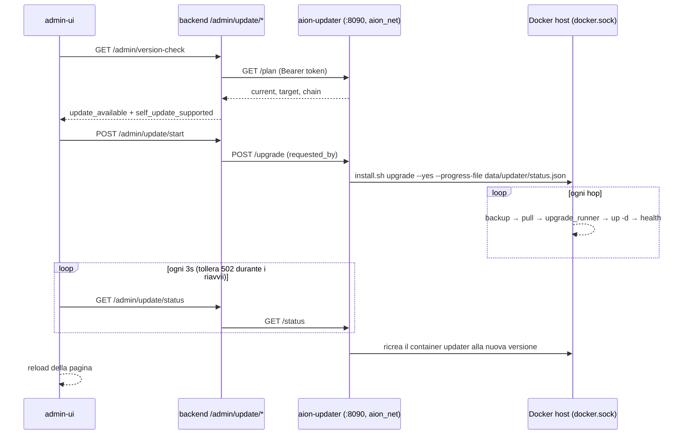

# Aggiornamento dall'admin-ui (sidecar `aion-updater`)

Nei deploy GHCR (`install.sh` + `docker-compose.ghcr.yml`) l'admin-ui mostra il
banner **"Nuova versione X disponibile"** con il pulsante **Aggiorna ora**.
Con un clic l'admin applica, uno dopo l'altro, tutti gli aggiornamenti
pendenti fino all'ultima release (es. `1.6.2 → 1.6.3 → 1.7.0`), seguendo
l'avanzamento in tempo reale.

Sotto il cofano viene eseguito lo **stesso** `install.sh upgrade` del flusso
manuale (vedi [Releases → Upgrade](../opensource/releases.md#upgrade-di-uninstallazione-ghcr-esistente)):
backup, hop sequenziali, `upgrade_runner.py` della nuova immagine, health check,
ripresa dall'ultimo hop riuscito. Cambia solo **chi** lo lancia.

## Come funziona

Il backend non può aggiornare lo stack in cui gira: non ha il socket Docker,
il suo `.env` è montato in sola lettura e riavviare i container ucciderebbe il
processo che sta aggiornando. Per questo c'è un piccolo container dedicato,
`aion-updater`, che resta in piedi per tutta la durata dell'aggiornamento.



| Componente | File | Ruolo |
|------------|------|-------|
| Sidecar | `docker/updater/server.py`, `docker/Dockerfile.updater` | API HTTP stdlib: `/healthz`, `/plan`, `/status`, `/upgrade` |
| Servizio compose | `updater` in `docker-compose.ghcr.yml` (profilo `updater`) | socket Docker + directory di installazione allo stesso path dell'host |
| Logica di upgrade | `scripts/install.sh` (`do_upgrade`) | flag `--plan` e `--progress-file`, modalità updater |
| Proxy backend | `src/api/admin_update.py` | `/admin/update/{status,plan,start}`, solo admin, audit `update.start` |
| Banner | `src/api/version_check.py` | usa il piano del sidecar quando disponibile, altrimenti GitHub |
| UI | `admin-ui/components/VersionUpdateBanner.tsx`, `components/update/*` | pulsante, dialog di conferma, overlay di avanzamento |

### Stato e avanzamento

- `data/updater/status.json` — stato corrente (`state`: `running` / `succeeded` / `failed`,
  `phase`, `chain`, `hop_index`, `completed`, `error`, `backup`, `requested_by`).
  Scritto in modo atomico da `install.sh` a ogni fase.
- `data/updater/logs/upgrade-<ts>.log` — log completo di ogni esecuzione (ultime 20 conservate);
  l'admin-ui ne mostra la coda nel pannello "Mostra log".
- Backend, admin-ui e Caddy si riavviano a ogni hop: l'overlay continua il
  polling mostrando "Servizi in riavvio…". Si può chiudere la pagina: riaprendo
  l'admin-ui l'overlay ricompare finché l'aggiornamento è in corso.

### Durante l'aggiornamento

- Il container `updater` **non** viene riavviato durante gli hop
  (`up -d` elenca esplicitamente tutti i servizi tranne `updater`).
  Dopo l'ultimo hop un container helper staccato esegue
  `docker compose up -d --remove-orphans` e ricrea l'updater alla nuova versione.
- L'health check usa `http://backend:8001/health` (`AION_UPGRADE_HEALTH_URL`),
  perché dentro il sidecar `localhost` non è l'host.
- L'immagine sandbox Podman viene aggiornata tramite l'API Docker-compatibile
  del socket Podman montato (`AION_PODMAN_REMOTE=1`); se il socket manca lo step
  viene saltato con un warning.
- Il lock `data/.upgrade.lock` registra anche l'hostname (`aion-updater`): un
  `install.sh upgrade` lanciato a mano sull'host e uno dall'admin-ui si
  escludono a vicenda. Un lock di un altro host è considerato attivo per
  `AION_UPGRADE_STALE_LOCK_SEC` secondi (default 2h).

## Abilitazione

`install.sh` (installazione **e** upgrade) aggiunge al `.env`, solo se mancanti:

| Chiave | Valore |
|--------|--------|
| `COMPOSE_PROFILES` | `updater` — attiva il servizio |
| `AION_UPDATER_TOKEN` | segreto casuale condiviso backend ↔ updater |
| `AION_HOST_INSTALL_DIR` | directory di installazione (aggiornata sempre) |
| `AION_HOST_HOME`, `AION_HOST_UID`, `AION_HOST_GID`, `AION_HOST_DOCKER_GID` | utente di deploy: i file scritti dall'updater restano suoi |

Per le installazioni esistenti basta quindi **un ultimo upgrade manuale** alla
prima versione che contiene l'updater; da lì in poi si usa il pulsante.

Per **disattivare** il pulsante: togliere `updater` da `COMPOSE_PROFILES` nel
`.env` e `docker compose -f docker-compose.ghcr.yml up -d --remove-orphans`.
Senza sidecar raggiungibile il banner torna al comportamento classico
(link a changelog e guida manuale).

## Sicurezza

:::warning docker.sock equivale a root sull'host
Chi controlla il socket Docker controlla la macchina. L'updater è progettato per
ridurre al minimo la superficie esposta, ma va considerato un componente privilegiato.
:::

Mitigazioni:

- **Nessuna porta pubblicata**: il sidecar è raggiungibile solo sulla rete interna `aion_net`.
- **Token**: tutte le API tranne `/healthz` richiedono `Authorization: Bearer $AION_UPDATER_TOKEN`
  (confronto a tempo costante con `hmac.compare_digest`).
- **Un solo comando**: l'API non accetta parametri liberi — può solo calcolare il piano
  o lanciare `install.sh upgrade` verso l'ultima release.
- **Solo admin**: il backend espone `/admin/update/*` dietro `require_admin_role` e
  registra ogni avvio nell'audit log (`update.start`, con versione di partenza, arrivo e catena).
- **Disattivabile**: togliendo il profilo `updater` il container non esiste.

## Modalità locale (test)

Per provare il flusso con codice non ancora rilasciato esiste una modalità
**ibrida**: gli hop intermedi scaricano le release pubblicate su GHCR esattamente
come in produzione, e solo l'**ultimo** hop `<ultima release> → local` costruisce
le immagini dal clone.

```bash
# nel .env dell'installazione GHCR di test
AION_UPGRADE_FINAL_LOCAL=1
AION_LOCAL_REPO_DIR=/percorso/assoluto/del/clone
```

- La catena diventa ad esempio `1.6.2 → 1.7.0 → local`. Se l'installazione è già
  all'ultima release resta solo l'hop `local`, che si può ripetere a ogni modifica.
- L'hop locale copia i file infrastrutturali (`docker-compose.ghcr.yml`,
  `docker/Caddyfile`, …) dal clone, esegue la build con tag `:local` (updater
  incluso) e lancia `upgrade_runner.py --to local`, che applica in ordine tutti
  gli `scripts/upgrades/<ver>.py` più recenti della versione di partenza: lo
  script della prossima release viene così testato davvero.
- Il clone è montato in sola lettura nel sidecar allo stesso path.
- `scripts/dev/test-self-update.sh` automatizza il test end-to-end (installazione
  di una release vecchia in una directory temporanea, modalità ibrida, avvio
  dell'aggiornamento e verifiche).

## Troubleshooting

| Sintomo | Causa / soluzione |
|---------|-------------------|
| Nessun pulsante "Aggiorna ora", solo "Come aggiornare" | Sidecar assente o non raggiungibile: `docker compose -f docker-compose.ghcr.yml ps updater`; verificare `COMPOSE_PROFILES=updater` e `AION_UPDATER_TOKEN` nel `.env` (il backend va riavviato dopo averlo aggiunto). |
| "Un aggiornamento è già in corso" ma nulla gira | Lock rimasto da un run interrotto: controllare `data/.upgrade.lock`; un lock di un altro host scade dopo `AION_UPGRADE_STALE_LOCK_SEC`. Se si è certi che nulla stia girando, rimuoverlo a mano. |
| Stato `failed` | Leggere l'errore nell'overlay e il log in `data/updater/logs/`. Le versioni già applicate restano installate: **Riprova** riparte dall'hop fallito (`AION_VERSION` nel `.env` è lo stato di ripresa). |
| Lo stato resta "running" dopo un riavvio dell'host | Al riavvio il sidecar marca come `failed` un run rimasto `running`; usare **Riprova**. |
| Rollback necessario | I backup sono in `data/_backups/` (percorso mostrato nell'overlay); vedi `scripts/aion_backup.py`. |

Upgrade manuale sempre disponibile dall'host, anche con il sidecar attivo:

```bash
curl -fsSL https://raw.githubusercontent.com/AION-by-ASA-Computer/AION_Agent/main/scripts/install.sh | bash -s -- upgrade
```
