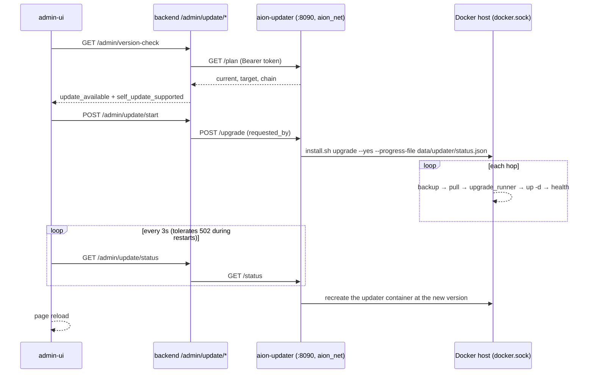

# Update from the admin UI (`aion-updater` sidecar)

On installations that use the prebuilt GHCR (GitHub Container Registry) images
(`install.sh` + `docker-compose.ghcr.yml`), the admin UI shows a
**"New version X available"** banner with an **Update now** button. With one
click, an administrator applies every pending update in sequence up to the
latest release (e.g. `1.6.2 → 1.6.3 → 1.7.0`) and watches the progress live.
This page is for administrators who use the button and for operators who enable,
secure or troubleshoot it.

Under the hood it runs the **same** `install.sh upgrade` as the manual flow (see
[Releases → Upgrade](../opensource/releases.md#upgrade-di-uninstallazione-ghcr-esistente)):
backup, sequential hops, the new image's `upgrade_runner.py`, health check, and
resume from the last successful hop. The only difference is **who** starts it.

:::tip Manual upgrade is always available
Even with the sidecar enabled, you can still upgrade from the host:

```bash
curl -fsSL https://raw.githubusercontent.com/AION-by-ASA-Computer/AION_Agent/main/scripts/install.sh | bash -s -- upgrade
```
:::

## Enabling the button

`install.sh` (both install **and** upgrade) adds these keys to `.env`, only if
they are missing:

| Key | Value |
|-----|-------|
| `COMPOSE_PROFILES` | `updater` — enables the service |
| `AION_UPDATER_TOKEN` | random secret shared by backend ↔ updater |
| `AION_HOST_INSTALL_DIR` | installation directory (always refreshed) |
| `AION_HOST_HOME`, `AION_HOST_UID`, `AION_HOST_GID`, `AION_HOST_DOCKER_GID` | the deploy user: files written by the updater stay owned by that user |

For existing installations, **one last manual upgrade** to the first version
that includes the updater is therefore enough; from then on you can use the
button.

To **turn the button off**: remove `updater` from `COMPOSE_PROFILES` in `.env`
and run `docker compose -f docker-compose.ghcr.yml up -d --remove-orphans`.
When the sidecar is not reachable, the banner goes back to its classic behavior
(links to the changelog and the manual guide).

## How it works

The backend cannot update the stack it runs in: it has no access to the Docker
socket, its `.env` is mounted read-only, and restarting the containers would
kill the very process doing the update. That is why a small dedicated
container, `aion-updater`, stays up for the whole duration of the update.



| Component | File | Role |
|-----------|------|------|
| Sidecar | `docker/updater/server.py`, `docker/Dockerfile.updater` | stdlib HTTP API: `/healthz`, `/plan`, `/status`, `/upgrade` |
| Compose service | `updater` in `docker-compose.ghcr.yml` (profile `updater`) | Docker socket + installation directory mounted at the same path as on the host |
| Upgrade logic | `scripts/install.sh` (`do_upgrade`) | `--plan` and `--progress-file` flags, updater mode |
| Backend proxy | `src/api/admin_update.py` | `/admin/update/{status,plan,start}`, admins only, audit event `update.start` |
| Banner | `src/api/version_check.py` | uses the sidecar's plan when available, otherwise GitHub |
| UI | `admin-ui/components/VersionUpdateBanner.tsx`, `components/update/*` | button, confirmation dialog, progress overlay |

### Status and progress

- `data/updater/status.json` — current state (`state`: `running` / `succeeded` / `failed`,
  `phase`, `chain`, `hop_index`, `completed`, `error`, `backup`, `requested_by`).
  Written atomically by `install.sh` at every phase.
- `data/updater/logs/upgrade-<ts>.log` — full log of each run (the last 20 are
  kept); the admin UI shows its tail in the "Show log" panel.
- Backend, admin-ui and Caddy restart at every hop: the overlay keeps polling
  and shows "Services restarting…". You can close the page: when you reopen the
  admin UI, the overlay comes back as long as the update is still running.

### During the update

- The `updater` container is **not** restarted during the hops
  (`up -d` explicitly lists every service except `updater`).
  After the last hop, a detached helper container runs
  `docker compose up -d --remove-orphans` and recreates the updater at the new
  version.
- The health check uses `http://backend:8001/health` (`AION_UPGRADE_HEALTH_URL`),
  because inside the sidecar `localhost` is not the host.
- The Podman sandbox image is updated through the Docker-compatible API of the
  mounted Podman socket (`AION_PODMAN_REMOTE=1`); if the socket is missing, the
  step is skipped with a warning.
- The lock file `data/.upgrade.lock` also records the hostname
  (`aion-updater`): an `install.sh upgrade` started by hand on the host and one
  started from the admin UI exclude each other. A lock held by another host is
  considered active for `AION_UPGRADE_STALE_LOCK_SEC` seconds (default 2 hours).

## Security

:::warning docker.sock is equivalent to root on the host
Whoever controls the Docker socket controls the machine. The updater is designed
to keep its exposed surface as small as possible, but treat it as a privileged
component.
:::

Mitigations:

- **No published port**: the sidecar is reachable only on the internal `aion_net` network.
- **Token**: every API except `/healthz` requires `Authorization: Bearer $AION_UPDATER_TOKEN`
  (constant-time comparison with `hmac.compare_digest`).
- **A single command**: the API accepts no free-form parameters — it can only
  compute the plan or start `install.sh upgrade` towards the latest release.
- **Admins only**: the backend exposes `/admin/update/*` behind
  `require_admin_role` and records every start in the audit log (`update.start`,
  with the starting version, target version and chain).
- **Can be turned off**: without the `updater` profile, the container does not exist.

## Local test mode

To try the flow with unreleased code there is a **hybrid** mode: intermediate
hops pull the releases published on GHCR exactly as in production, and only the
**last** hop `<latest release> → local` builds the images from the clone.

```bash
# in the .env of the test GHCR installation
AION_UPGRADE_FINAL_LOCAL=1
AION_LOCAL_REPO_DIR=/percorso/assoluto/del/clone
```

- The chain becomes, for example, `1.6.2 → 1.7.0 → local`. If the installation
  is already on the latest release, only the `local` hop remains, and you can
  repeat it after every change.
- The local hop copies the infrastructure files (`docker-compose.ghcr.yml`,
  `docker/Caddyfile`, …) from the clone, builds with the `:local` tag (updater
  included) and runs `upgrade_runner.py --to local`, which applies, in order,
  every `scripts/upgrades/<ver>.py` newer than the starting version. This way
  the next release's upgrade script really gets tested.
- The clone is mounted read-only into the sidecar at the same path.
- `scripts/dev/test-self-update.sh` automates the end-to-end test (installs an
  old release in a temporary directory, enables hybrid mode, starts the update
  and runs the checks).

## Troubleshooting

| Symptom | Cause / fix |
|---------|-------------|
| No "Update now" button, only "How to update" | Sidecar missing or unreachable: `docker compose -f docker-compose.ghcr.yml ps updater`; check `COMPOSE_PROFILES=updater` and `AION_UPDATER_TOKEN` in `.env` (restart the backend after adding it). |
| "An update is already running" but nothing is running | A lock left over by an interrupted run: check `data/.upgrade.lock`; a lock from another host expires after `AION_UPGRADE_STALE_LOCK_SEC`. If you are sure nothing is running, delete it by hand. |
| State `failed` | Read the error in the overlay and the log in `data/updater/logs/`. Versions already applied stay installed: **Retry** resumes from the failed hop (`AION_VERSION` in `.env` is the resume state). |
| State stays "running" after a host reboot | On restart, the sidecar marks a run left in `running` as `failed`; use **Retry**. |
| Rollback needed | Backups are in `data/_backups/` (path shown in the overlay); see `scripts/aion_backup.py`. |
