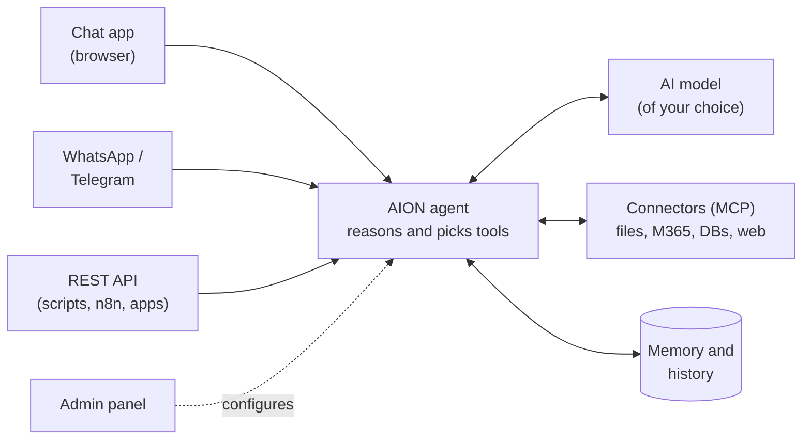

# What is AION

AION Agents is a **company AI assistant you host yourself**. It looks like a normal chat, but behind the chat there is an *agent*: a program that, instead of only writing text, can **use tools** — open a file on the company file server, run a query, read a monitoring dashboard, search the web — and then answer using what it found. This page explains what it does and how the pieces fit together, without assuming technical knowledge.

## What can I do with it?

Some typical uses:

- **Ask questions about documents**: attach a PDF, Word or Excel file and ask for a summary, a comparison or the figures in a table. Scanned documents are read with OCR (text recognition).
- **Produce documents**: ask for a report, a Word document, a chart or a presentation; the result is a file you can download.
- **Work with company systems**: read and write files on Windows shares, work with Microsoft 365, query databases, check Prometheus/Grafana monitoring, and any other system connected by the administrator.
- **Search the web** for up-to-date information, or run a longer **deep research** on a topic.
- **Automate**: schedule recurring tasks, or call the agent from scripts, n8n workflows and other applications through the [API](../api-guide/overview.md).
- **Chat from your phone** through [WhatsApp](../integrations/whatsapp.md) or [Telegram](../telegram/RUNBOOK.md), if your company enables them.

## The main parts

| Part | What it is | Who uses it |
|---|---|---|
| **Chat app** (chat-ui) | The web page where you chat with the agent, attach files and download results. | Everyone |
| **Admin panel** (admin-ui) | Where administrators manage users, AI models, agent profiles, connectors and security. | Administrators |
| **Agent** (backend) | The server that receives questions, calls the AI model and the tools, and stores conversations. | — (runs in the background) |
| **Connectors** | Plug-ins that give the agent access to a system (files, Microsoft 365, databases…). They use the **MCP** standard (Model Context Protocol). | Configured by administrators, some need each user's credentials |
| **AI model** (LLM) | The language model that "thinks". AION is not tied to a specific model: your company chooses the one it prefers. | Chosen by administrators |
| **Memory** | Conversation history plus what the agent learns about you over time (preferences, recurring facts). | Automatic |

## What happens when I ask a question

1. You write a message (and maybe attach a file) in the chat.
2. AION prepares the context: the instructions of the **profile** you chose, the relevant parts of the conversation and what it remembers about you.
3. The AI model reads everything and decides whether it can answer directly or needs a **tool** (for example "read the file `budget.xlsx`" or "search the web").
4. AION runs the tool, gives the result back to the model, and repeats until the model has enough information.
5. The answer is written in the chat as it is generated (*streaming*). You can see which tools were used and download any file produced.

## Is my data safe?

- **It runs on your servers.** Conversations, files and memory are stored in your infrastructure.
- **Everyone sees only their own data.** Conversations and files belong to their author; even administrators cannot read other people's chats from the admin panel.
- **Tools act with your permissions.** Connectors such as the Windows file server or Microsoft 365 use *your* credentials, so you can only reach what you could reach anyway.
- **Administrators control access**: which profiles and tools each user can use, sign-in with company accounts (Microsoft or Google SSO), two-factor authentication, and API keys with limited permissions.

More details: [Security and identity](../security/identity-and-chat-auth.md) and [Session isolation](../security/session-isolation.md).

## Next steps

- Learn the vocabulary in [Key concepts](./key-concepts.md).
- Try it yourself with the [Quickstart](./quickstart.md).
- Already have access? Read [Using the chat](../user-guide/using-the-chat.md).
