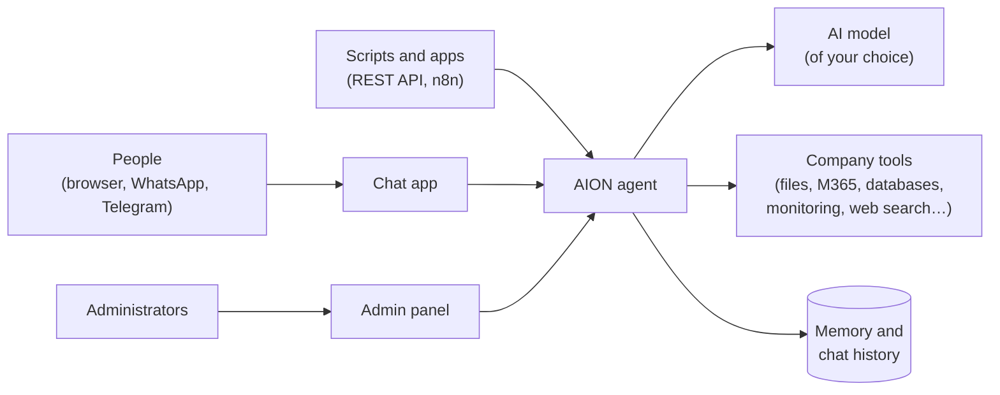

# Welcome to AION Agents

**AION Agents** is an AI assistant that your company runs on its own servers. People chat with it from the browser (or from messaging apps such as WhatsApp and Telegram), and it can **use your company's tools**: read and write files, query databases and monitoring systems, search the web, work with Microsoft 365 and more. Administrators decide which tools, models and data each person can use. Developers can call the same assistant **through a REST API**.

## Where do you want to start?

| I want to… | Go to |
|---|---|
| Understand what AION is and how it works, in plain words | [What is AION](./getting-started/what-is-aion.md) and [Key concepts](./getting-started/key-concepts.md) |
| Try it on my computer in a few minutes | [Quickstart](./getting-started/quickstart.md) |
| Use the chat in my day-to-day work | [Using the chat](./user-guide/using-the-chat.md) |
| Call the agent from a script, an app or n8n | [API guide](./api-guide/overview.md) — start with [Get an API key](./api-guide/get-an-api-key.md) |
| Set up and manage AION for my company | [Administrator checklist](./admin-guide/checklist.md) |
| Install it on a server, update it, back it up | [Deploy with Docker](./deployment/docker.md) |
| Understand how it is built inside | [Architecture overview](./architecture/overview.md) |

## AION in one picture

The agent receives a question, decides which tools to use, calls the AI model as many times as needed and answers. Conversations, files and memory are kept in your infrastructure; the AI model is the one your company chooses.

## How this documentation is organized

The tabs at the top of the page split the documentation by audience:

- **Get started** — what AION is, key concepts, quickstart and the guide for chat users.
- **API** — everything needed to integrate AION into other software: API keys, examples in curl, Python, JavaScript and PowerShell, streaming, OpenAI compatibility, the full reference.
- **Administration** — installation, configuration, users and security, connectors (MCP), messaging channels.
- **Internals** — architecture, memory, agent pipeline, benchmarks and design notes, for people who develop AION.

Use the search box (top right) to jump to any page. Can't find something? See the [FAQ](./getting-started/faq.md).
