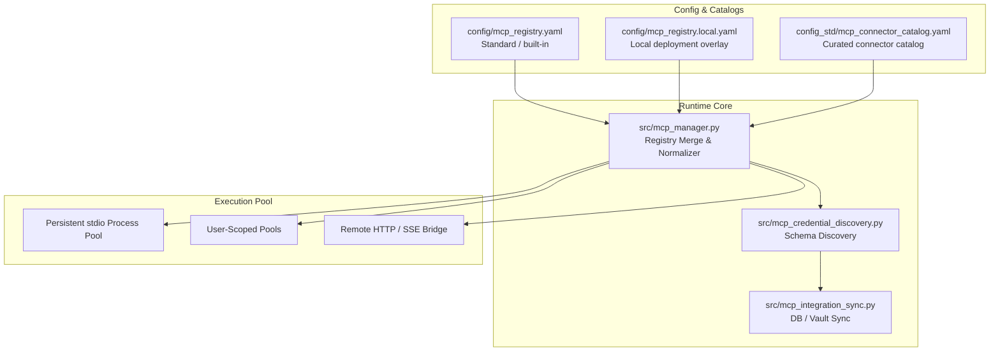
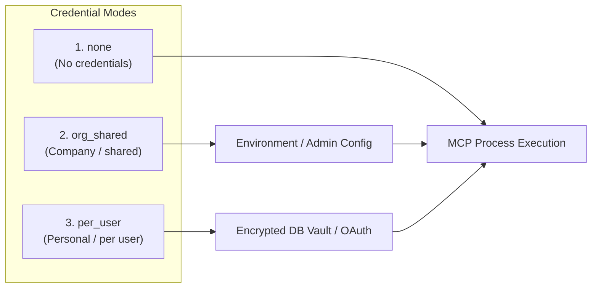

# MCP integrations (Model Context Protocol)

**MCP (Model Context Protocol)** is the open standard AION uses to plug tools and connectors into
the agent: external APIs, databases, code workspaces and SaaS services (GitHub, Google Workspace,
Microsoft 365, Postgres, ClickUp and many more). Each connector is an "MCP server" that gives the
agent a set of tools it can call. This page is an overview for **administrators** and
**developers/operators** who install, configure or troubleshoot connectors; end users usually only
need to sign in to a connector from chat-ui.

MCP servers run as external processes, isolated from the agent's main runtime. This brings
**security**, **sandboxing**, **scalability** and immediate **interoperability** with the MCP
ecosystem (the same servers work with Claude Desktop, Cursor and VS Code).

---

## 1. Architecture and registry

AION uses a **base + local overlay** pattern, with registries in two formats (`YAML` and `JSON`).



### Configuration files

| File | Role |
|------|------|
| `config/mcp_registry.yaml` (base) | Built-in and standard MCP servers (e.g. `session_sandbox`, `ocr`, `stt`, `skills_hub`, `prometheus`, `grafana`, `query_memory`). The committed reference template is `config_std/mcp_registry.yaml`. |
| `config/mcp_registry.local.yaml` (flat local overlay) | Settings specific to this installation (not committed to git). Entries here override or extend the base registry. |
| `config/mcp_registry.local.json` (standard local overlay) | Supports the native `{"mcpServers": { ... }}` format, fully compatible with Claude Desktop, Cursor and Smithery. |
| `config_std/mcp_connector_catalog.yaml` (connector catalog) | Source of truth for ready-to-use connectors, with authentication metadata, descriptions, categories and configuration templates. |

---

## 2. Installing MCP servers

:::tip Your own MCP servers
Besides public and catalog servers, your developers can build their own MCP server and an administrator can upload it from the MCP Hub. It runs in an isolated container with the network closed by default. See [Custom MCP servers](../mcp/custom-mcp-servers.md) and [Develop a custom MCP server](../mcp/custom-mcp-development.md).
:::

AION offers several ways to install a server, from the graphical UI to manual configuration.

### A. From the MCP Hub (admin-ui)

In **Admin Dashboard → MCP Hub**:

1. **Curated catalog**: browse the certified connectors (GitHub, Slack, PostgreSQL, Notion, etc.) and click **Install**.
2. **Marketplace search**: search public MCP marketplaces (Smithery, Glama, GitHub, …). The backend fetches the package and normalises its entrypoint automatically.
3. **Remote endpoint**: add a remote MCP server hosted at a URL (HTTP or SSE).

```http
POST /admin/mcp/install-from-catalog?connector_id=github
GET  /admin/market/search?q=...
POST /admin/market/install-zero
POST /admin/market/install-remote
```

### B. Automatic entrypoint normalisation

When you install a package from the marketplace (`src/mcp_registry_normalize.py`), AION works out
automatically how to run the process:

- **Python**:
  - If there is a `pyproject.toml`, it uses `uv run --directory <dir> <script> stdio` or looks for the built executable in `.venv/Scripts/` or `.venv/bin/`.
  - If it is a plain PyPI package, it uses `uvx <package>@latest stdio`.
  - If there is a `requirements.txt`, it runs with the configured Python interpreter (`python3 server.py`).
- **Node.js / TypeScript**:
  - Builds or runs `build/index.js`, `index.ts` (with `tsx` or `bun`), or `package.json` scripts.
- **Docker**:
  - Can run isolated MCP containers with `docker run -i --rm ...`.

### C. Manual configuration in `mcp_registry.local.yaml`

You can add or customise any MCP server by hand in `config/mcp_registry.local.yaml`:

```yaml
# Example: local server via uvx (Python)
mcp_postgres:
  command: "uvx"
  args:
    - "mcp-server-postgres@latest"
    - "stdio"
  env:
    POSTGRES_URL: "${POSTGRES_CONNECTION_STRING}"
  description: "PostgreSQL database connector"

# Example: Node.js server via npx
mcp_github:
  command: "npx"
  args:
    - "-y"
    - "@modelcontextprotocol/server-github"
  env:
    GITHUB_PERSONAL_ACCESS_TOKEN: "${AION_USER_GITHUB_TOKEN}"
  description: "Manage GitHub issues, PRs and repositories"

# Example: remote SSE / HTTP server
mcp_remote_saas:
  command: "remote"
  url: "https://mcp.internal.company.com/sse"
  auth_type: "bearer"
  env:
    BEARER_TOKEN: "${INTERNAL_MCP_TOKEN}"
  description: "Internal company microservices"
```

---

## 3. Runtime modes and lifecycle

AION keeps MCP processes running between requests, so it avoids the cost of starting a process for
every tool call.

### Persistent stdio pool (`AION_MCP_POOL=1`)

- **On by default.** MCP stdio processes are started and kept alive in a persistent, process-level pool.
- **Auto-recovery**: if a subprocess crashes or stops, the pool restarts it transparently on next use.
- **Single worker**: the AION backend runs with `workers: 1` to preserve the pool's in-memory state.

### Process scoping

| Scope | Configuration / trigger | Description |
|---|---|---|
| **Global / shared pool** | Default for stateless tools or tools with a shared credential | Tools are shared across sessions to maximise memory reuse |
| **Session-scoped** | `AION_MCP_SESSION_SCOPED_SERVERS` (e.g. `session_sandbox`, `ocr`, `stt`, `promo_render`, `skills_hub`) | A separate process is started for each `session_id`. It has access to the session's sandbox filesystem |
| **User-scoped pool** | `AION_MCP_USER_POOL=1` | Pool keyed by `(user_id, tenant_id)`. Gives safe isolation in multi-tenant setups when users connect with their own personal credentials |

### MCP SDK compatibility detection (`mcp<2` vs `mcp>=2`)

At runtime, AION reads the `requires-dist` metadata of PyPI packages to tell whether a package needs
the new `mcp>=2` SDK or the older `mcp<2` (legacy FastMCP), and automatically adds the right
compatibility flags to `uvx`.

---

## 4. Credentials and authentication

AION supports three credential models, configurable for each MCP server (`src/mcp_integration_sync.py`):



### Credential modes (`credential_mode`)

| Mode | When to use it | Where the credential comes from |
|------|----------------|---------------------------------|
| **`none`** | No key or credential needed (e.g. local utility, calculation or documentation servers) | - |
| **`org_shared`** | One credential for the whole instance or tenant (e.g. a shared database, the company Slack bot account, a Grafana/Prometheus token) | Global environment variables (`.env`) or set by the admin in the panel |
| **`per_user`** | Each chat user must sign in or enter their own API key / Personal Access Token (PAT) | Stored encrypted in the unified database (`data/aion.db`) |

### OAuth 2.0 sign-in

For services such as **Google Workspace**, **Microsoft 365 / SharePoint** and **GitHub**, AION
supports full OAuth 2.0 flows:

- The user signs in directly from chat-ui by clicking "Sign in with `[Service]`".
- Refresh tokens are renewed automatically in the background.
- End users never have to generate or copy tokens by hand.

### Runtime env aliases and placeholder substitution

AION supports the `${VAR_NAME}` syntax in all YAML files. In addition, `runtime_env_aliases` lets the
system automatically map alternative variable names expected by different MCP packages:

```yaml
# Maps automatically if the package expects GITHUB_PERSONAL_ACCESS_TOKEN but the user configured GITHUB_TOKEN
runtime_env_aliases:
  GITHUB_PERSONAL_ACCESS_TOKEN:
    - GITHUB_TOKEN
    - GH_TOKEN
```

---

## 5. Assigning tools to agent profiles

Registered MCP servers can be attached selectively to the different **agent profiles**
(`config/profiles/*.yaml`):

```yaml
name: DevOps Assistant
description: Agent specialised in infrastructure and monitoring
instructions: |
  You help the team operate and monitor the infrastructure.

# Built-in native tool groups
native_tool_groups:
  - web_research

# MCP servers active for this profile
mcp_servers:
  - session_sandbox
  - mcp_postgres
  - prometheus
  - grafana
```

When the user picks the profile in chat-ui, the agent loads only the tools attached to it. This
keeps the model's context window smaller and prevents calls to tools that are not relevant.

---

## 6. Diagnostics and troubleshooting

### CLI diagnostic tool

A dedicated script checks the status of all configured MCP servers:

```bash
# Run diagnostics on all MCP servers
python -m src.diagnose_mcp
```

### Troubleshooting checklist

| Symptom | Likely cause | Fix |
|---|---|---|
| `Tool not found` or tool not listed | Server not enabled in the active profile | Check the `mcp_servers` list in `config/profiles/<profile>.yaml` |
| `spawn ENOENT` or `command not found` error | `uv`, `uvx`, `node` or `npx` not on the PATH | Make sure Node.js and `uv` are installed on the system / in the container |
| Missing credentials error | Environment variable not set, or user credential missing | Check the variables in `.env`, or ask the user to enter the key in chat-ui |
| Process start timeout | Slow package download or build on first start | The first start of packages via `npx` or `uvx` can take a few seconds to download |
| Remote server connection error | SSE/HTTP endpoint unreachable or invalid certificate | Use the test endpoint `POST /admin/mcp/probe-remote` to check connectivity |

---

## Related documentation

- [MCP registry - philosophy and design](../mcp/registry.md)
- [Curated connector catalog](../mcp/connector-catalog.md)
- [User isolation and credentials](../mcp/user-isolation-and-credentials.md)
- [Orchestration and lifecycle](../mcp/orchestration.md)
