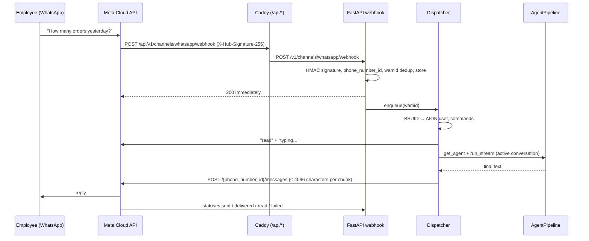

# WhatsApp channel

The WhatsApp channel lets employees chat with AION from their own WhatsApp by
writing to the **company WhatsApp number**. Use it when people need AION on the
go, without opening the chat-ui. Replies come from the same pipeline as the
chat-ui: same profiles, same memory (STM/LTM), same MCP tools, and the
conversations also show up in the chat-ui with a WhatsApp icon.

This page is for three audiences:

| Section | For | What it covers |
|---------|-----|----------------|
| [A. Connect the company number](#a-connect-the-company-number-admin) | Administrator | One-time setup on Meta and in admin-ui |
| [B. Link an employee's WhatsApp](#b-link-an-employees-whatsapp) | End user | How to link your WhatsApp and the commands you can use |
| [Files and photos](#files-and-photos), [Voice messages](#messaggi-vocali) | End user and IT | What you can send and receive |
| [C. How a message travels](#c-how-a-message-reaches-aion-and-comes-back), [Endpoints](#endpoint), [Configuration](#configuration-env), [Troubleshooting](#troubleshooting), [Local development](#local-development) | IT / operators | Internals, settings and fixes |

At a glance:

| Who | Does what | Where | How often |
|-----|-----------|-------|-----------|
| Company admin | Connects the company WhatsApp number to AION | Meta + admin-ui → **WhatsApp** | Once |
| Employee | Links their own WhatsApp to their AION account | chat-ui → Settings → **WhatsApp** | Once |
| Employee | Writes to AION | WhatsApp | Any time |

AION only uses **Meta's official APIs** (WhatsApp Cloud API, Graph API
`v26.0`): no unofficial libraries and no WhatsApp Web.

This page covers **Phase 1 (text)**, the media part of **Phase 2** (incoming
photos and documents, outgoing files generated by the agent) and **voice
messages** (transcribed with the speech-to-text engine). The full plan,
including later phases (templates, proactive messages), is in
[`docs/architecture/whatsapp-channel-plan.md`](../architecture/whatsapp-channel-plan.md).

:::note
The bot's own replies (welcome message, command list, notices) are currently
written in Italian, and so are the commands (`/aiuto`, `/nuova`, `/scollega`,
`COLLEGA`). This page quotes those replies in English translation.
:::

---

## A. Connect the company number (admin) {#a-connect-the-company-number-admin}

The flow is the same as for SSO: paste the credentials, **verify** the
connection, and only then **enable** the channel.

### A1. On Meta

1. **Business portfolio.** You need the company's Business portfolio on
   [business.facebook.com](https://business.facebook.com). Business
   verification is recommended: without it, message limits are lower.
2. **Meta app.** On
   [developers.facebook.com/apps](https://developers.facebook.com/apps), create
   an app of type **Business** and add the **WhatsApp** product to it.
3. **Company number.** In WhatsApp Manager, add the number employees will
   write to.
   - It must be a number that is **not already active** on WhatsApp or the
     WhatsApp Business app.
   - Verify it by SMS or phone call and choose the **display name** (subject
     to Meta approval).
4. **IDs.** From *WhatsApp → API Setup*, copy the **Phone Number ID** and the
   **WhatsApp Business Account ID** (WABA ID).
5. **Permanent token.** In *Business settings → System users*:
   - create a **System User** with the admin role;
   - assign it the app and the WABA;
   - generate a **non-expiring** token with the permissions
     `whatsapp_business_messaging` and `whatsapp_business_management`.

   The temporary token shown in "API Setup" lasts 24 hours: it is only good
   for a quick test.
6. **App secret.** From *App → Settings → Basic*, copy the **App secret**.
   AION uses it to verify the webhook signature.

### A2. In AION (admin-ui → Platform → WhatsApp)

7. Paste the WABA ID, Phone Number ID, token and app secret. Optionally choose
   the default agent profile (default `aion_std`) and the thinking level (see
   below). Then save.
   - **Thinking level**: `Off`, `Minimal`, `Medium` or `Maximum`, like the
     Thinking menu in the chat-ui. "System default" (no value) follows
     `AION_DEFAULT_REASONING_EFFORT` / `AION_THINKING_ENABLED`. Higher levels
     make replies slower and can exceed the turn timeout
     (`AION_WHATSAPP_TURN_TIMEOUT_S`). The reasoning itself is never sent to
     WhatsApp, only the final answer.
   - Like the profile, the thinking level applies to the whole channel and
     does not require re-verifying the Meta connection.
   - The token and app secret are encrypted in the database
     (`AION_CREDENTIAL_ENCRYPTION_KEY`), like SSO secrets; the page only shows
     their last 4 characters.
   - To keep the saved values, leave those fields empty.
8. AION shows two values to copy:
   - **Webhook URL**: `https://DOMAIN/api/v1/channels/whatsapp/webhook`;
   - **Verify token**, generated by AION. "Regenerate" creates a new one, which
     you must then paste on Meta again.

### A3. Webhook on Meta

9. In *Meta app → WhatsApp → Configuration → Webhook*:
   - paste the URL and the verify token and click **Verify and save**. Meta
     immediately calls AION, which records "webhook verified";
   - subscribe to the **`messages`** field.
10. Add a **payment method** to the WABA. Publishing the app (**Live** mode)
    is **optional**: the channel already works with an "Unpublished" app.

### A4. Verify and enable

11. In admin-ui, click **Verify**. AION calls the Graph API and shows a
    checklist:

    | Check | What it verifies |
    |-------|------------------|
    | `token_phone` | The token is valid and can see the number (verified name, quality) |
    | `cloud_api_registered` | The number is registered on Cloud API (`platform_type = CLOUD_API`) |
    | `app_subscribed` | The app is subscribed to the WABA (if not, AION subscribes it automatically) |
    | `webhook_verified` | Meta completed the handshake from step 9 |

12. When every item is ✓, click **Enable channel**. The channel cannot be
    enabled without a successful verification.

:::warning
If you later change the WABA ID, Phone Number ID, token or app secret, the
channel is **disabled** and must be verified again.
:::

---

## B. Link an employee's WhatsApp {#b-link-an-employees-whatsapp}

WhatsApp never creates accounts. Only people who already have an AION account
can use the channel, after linking it:

1. In chat-ui → **Settings → WhatsApp**, click **Link WhatsApp**.
   - The tab only appears when the channel is enabled.
2. AION shows a **QR code**, an **Open WhatsApp** button and the code in plain
   text.
   - On a computer, scan the QR code with your phone; on your phone, tap the
     button.
   - The link is `https://wa.me/<number>?text=COLLEGA%20<code>`.
3. WhatsApp opens with the message `COLLEGA 7KQ4M2XP` already typed. Press
   **Send**.
4. AION links that WhatsApp number to your account and replies with a welcome
   message and the list of commands. The settings page shows "Linked".

Code rules:

- 8 characters, with no ambiguous characters (`0/O`, `1/I/L`);
- single use, expires after **10 minutes**;
- a new code invalidates the previous one;
- after **5 wrong attempts within 15 minutes** from the same WhatsApp number,
  further attempts are blocked.

One WhatsApp number is linked to one user, and vice versa: linking again
replaces the previous link. Someone who writes to the number without being
linked gets **at most one reply every 10 minutes**, with a link to the WhatsApp
tab in the settings.

To unlink:

- the employee uses chat-ui → Settings → WhatsApp → **Unlink**, or writes
  `/scollega`;
- the admin uses admin-ui → WhatsApp → **Linked users**.

If the AION user is deleted, the link is deleted with it.

### WhatsApp commands

| Command | Effect |
|---------|--------|
| `/aiuto` (`/help`) | Shows the commands |
| `/nuova` (`/new`) | Starts a new conversation |
| `/scollega` (`/unlink`) | Unlinks this WhatsApp number from the account |
| `COLLEGA <code>` | Links (or re-links) the account |

Anything else is a question for the agent. Photos and documents are described
in [Files and photos](#files-and-photos), voice messages in
[Voice messages](#messaggi-vocali). Commands must be typed: a voice message is
never interpreted as a command.

---

## C. How a message reaches AION and comes back {#c-how-a-message-reaches-aion-and-comes-back}



1. **Webhook.** `POST /v1/channels/whatsapp/webhook`. Caddy strips the `/api`
   prefix.
   - The channel is identified by the payload's `metadata.phone_number_id`.
   - Invalid `X-Hub-Signature-256` signature → **403**.
   - Unknown number, disabled channel or kill switch → **200** and nothing
     else, so Meta does not retry.
2. **Stored before the 200.** Every message is saved in `whatsapp_messages`.
   - The `wamid` is unique, so Meta's retries are discarded.
   - If the backend restarts during a turn, on startup it resumes messages in
     state `received`/`processing` from the last 24 hours. Older ones move to
     `failed`.
3. **Dispatcher.** A background asyncio task, with one lock per sender so that
   messages from the same person stay in order.
   - Identity: **BSUID** (the webhook's `user_id`) → `whatsapp_identities` →
     AION user.
   - The phone number is just extra data: with WhatsApp usernames it may be
     missing.
4. **Turn.** Exactly the same as in the chat-ui:
   - the channel's default profile if the user has access to it, otherwise
     the first allowed profile;
   - the thinking level configured for the channel (admin-ui), mapped onto the
     model with the same rules as the chat-ui;
   - the user's active conversation, or a new one with
     `metadata.source = "whatsapp"`;
   - the turn is registered as a background run, so the chat-ui can follow it
     live;
   - received photos and documents are passed as turn attachments, like
     chat-ui uploads (see [Files and photos](#files-and-photos));
   - this "real session" logic (title, past attachments, thinking level in
     the metadata, background run, generated files) lives in
     `src/channels/session_turn.py` and is shared with the Telegram channel
     (see [Telegram channel](../telegram/RUNBOOK.md)).
   - **"Typing…"**: Meta shows it for at most 25 seconds, so AION renews it
     every 20 seconds until the turn ends (after 3 refusals in a row from Meta
     it stops trying).
   - **Long turns**: after `AION_WHATSAPP_WORKING_NOTICE_S` seconds (default
     90) AION sends, once, "⏳ I'm working on it, I'll write as soon as I'm
     done…". If Meta refuses to renew "typing…", the message is sent right
     away without waiting for the threshold. Note that Meta only confirms it
     accepted the request, not that the indicator actually appears on the
     phone: an accepted renewal is treated as working. Set `0` to turn the
     message off.
   - **Timeout**: `AION_WHATSAPP_TURN_TIMEOUT_S`. When it expires, AION sends
     the link to the conversation.
5. **Reply.** Markdown is converted to WhatsApp formatting:
   - `**b**` → `*b*`; headings become bold lines;
   - tables become `• a — b` lists;
   - links become `text (url)`.

   The text is split into 4096-character chunks. Beyond
   `AION_WHATSAPP_MAX_CHUNKS` chunks it is cut off with "Continue on AION:
   `<link>`". Files created by the agent during the turn follow the text.
6. **Statuses.** The `sent`/`delivered`/`read`/`failed` webhooks update the
   outgoing messages, and a status never moves backwards.

---

## Files and photos {#files-and-photos}

Employees can send **photos** (JPEG/PNG) and **documents** (PDF, Word, Excel,
PowerPoint, text…) and receive **files created by the agent** on WhatsApp.
Voice messages are transcribed (see [Voice messages](#messaggi-vocali)); videos
and stickers get a polite "not supported" reply.

### Incoming

| What the user sends | What AION does |
|---------------------|----------------|
| Photo or document **with a caption** | Starts a turn right away: the caption is the question, the file is attached |
| Photo or document **without a caption** | Saves the file and replies "📎 Received!…" (once per burst); further files only get the blue ticks |
| Text after uncaptioned files | Starts a turn with all pending files as attachments |
| `/nuova` | Discards the pending files (they stay in the old conversation) |

- The file is downloaded from the Graph API (`GET /{media-id}` → URL valid for
  5 minutes, `Authorization: Bearer`). The token is sent **only** to Meta hosts
  (`*.fbsbx.com`, `*.whatsapp.net`, `*.facebook.com`). If the URL has expired
  (message left in the queue, restart) it is regenerated once.
- Saving works exactly like a chat-ui upload: the session's `uploads/`, legacy
  Word conversion, PDF auto-ingest, copy to the storage backend. The file is
  therefore also visible in the chat-ui.
- Limit: `min(AION_UPLOAD_MAX_BYTES, 100 MB)`. Above it, AION replies with the
  link to the chat-ui.
- Pending files are tied to the active conversation
  (`whatsapp_identities.pending_attachments_json`) and expire after
  **24 hours**.
- The agent reads images with the OCR/document tools, as for chat-ui uploads
  (no native vision with harness v2).

### Outgoing

- After the turn, AION compares the session's `workspace/` and `derived/`
  before and after: new or modified files are sent **after the text**.
  Internal files are excluded (`.versions/`, `derived/tool_results/`,
  `derived/docs/`, `.py`/`.js` scripts, `.json`, logs…), using the same filter
  as the chat-ui.
- JPEG/PNG up to 5 MB → image; larger ones, PDF and Office files → document
  with the original name; other text files (CSV, Markdown, HTML…) → document
  `text/plain`. Other types are not sent.
- At most `AION_WHATSAPP_MAX_OUTBOUND_FILES` files per reply: extra files,
  unsupported ones, or ones Meta rejects are reported with "📁 N more files are
  available on AION: `<link>`".
- Each file is uploaded with `POST /{phone_number_id}/media` and sent by `id`.
  We are always inside the 24-hour window, because AION is replying right
  away to a user message.

## Voice messages {#messaggi-vocali}

A voice message (or a forwarded audio file) is treated like a spoken text
message:

1. the file is downloaded and saved in `uploads/` like photos
   (`vocale_<date>.ogg`), so it stays visible in the chat-ui;
2. while "typing…" is shown, the backend transcribes it with
   `transcribe_audio_file` from
   [`src/tools/audio_transcribe.py`](../../src/tools/audio_transcribe.py),
   **the same function used by the `stt` MCP server**, called in-process
   ([`src/channels/whatsapp/voice.py`](../../src/channels/whatsapp/voice.py)):
   same engine (remote Whisper service or local faster-whisper), same
   `AION_STT_*` settings from admin-ui → Settings → Audio, default language
   `AION_STT_LANGUAGE`. See [Speech-to-text](../mcp/speech-to-text.md);
3. the turn starts with the text `🎤 <transcript>` and the audio file attached.
   The user only receives the agent's answer (the transcript is not echoed
   back). The voice message also carries any pending files (for example, a
   photo without a caption followed by the voice message "what is this?").

- The transcript is written to the session's `derived/audio/<slug>/`: the
  pipeline detects it and tells the agent the audio is already transcribed,
  instead of having it call `transcribe_audio` again.
- A new conversation started by a voice message takes the transcript as its
  title.
- Voice messages longer than `AION_WHATSAPP_VOICE_MAX_SEC` (default 10
  minutes) are refused with a message. A voice message with no speech, or a
  failed transcription, gets an error message and no turn starts (the audio
  stays saved and pending files stay pending).
- Transcriptions run one at a time in the backend process. With the local
  engine, the faster-whisper model also stays loaded in the backend's memory
  (about 0.5 GB with `small`), in addition to the MCP server.
- `AION_WHATSAPP_VOICE=0` turns voice messages off: the user is asked to type
  the question instead.

---

## Endpoints {#endpoint}

| Method | Path | Auth | Purpose |
|--------|------|------|---------|
| GET | `/v1/channels/whatsapp/webhook` | verify token | Meta handshake (`hub.challenge`) |
| POST | `/v1/channels/whatsapp/webhook` | HMAC signature | Meta events (max 3.5 MB) |
| GET | `/v1/me/whatsapp` | user token | Channel and link status |
| POST | `/v1/me/whatsapp/link-code` | user token | `COLLEGA` code + `wa.me` link + QR (409 `whatsapp_channel_disabled`) |
| DELETE | `/v1/me/whatsapp` | user token | Unlink |
| GET / PUT | `/admin/whatsapp` | admin | Configuration (masked secrets) / save |
| POST | `/admin/whatsapp/verify-token` | admin | New verify token |
| POST | `/admin/whatsapp/validate` | admin | Checklist against the Graph API |
| POST | `/admin/whatsapp/enable` | admin | `{enabled}`; 409 `not_configured` / `not_validated` / `force_disabled` |
| GET | `/admin/whatsapp/identities` | admin | Linked users |
| DELETE | `/admin/whatsapp/identities/{id}` | admin | Unlink a user |

The code is in `src/channels/whatsapp/` (config, signature, parsing, Graph
client, linking, formatting, dispatcher), `src/api/v1/whatsapp.py` and
`src/api/admin_whatsapp.py`.

## Configuration (env) {#configuration-env}

| Variable | Default | Description |
|----------|---------|-------------|
| `AION_PUBLIC_API_URL` | — | **Public HTTPS URL** of the backend; the webhook URL is derived from it |
| `AION_CHAT_URL` / `AION_PUBLIC_CHAT_URL` | — | Base for the chat-ui links sent on WhatsApp |
| `AION_WHATSAPP_FORCE_DISABLE` | `0` | Kill switch: `1` ignores webhooks and blocks enabling the channel |
| `AION_WHATSAPP_GRAPH_VERSION` | `v26.0` | Graph API version |
| `AION_WHATSAPP_TURN_TIMEOUT_S` | `600` | Turn timeout (minimum 30) |
| `AION_WHATSAPP_WORKING_NOTICE_S` | `90` | Seconds before the "I'm working on it…" message on long turns; `0` = never |
| `AION_WHATSAPP_MAX_CHUNKS` | `3` | Maximum messages per reply |
| `AION_WHATSAPP_MEDIA` | `1` | `0` = text only (photos/documents refused, no outgoing files) |
| `AION_WHATSAPP_MAX_OUTBOUND_FILES` | `5` | Generated files sent per reply; the rest via a link |
| `AION_WHATSAPP_MAX_OUTBOUND_BYTES` | `104857600` | Maximum size of a sent file (Meta's cap is 100 MB) |
| `AION_WHATSAPP_VOICE` | `1` | `0` = voice messages refused (also requires `AION_WHATSAPP_MEDIA=1`) |
| `AION_WHATSAPP_VOICE_MAX_SEC` | `600` | Maximum length of a transcribed voice message |
| `AION_WHATSAPP_VOICE_BUDGET_SEC` | `180` | Maximum transcription time; beyond it, the agent receives the part transcribed so far (flagged as partial) |
| `AION_UPLOAD_MAX_BYTES` | — | Upload limit, also applied to received files (max 100 MB) |

:::warning
The backend must run with `--workers 1`: the queue and the locks live in
memory. The resume-on-startup logic covers restarts.
:::

---

## Troubleshooting {#troubleshooting}

| Symptom | Likely cause | What to do |
|---------|--------------|------------|
| Meta: "The callback URL could not be validated" | URL not reachable or not HTTPS, or a different verify token | Check `AION_PUBLIC_API_URL`, DNS and the certificate; copy the token again from the admin page |
| Checklist: `webhook_verified` ✗ | Handshake never completed, or token regenerated | Repeat "Verify and save" on Meta |
| Log: `invalid signature` (403) | Wrong app secret, or the secret of another app | Paste again the App secret of the app that owns the webhook |
| No incoming messages | `messages` field not subscribed, channel not enabled | Subscribe to `messages`, check "Last webhook received" on the admin page |
| `token_phone` ✗ with `[190]` | Token expired or revoked | Generate a permanent token from the System User |
| `cloud_api_registered` ✗ | Number on On-Premises or not registered | Register the number on Cloud API in WhatsApp Manager |
| Error `131047` on sends | Outside the 24-hour window | Expected for proactive messages (Phase 2: templates); in Phase 1 AION only replies to people who just wrote |
| Error `131052` | Incoming file above Meta's limit (100 MB) | Send the file from the chat-ui |
| Error `131053` | Outgoing file with a type or size Meta does not accept | The file stays available in the chat-ui ("N more files" message) |
| "I couldn't download the file" | URL expired even after the refresh, token without permissions, or a Meta error | Check `last_error` and the `aion.whatsapp.media` logs |
| Error `131026` | Recipient unreachable (old WhatsApp, terms not accepted) | Ask the employee to update WhatsApp |
| Emergency (spam, compromised token) | — | Set `AION_WHATSAPP_FORCE_DISABLE=1` and restart; then rotate the token and app secret |

The channel's latest errors show up in admin-ui (`last_error`). The status of
every message is in the `whatsapp_messages` table.

## Local development {#local-development}

1. On developers.facebook.com, in the test app, use Meta's free **test
   number** and add your own phone as a recipient (up to 5).
2. With the Docker stack (`DOMAIN=:80` in `.env`), start the tunnel and the
   stack with a single command:

   ```bash
   scripts/whatsapp-tunnel.sh
   ```

   The script opens a Cloudflare quick tunnel to Caddy and runs
   `docker compose up -d --build`. It points the backend's
   `AION_PUBLIC_API_URL`, `AION_PUBLIC_CHAT_URL` and `AION_CHAT_URL` at the
   tunnel through a compose override generated in `.aion-tunnel/`, without
   changing `.env`. At the end it prints the **Callback URL** to paste on Meta
   and stays in the foreground: Ctrl+C closes the tunnel.
   - Options: `--no-build`, `--port N` (default `CADDY_HTTP_PORT`),
     `--down-on-exit` (also stops the stack).
   - The `*.trycloudflare.com` URL **changes on every start**: paste it on
     Meta again and re-verify the webhook ("Verify and save").
   - Admin-ui and chat-ui remain reachable at `http://localhost` too.

   Without Docker (backend running with `uvicorn` on port 8001):

   ```bash
   cloudflared tunnel --url http://localhost:8001
   ```

   then set `AION_PUBLIC_API_URL=https://<tunnel>.trycloudflare.com` in
   `.env` and restart. Without Caddy, the webhook path has no `/api` prefix.
3. Continue as in sections A and B, using the URL shown on the admin page.

Automated tests:

```bash
python -m pytest src/test/test_whatsapp_*.py src/test/test_admin_whatsapp.py -v
```

The Graph API is mocked with `httpx.MockTransport`; webhook fixtures are in
`src/test/fixtures/whatsapp/`.

## Not supported yet

- videos and stickers;
- native vision on photos with harness v2 (today: OCR tools);
- chat-ui charts (`charts`) as images;
- templates and proactive messages (e.g. cron notifications);
- choosing the profile and thinking level from WhatsApp (per user);
- Embedded Signup;
- per-user rate limits.
