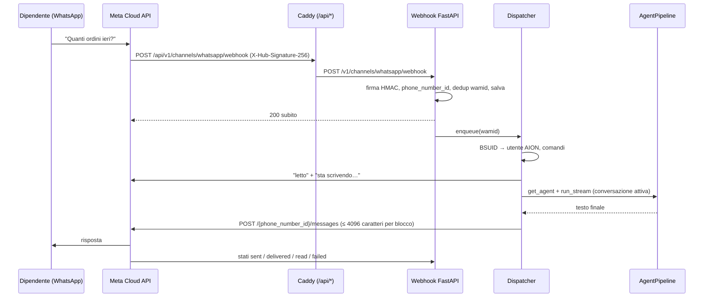

# Canale WhatsApp

Con il canale WhatsApp i dipendenti chattano con AION dal proprio WhatsApp,
scrivendo al **numero WhatsApp aziendale**. Le risposte arrivano dalla stessa
pipeline della chat-ui: stessi profili, stessa memoria (STM/LTM), stessi tool
MCP. Le conversazioni restano visibili anche nella chat-ui, con l'icona
WhatsApp.

Questa pagina copre la **Fase 1 (testo)** e la parte media della **Fase 2**
(foto e documenti in ingresso, file generati dall'agente in uscita). Il piano
completo, con le fasi successive (vocali, template, messaggi proattivi), è in
[`docs/architecture/whatsapp-channel-plan.md`](../architecture/whatsapp-channel-plan.md).

| Chi | Cosa fa | Dove | Quante volte |
|-----|---------|------|--------------|
| Admin dell'azienda | Collega il numero WhatsApp aziendale ad AION | Meta + admin-ui → **WhatsApp** | Una volta |
| Dipendente | Collega il proprio WhatsApp al proprio account AION | chat-ui → Impostazioni → **WhatsApp** | Una volta |
| Dipendente | Scrive ad AION | WhatsApp | Sempre |

AION usa solo le **API ufficiali di Meta** (WhatsApp Cloud API, Graph API
`v26.0`), senza librerie non ufficiali né WhatsApp Web.

---

## A. Collegare il numero aziendale (admin)

Il flusso è lo stesso dell'SSO: si incollano le credenziali, si **verifica**
il collegamento e solo dopo si **attiva** il canale.

### A1. Lato Meta

1. **Business portfolio.** Su
   [business.facebook.com](https://business.facebook.com) serve il Business
   portfolio dell'azienda. La verifica dell'azienda è consigliata: senza
   verifica ci sono limiti più bassi sui messaggi.
2. **App Meta.** Su
   [developers.facebook.com/apps](https://developers.facebook.com/apps) si crea
   un'app di tipo **Business** e le si aggiunge il prodotto **WhatsApp**.
3. **Numero aziendale.** In WhatsApp Manager si aggiunge il numero che i
   dipendenti useranno.
   - Deve essere un numero **non già attivo** su WhatsApp o WhatsApp Business
     app.
   - Si verifica via SMS o chiamata e si sceglie il **nome visualizzato**
     (soggetto ad approvazione Meta).
4. **ID.** Da *WhatsApp → API Setup* si copiano il **Phone Number ID** e il
   **WhatsApp Business Account ID** (WABA ID).
5. **Token permanente.** In *Impostazioni business → Utenti di sistema*:
   - si crea un **System User** di tipo admin;
   - gli si assegnano l'app e il WABA;
   - si genera un token **senza scadenza** con i permessi
     `whatsapp_business_messaging` e `whatsapp_business_management`.

   Il token temporaneo di "API Setup" dura 24 ore: va bene solo per una prova.
6. **App secret.** Da *App → Impostazioni → Di base* si copia l'**App
   secret**: serve ad AION per verificare la firma dei webhook.

### A2. Lato AION (admin-ui → Piattaforma → WhatsApp)

7. Si incollano WABA ID, Phone Number ID, token e app secret, e si sceglie il
   profilo agente predefinito (facoltativo, default `aion_std`) e il livello
   di pensiero (facoltativo, vedi sotto). Poi si salva.
   - **Livello di pensiero**: `Spento`, `Minimo`, `Medio` o `Massimo`, come il
     menu Thinking della chat-ui. "Predefinito di sistema" (nessun valore)
     segue `AION_DEFAULT_REASONING_EFFORT` / `AION_THINKING_ENABLED`. Livelli
     alti rendono la risposta più lenta e possono superare il timeout del
     turno (`AION_WHATSAPP_TURN_TIMEOUT_S`). Il ragionamento non viene mai
     inviato su WhatsApp, solo la risposta finale.
   - Come il profilo, il livello vale per tutto il canale e non richiede di
     rifare la verifica del collegamento con Meta.
   - Token e app secret sono cifrati nel DB (`AION_CREDENTIAL_ENCRYPTION_KEY`),
     come i segreti SSO, e nella pagina si vedono solo le ultime 4 cifre.
   - Per non cambiarli basta lasciare vuoti i campi.
8. AION mostra due valori da copiare:
   - **URL del webhook**: `https://DOMINIO/api/v1/channels/whatsapp/webhook`;
   - **Verify token**, generato da AION. "Rigenera" ne crea uno nuovo, che va
     poi reinserito su Meta.

### A3. Webhook su Meta

9. In *App Meta → WhatsApp → Configurazione → Webhook*:
   - si incollano URL e verify token e si preme **Verifica e salva**: Meta
     chiama subito AION, che registra "webhook verificato";
   - si sottoscrive il campo **`messages`**.
10. Si aggiunge un **metodo di pagamento** al WABA. La pubblicazione
    dell'app (modalità **Live**) è **facoltativa**: il canale funziona già
    con l'app "Non pubblicata".

### A4. Verifica e attivazione

11. In admin-ui si preme **Verifica**. AION chiama la Graph API e mostra una
    checklist:

    | Controllo | Cosa verifica |
    |-----------|---------------|
    | `token_phone` | Il token è valido e vede il numero (nome verificato, qualità) |
    | `cloud_api_registered` | Il numero è registrato su Cloud API (`platform_type = CLOUD_API`) |
    | `app_subscribed` | L'app è sottoscritta al WABA (se manca, AION la sottoscrive da solo) |
    | `webhook_verified` | Meta ha completato l'handshake del passo 9 |

12. Se è tutto ✓ si preme **Attiva canale**. Non si può attivare senza una
    verifica riuscita.

Se poi si cambiano WABA ID, Phone Number ID, token o app secret, il canale si
**disattiva** e va riverificato.

---

## B. Collegare il WhatsApp di un dipendente

WhatsApp non crea mai account. Solo chi ha già un account AION può usare il
canale, dopo averlo collegato:

1. In chat-ui → **Impostazioni → WhatsApp** preme **Collega WhatsApp**.
   - La scheda compare solo se il canale è attivo.
2. AION mostra un **QR code**, un pulsante **Apri WhatsApp** e il codice in
   chiaro.
   - Dal computer si inquadra il QR col telefono; dal telefono si tocca il
     pulsante.
   - Il link è `https://wa.me/<numero>?text=COLLEGA%20<codice>`.
3. WhatsApp si apre con il messaggio `COLLEGA 7KQ4M2XP` già scritto. Il
   dipendente preme **Invia**.
4. AION collega quel WhatsApp all'account e risponde con un benvenuto e
   l'elenco dei comandi. La pagina delle impostazioni mostra "Collegato".

Regole del codice:

- 8 caratteri, senza caratteri ambigui (`0/O`, `1/I/L`);
- monouso, scade dopo **10 minuti**;
- un nuovo codice invalida il precedente;
- dopo **5 tentativi errati in 15 minuti** dallo stesso WhatsApp, i tentativi
  sono bloccati.

Un WhatsApp è collegato a un solo utente e viceversa: ricollegare sostituisce
il collegamento precedente. Chi scrive al numero senza essere collegato riceve
**una sola risposta ogni 10 minuti**, con il link alla scheda WhatsApp delle
impostazioni.

Per scollegarsi:

- il dipendente usa chat-ui → Impostazioni → WhatsApp → **Scollega**, oppure
  scrive `/scollega`;
- l'admin usa admin-ui → WhatsApp → **Utenti collegati**.

Se l'utente AION viene cancellato, il collegamento sparisce con lui.

### Comandi su WhatsApp

| Comando | Effetto |
|---------|---------|
| `/aiuto` (`/help`) | Mostra i comandi |
| `/nuova` (`/new`) | Inizia una nuova conversazione |
| `/scollega` (`/unlink`) | Scollega questo WhatsApp dall'account |
| `COLLEGA <codice>` | Collega (o ricollega) l'account |

Tutto il resto è una domanda per l'agente. Foto e documenti sono descritti in
[File e foto](#file-e-foto).

---

## C. Come un messaggio arriva ad AION e torna indietro



1. **Webhook.** `POST /v1/channels/whatsapp/webhook`. Caddy toglie il prefisso
   `/api`.
   - Il canale si trova dal `metadata.phone_number_id` del payload.
   - Firma `X-Hub-Signature-256` non valida → **403**.
   - Numero sconosciuto, canale disattivato o kill switch → **200** senza fare
     nulla, così Meta non ritenta.
2. **Persistenza prima del 200.** Ogni messaggio va in `whatsapp_messages`.
   - Il `wamid` è unico: i retry di Meta vengono scartati.
   - Se il backend si riavvia durante un turno, all'avvio riprende i messaggi
     `received`/`processing` delle ultime 24 ore. Quelli più vecchi passano a
     `failed`.
3. **Dispatcher.** È un task asyncio in background, con un lock per mittente
   così i messaggi della stessa persona restano in ordine.
   - Identità: **BSUID** (`user_id` del webhook) → `whatsapp_identities` →
     utente AION.
   - Il numero è solo un dato in più: con gli username WhatsApp può mancare.
4. **Turno.** È lo stesso della chat-ui:
   - profilo predefinito del canale, se l'utente ha accesso; altrimenti il
     primo profilo consentito;
   - livello di pensiero configurato per il canale (admin-ui), con le stesse
     regole di mappatura sul modello della chat-ui;
   - conversazione attiva dell'utente, oppure una nuova con
     `metadata.source = "whatsapp"`;
   - il turno è registrato tra le run in background, quindi la chat-ui lo può
     seguire dal vivo;
   - foto e documenti ricevuti sono passati come allegati del turno, come gli
     upload della chat-ui (vedi [File e foto](#file-e-foto)).
   - Timeout: `AION_WHATSAPP_TURN_TIMEOUT_S`. Allo scadere AION manda il link
     alla conversazione.
5. **Risposta.** Il Markdown diventa formattazione WhatsApp:
   - `**b**` → `*b*`; i titoli diventano righe in grassetto;
   - le tabelle diventano elenchi `• a — b`;
   - i link diventano `testo (url)`.

   Il testo è diviso in blocchi da 4096 caratteri. Oltre
   `AION_WHATSAPP_MAX_CHUNKS` blocchi viene troncato con "Continua su AION:
   &lt;link&gt;". Dopo il testo arrivano i file creati dall'agente nel turno.
6. **Stati.** I webhook `sent`/`delivered`/`read`/`failed` aggiornano i
   messaggi in uscita e non tornano mai indietro di stato.

---

## File e foto

Il dipendente può inviare **foto** (JPEG/PNG) e **documenti** (PDF, Word,
Excel, PowerPoint, testo…) e riceve su WhatsApp i **file creati dall'agente**.
Vocali, video e sticker ricevono un messaggio cortese di non supporto.

### In ingresso

| Cosa invia l'utente | Cosa fa AION |
|---------------------|--------------|
| Foto o documento **con didascalia** | Turno immediato: la didascalia è la domanda, il file è allegato |
| Foto o documento **senza didascalia** | Salva il file e risponde "📎 Ricevuto!…" (una volta per raffica); i file successivi ricevono solo le spunte blu |
| Testo dopo file senza didascalia | Turno con tutti i file in attesa come allegati |
| `/nuova` | Scarta i file in attesa (restano nella vecchia conversazione) |

- Il file è scaricato dalla Graph API (`GET /{media-id}` → URL valido 5 minuti,
  `Authorization: Bearer`). Il token è inviato **solo** a host Meta
  (`*.fbsbx.com`, `*.whatsapp.net`, `*.facebook.com`). Se l'URL è scaduto
  (messaggio rimasto in coda, riavvio) viene rigenerato una volta.
- Il salvataggio è identico all'upload della chat-ui: `uploads/` della
  sessione, conversione Word legacy, auto-ingest dei PDF, copia sullo storage
  backend. Il file è quindi visibile anche nella chat-ui.
- Limite: `min(AION_UPLOAD_MAX_BYTES, 100 MB)`. Oltre, AION risponde con il link
  alla chat-ui.
- I file in attesa sono legati alla conversazione attiva
  (`whatsapp_identities.pending_attachments_json`) e scadono dopo **24 ore**.
- L'agente legge le immagini con i tool OCR/documenti, come per gli upload
  della chat-ui (nessuna vision nativa con l'harness v2).

### In uscita

- Dopo il turno AION confronta `workspace/` e `derived/` della sessione prima e
  dopo: i file nuovi o modificati sono inviati **dopo il testo**. Sono esclusi
  i file interni (`.versions/`, `derived/tool_results/`, `derived/docs/`,
  script `.py`/`.js`, `.json`, log…), con lo stesso filtro della chat-ui.
- JPEG/PNG fino a 5 MB → immagine; oltre, PDF e Office → documento con il nome
  originale; altri file di testo (CSV, Markdown, HTML…) → documento
  `text/plain`. Altri tipi non sono inviati.
- Al massimo `AION_WHATSAPP_MAX_OUTBOUND_FILES` file per risposta: quelli in
  più, non supportati o rifiutati da Meta sono segnalati con "📁 Altri N file
  sono disponibili su AION: &lt;link&gt;".
- Ogni file è caricato con `POST /{phone_number_id}/media` e inviato per `id`.
  Siamo sempre nella finestra di 24 ore, perché AION risponde subito a un
  messaggio dell'utente.

---

## Endpoint

| Metodo | Path | Auth | Uso |
|--------|------|------|-----|
| GET | `/v1/channels/whatsapp/webhook` | verify token | Handshake Meta (`hub.challenge`) |
| POST | `/v1/channels/whatsapp/webhook` | firma HMAC | Eventi Meta (max 3,5 MB) |
| GET | `/v1/me/whatsapp` | token utente | Stato canale e collegamento |
| POST | `/v1/me/whatsapp/link-code` | token utente | Codice `COLLEGA` + link `wa.me` + QR (409 `whatsapp_channel_disabled`) |
| DELETE | `/v1/me/whatsapp` | token utente | Scollega |
| GET / PUT | `/admin/whatsapp` | admin | Configurazione (segreti mascherati) / salvataggio |
| POST | `/admin/whatsapp/verify-token` | admin | Nuovo verify token |
| POST | `/admin/whatsapp/validate` | admin | Checklist con la Graph API |
| POST | `/admin/whatsapp/enable` | admin | `{enabled}`; 409 `not_configured` / `not_validated` / `force_disabled` |
| GET | `/admin/whatsapp/identities` | admin | Utenti collegati |
| DELETE | `/admin/whatsapp/identities/{id}` | admin | Scollega un utente |

Il codice è in `src/channels/whatsapp/` (config, firma, parsing, Graph client,
collegamento, formattazione, dispatcher), `src/api/v1/whatsapp.py` e
`src/api/admin_whatsapp.py`.

## Configurazione (env)

| Variabile | Default | Descrizione |
|-----------|---------|-------------|
| `AION_PUBLIC_API_URL` | — | URL **HTTPS pubblico** del backend: da qui si calcola l'URL del webhook |
| `AION_CHAT_URL` / `AION_PUBLIC_CHAT_URL` | — | Base dei link alla chat-ui inviati su WhatsApp |
| `AION_WHATSAPP_FORCE_DISABLE` | `0` | Kill switch: `1` ignora i webhook e blocca l'attivazione |
| `AION_WHATSAPP_GRAPH_VERSION` | `v26.0` | Versione Graph API |
| `AION_WHATSAPP_TURN_TIMEOUT_S` | `600` | Timeout del turno (minimo 30) |
| `AION_WHATSAPP_MAX_CHUNKS` | `3` | Messaggi massimi per risposta |
| `AION_WHATSAPP_MEDIA` | `1` | `0` = solo testo (foto/documenti rifiutati, nessun file in uscita) |
| `AION_WHATSAPP_MAX_OUTBOUND_FILES` | `5` | File generati inviati per risposta; gli altri con link |
| `AION_WHATSAPP_MAX_OUTBOUND_BYTES` | `104857600` | Dimensione massima di un file inviato (tetto Meta 100 MB) |
| `AION_UPLOAD_MAX_BYTES` | — | Limite degli upload, vale anche per i file ricevuti (max 100 MB) |

Il backend deve girare con `--workers 1`: la coda e i lock sono in memoria.
La ripresa all'avvio copre i riavvii.

---

## Risoluzione problemi

| Sintomo | Causa probabile | Cosa fare |
|---------|-----------------|-----------|
| Meta: "Impossibile convalidare l'URL di callback" | URL non raggiungibile o non HTTPS, oppure verify token diverso | Controllare `AION_PUBLIC_API_URL`, il DNS e il certificato; ricopiare il token dalla pagina admin |
| Checklist: `webhook_verified` ✗ | Handshake mai completato o token rigenerato | Ripetere "Verifica e salva" su Meta |
| Log: `invalid signature` (403) | App secret sbagliato o di un'altra app | Reincollare l'App secret dell'app che ha il webhook |
| Nessun messaggio in arrivo | Campo `messages` non sottoscritto, canale non attivo | Sottoscrivere `messages`, controllare "Ultimo webhook" nella pagina admin |
| `token_phone` ✗ con `[190]` | Token scaduto o revocato | Generare un token permanente dal System User |
| `cloud_api_registered` ✗ | Numero su On-Premises o non registrato | Registrare il numero su Cloud API in WhatsApp Manager |
| Errore `131047` sugli invii | Fuori dalla finestra di 24 ore | Normale per messaggi proattivi (Fase 2: template); in Fase 1 AION risponde solo a chi ha appena scritto |
| Errore `131052` | File in ingresso oltre il limite di Meta (100 MB) | Inviare il file dalla chat-ui |
| Errore `131053` | File in uscita con tipo o dimensione non accettati da Meta | Il file resta disponibile nella chat-ui (messaggio "Altri N file") |
| "Non sono riuscito a scaricare il file" | URL scaduto anche dopo il refresh, token senza permessi o errore Meta | Controllare `last_error` e i log `aion.whatsapp.media` |
| Errore `131026` | Destinatario non raggiungibile (WhatsApp vecchio, termini non accettati) | Chiedere al dipendente di aggiornare WhatsApp |
| Emergenza (spam, token compromesso) | — | `AION_WHATSAPP_FORCE_DISABLE=1` e riavvio; poi ruotare token e app secret |

Gli ultimi errori del canale compaiono in admin-ui (`last_error`). Lo stato di
ogni messaggio è nella tabella `whatsapp_messages`.

## Sviluppo locale

1. Su developers.facebook.com, nell'app di test, usare il **numero di test**
   gratuito di Meta e aggiungere il proprio telefono tra i destinatari
   (massimo 5).
2. Con lo stack Docker (`DOMAIN=:80` nel `.env`), avviare tunnel e stack con
   un solo comando:

   ```bash
   scripts/whatsapp-tunnel.sh
   ```

   Lo script apre un quick tunnel Cloudflare verso Caddy ed esegue
   `docker compose up -d --build`. Punta `AION_PUBLIC_API_URL`,
   `AION_PUBLIC_CHAT_URL` e `AION_CHAT_URL` del backend al tunnel con un
   override compose generato in `.aion-tunnel/`, senza modificare `.env`.
   Alla fine stampa la **Callback URL** da incollare su Meta e resta in primo
   piano: Ctrl+C chiude il tunnel.
   - Opzioni: `--no-build`, `--port N` (default `CADDY_HTTP_PORT`),
     `--down-on-exit` (ferma anche lo stack).
   - L'URL `*.trycloudflare.com` **cambia a ogni avvio**: va reinserito su
     Meta e il webhook va riverificato ("Verifica e salva").
   - Admin-ui e chat-ui restano raggiungibili anche da `http://localhost`.

   Senza Docker (backend con `uvicorn` sulla 8001):

   ```bash
   cloudflared tunnel --url http://localhost:8001
   ```

   poi in `.env` impostare `AION_PUBLIC_API_URL=https://<tunnel>.trycloudflare.com`
   e riavviare. Senza Caddy il path del webhook non ha il prefisso `/api`.
3. Procedere come nelle sezioni A e B, con l'URL mostrato dalla pagina admin.

Test automatici:

```bash
python -m pytest src/test/test_whatsapp_*.py src/test/test_admin_whatsapp.py -v
```

La Graph API è simulata con `httpx.MockTransport`; le fixture dei webhook
sono in `src/test/fixtures/whatsapp/`.

## Non ancora supportato

- messaggi vocali (trascrizione), video e sticker;
- vision nativa sulle foto con l'harness v2 (oggi: tool OCR);
- grafici della chat-ui (`charts`) come immagini;
- template e messaggi proattivi (es. notifiche dei cron);
- scelta del profilo e del livello di pensiero da WhatsApp (per utente);
- Embedded Signup;
- rate limit per utente.
