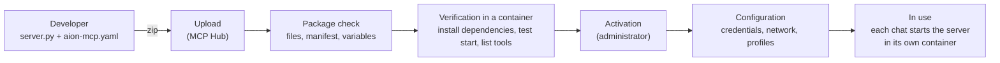

# Custom MCP servers

A **custom MCP server** is a small program written by your company's developers that gives the AION agent new tools — for example "search a customer in our CRM" or "read the stock of an item from the ERP". AION accepts these servers as an upload from the admin panel, checks that they work, runs them in an isolated container and makes their tools available to the agents you choose. This page explains the whole lifecycle for **administrators** and **IT staff**; developers writing the server should read [Develop a custom MCP server](./custom-mcp-development.md).

:::info In short
1. Your developers write a Python MCP server and zip it with a small `aion-mcp.yaml` file that describes it.
2. An administrator uploads the zip in **admin panel → MCP Hub → Upload MCP**.
3. AION installs its dependencies and test-starts it in an isolated container, then shows the tools it found.
4. The administrator activates it, enters credentials (or lets each user enter their own) and adds it to the agent profiles.
:::

## Who does what

| Role | What they do | Where |
|---|---|---|
| **Developer** | Writes `server.py`, fills in `aion-mcp.yaml`, tests locally, zips the folder. | Own PC — see [Develop a custom MCP server](./custom-mcp-development.md) |
| **Administrator** | Enables the feature, uploads and activates the package, sets credentials and allowed network addresses, assigns it to profiles, publishes new versions. | Admin panel → **Settings → MCPs**, **MCP Hub**, **Settings → Network** |
| **End user** | Uses the new tools in the chat. If the server needs personal credentials, enters them once in **Integrations**. | Chat app |

Uploading and managing custom servers is reserved to administrators: end users cannot import code into AION.

## How it works



## Import a server (administrator)

### 1. Enable the feature

Open **Settings → MCPs** and turn on **Upload enabled**. The **Upload MCP** button appears in the MCP Hub. The change applies immediately, without restarting AION.

### 2. Upload the package

In **MCP Hub → Upload MCP**, drop the file you received from the developers:

- a **`.zip`** containing `server.py` and `aion-mcp.yaml` (recommended), or
- a single **`.py`** file: in this case AION asks you to fill in the server details (name, slug, version, credentials) in a form, because there is no manifest.

The **Developer guide** button in the same window shows the developers' instructions and the templates, so you can share them with your team.

### 3. Review and verification

AION checks the package before anything is installed:

- **files and manifest**: size limits, structure, required fields;
- **variables check**: environment variables the code reads but the manifest does not declare (they would be empty at run time);
- **verification in an isolated container**: AION installs the libraries listed in `requirements.txt`, starts the server once without credentials and asks it for its tools. You see the list of tools found, or the error together with the server log.

If verification fails, give the log to the developers, let them fix the package and upload it again (or press **Run verification again** after fixing the details in the form).

### 4. Activate

When the status is **Ready for activation**, press **Activate MCP server**. AION installs it as a regular connector of the MCP Hub and opens its configuration.

### 5. Configure

| Setting | What to do |
|---|---|
| **Credentials** | Defined by the manifest. Mode **Shared (admin)**: enter the values now, they are used for the whole company. Mode **Per user**: each user enters their own values in **Integrations** in the chat app. Mode **No credentials**: nothing to do. Values are always stored encrypted. |
| **Reachable addresses** | The network is **closed by default**. List the addresses the server may contact (see [Network](#network-closed-by-default)). The list proposed by the developers in the manifest is pre-filled. |
| **Availability and profiles** | As for any connector: choose who can use it and add the server to the agent **profiles** that should have its tools. |

From the next chat message, agents with that profile can use the new tools.

## Publish a new version

The developers change the code, increase `version` in `aion-mcp.yaml` and send a new zip with the **same slug**. Upload it the same way: AION verifies it, and on activation:

- the new code replaces the old one in one step (if activation fails, the previous version stays in place);
- the previous version is archived (the last 3 by default) for rollback;
- credentials and the values changed by the administrator are kept;
- running instances are restarted, so the next chat turn uses the new code.

Uploading the same version number again asks for an explicit confirmation.

## Security model

AION does not try to judge the code it receives; it **runs it where it cannot do damage**. Every custom server, including during verification, runs in its own container ("jail"):

| Protection | What it means |
|---|---|
| **Isolated container** | Unprivileged user, no capabilities, read-only filesystem: the package files cannot be modified, only `/tmp` is writable. CPU, memory and number of processes are limited. |
| **No access to AION** | The server cannot see AION's database, files, conversations or configuration, and cannot reach AION over the network. |
| **Clean environment** | The process starts with an environment built from scratch: only the values declared in the manifest, the server's own credentials and a few context variables. AION's own secrets never reach it, even if the manifest asks for a variable with the same name. |
| **Credentials from the vault only** | Credential values come only from AION's encrypted store, entered by the administrator or by each user. |
| **Fixed start command** | The command is the one recorded at activation; editing the registry cannot make AION start something else. |
| **Network closed by default** | See below. |
| **Safe dependency install** | Libraries are installed in a separate build container. By default only *wheel* packages are accepted: installing a wheel never runs code from the package. |
| **Audit** | Uploads, activations, removals and configuration changes are written to the audit log (never with secret values). |
| **Emergency stop** | **Settings → MCPs → Emergency stop** stops all custom servers at once. |

### Network: closed by default {#network-closed-by-default}

A custom server has **no network** unless its list of reachable addresses says otherwise. Each line is one destination:

```text
crm.company.local:443              # host name and port
as400.company.local:446,8470-8476  # several ports and port ranges
10.20.0.0/24:5432                  # IP address or subnet
api.example.com                    # every port of that host
```

- Everything not listed is blocked, AION included. DNS is blocked too: names are resolved by AION when the container starts, so a name not in the list cannot be reached.
- Wildcards (`*.example.com`) are not supported; at most 50 entries per server.
- The developers propose the list in the manifest (`network:`); the administrator can change it in **MCP Hub → Configure → Reachable addresses**.

### Company certificates

If internal applications use HTTPS with certificates issued by your company's certificate authority (CA), upload the CA certificate in **Settings → Network → Company certificate authority**. It is added to the public authorities (internet sites keep working) and applied immediately to all custom servers. On the server you can instead point `AION_SANDBOX_CA_BUNDLE` to a PEM file; in that case it cannot be changed from the panel.

## Requirements and settings

Custom servers need the **container engine** (Docker or Podman) that AION already uses for its sandbox. Without it, custom servers do not start; the only exception is a development flag that must never be used in production.

Most limits can be changed from **Settings → MCPs** (applied without restart) or in `.env`:

| Variable | Default | Meaning |
|---|---|---|
| `AION_CUSTOM_MCP_ENABLED` | `0` | Upload and management from the admin panel (**Upload enabled**). |
| `AION_CUSTOM_MCP_FORCE_DISABLE` | `0` | Emergency stop: no custom server is started. |
| `AION_CUSTOM_MCP_MAX_UPLOAD_MB` | `20` | Maximum size of the uploaded file. |
| `AION_CUSTOM_MCP_MAX_FILES` | `500` | Maximum number of files in the zip. |
| `AION_CUSTOM_MCP_KEEP_VERSIONS` | `3` | Previous versions kept for rollback. |
| `AION_CUSTOM_MCP_BUILD_TIMEOUT` | `300` | Seconds allowed to install dependencies. |
| `AION_CUSTOM_MCP_PROBE_TIMEOUT` | `90` | Seconds allowed for the test start. |
| `AION_CUSTOM_MCP_ALLOW_SOURCE_BUILDS` | `0` | Also accept libraries without a wheel (compiled from source, still inside the build container). |
| `AION_CUSTOM_MCP_MEMORY` / `_CPUS` / `_PIDS` | `512m` / `1.0` / `128` | Resources of each server container. |
| `AION_SANDBOX_CA_BUNDLE` | — | PEM file with the company CA (alternative to the upload in the panel). |
| `AION_CUSTOM_MCP_ALLOW_UNSANDBOXED` | `0` | **Development only**, `.env` only: lets custom servers run without a container on machines without a container engine. |

## Where the files are

Custom servers live next to the standard ones, in a folder that survives upgrades:

```text
mcp_servers/custom/
├── <slug>/                 active version (code + aion-mcp.yaml)
├── .staging/<upload_id>/   uploads under review (removed after 24 h if not activated)
├── .versions/<slug>/<v>/   previous versions, for rollback
└── .deps/<key>/            installed libraries, shared between servers with identical requirements
```

Back them up together with the data volume. Deleting a custom server from the MCP Hub also removes its files, versions and stored configuration.

## Admin API

The admin panel uses these endpoints (admin token required, API keys are refused):

| Endpoint | Purpose |
|---|---|
| `GET /admin/mcp-custom/config` | Feature state and limits. |
| `GET /admin/mcp-custom` | Installed custom servers. |
| `GET /admin/mcp-custom/guide-template`, `/manifest-schema` | Templates and JSON Schema of `aion-mcp.yaml`. |
| `POST /admin/mcp-custom/uploads` | Upload a package (`.zip` or `.py`). |
| `GET /admin/mcp-custom/uploads/{id}` | Review and verification status, with logs. |
| `POST /admin/mcp-custom/uploads/{id}/verify` | Run the verification again. |
| `PUT /admin/mcp-custom/uploads/{id}/manifest` | Fill in or correct the server details of an upload. |
| `POST /admin/mcp-custom/uploads/{id}/activate` | Activate a verified upload. |
| `DELETE /admin/mcp-custom/uploads/{id}` | Discard an upload. |
| `PUT /admin/mcp-custom/servers/{slug}/network` | Change the reachable addresses. |
| `GET/PUT/DELETE /admin/network/ca` | Company CA certificate. |

## Related pages

- [Develop a custom MCP server](./custom-mcp-development.md) — for the developers.
- [MCP integration overview](../integrations/mcp.md) and [MCP registry](./registry.md) — how connectors work in general.
- [Credentials and isolation](./user-isolation-and-credentials.md) — shared vs per-user credentials.
- [Podman sandbox](../deployment/podman-sandbox.md) — the container engine used for isolation.
