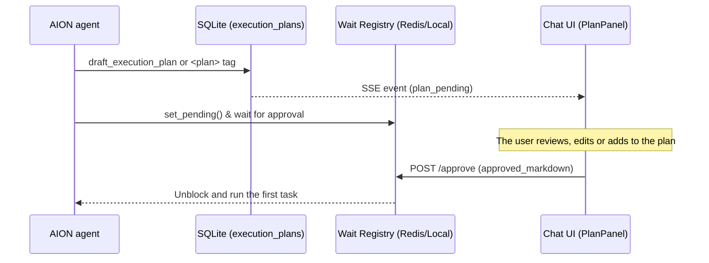

# Orchestration, task graph and HITL

For complex requests, the AION agent can first write an **execution plan** (a list of tasks with dependencies), wait for a person to approve or edit it, and then carry it out step by step while showing progress in the chat sidebar. This approval step is called **HITL (Human-in-the-Loop)**. This page describes the data model, the built-in tools, the approval flow and the internal API behind it; it is mainly for developers/operators, while end users only see the plan panel in chat-ui.

---

## 1. Data models and protocol

The execution-graph contracts and models are defined with Pydantic v2 in [protocol.py](src/a2a/protocol.py):

- **`TaskStatus`**: enum describing the life cycle of a single task:
  - `pending`: waiting for its dependencies to be resolved.
  - `ready`: dependencies done, ready to run.
  - `running`: currently running.
  - `completed`: finished successfully.
  - `failed`: execution failed.
  - `skipped`: skipped because of upstream failures or plan changes.
- **`ExecutionTask`**: a node of the graph, with:
  - `id`: auto-generated unique identifier (e.g. `task_01`).
  - `title`: short description of the atomic action to perform.
  - `description`: operational details, constraints or acceptance criteria.
  - `depends_on`: list of task IDs it depends on. The model forbids self-dependencies (`_no_self_dep`).
  - `target_profile`: name of the specialized agent the task is delegated to (optional).
  - `status`: current state (`TaskStatus`).
- **`ExecutionPlan`**: the graph container. It validates:
  - no duplicate IDs among tasks;
  - every dependency points to an existing task;
  - no cycles in the graph, using a DFS algorithm (`_graph_consistent`).

---

## 2. Single source of truth (SSOT)

The plan markdown and the checkbox progress **do not live in the workspace** as physical `execution_plan_*.md` files.

The only source of truth is the SQLite relational database (`data/aion.db`):

- **`execution_plans` table**: mapped in [models.py](src/data/models.py) as `ExecutionPlanRecord`. It stores the history, incremental revisions, the markdown (both draft and approved), user annotations and structured todos.
- **Pipeline and artifacts**: when the agent emits or changes the plan in the `<plan>` tag, the pipeline event is marked `saved: false` with `storage_key: orchestration://{plan_id}` (instead of saving a file in the workspace).
- **Display**: the sidebar (`TaskPlanManagerV4`) polls the database and shows the current state, restoring it after a page refresh. The agent reads the state only through `get_execution_plan()` and the output of `mark_task_completed()`.

---

## 3. In-process orchestration tools

These tools are **built in** for every profile and registered in-process by `merge_builtin_orchestration_tools()` in [orchestration_tools.py](src/runtime/orchestration_tools.py) (called from `get_agent` in [main.py](src/main.py)). They run in-process to keep the HITL state consistent with the `chat-ui` SSE (Server-Sent Events) channels:

1. **`draft_execution_plan(goal, tasks)`**: creates a draft execution plan in the DB, sends an `orchestration_plan_pending` SSE notification and registers it in the Wait Registry.
2. **`list_session_execution_plans(limit)`**: lists the execution plans of the current session and shows which one is active.
3. **`get_execution_plan(plan_id)`**: returns the draft or approved plan as Markdown, plus the completion state of each task, straight from the database.
4. **`update_execution_plan(plan_id, plan_markdown)`**: lets the agent or the user overwrite the whole plan markdown (e.g. to change tasks or add remediation steps after errors).
5. **`mark_task_completed(plan_id, task_id)`**: marks a task as done (ticking the `- [x]` checkbox in the markdown stored in the DB). A built-in guard allows only one successful call per turn.

---

## 4. HITL flow and Wait Registry

The approval flow guarantees human validation before code or state-changing actions run:

- **Active wait**: when the agent creates or updates a draft plan, the execution thread waits for the Wait Registry state to change from `pending` to `approved` or `rejected`.
- **Wait Registry**: implemented in [plan_wait_registry.py](src/runtime/plan_wait_registry.py). It uses Redis, or a local in-memory queue (`LocalFallback`) when `AION_REDIS_FALLBACK_LOCAL=1` is set.
- **Timeout**: controlled by `AION_ORCH_PLAN_WAIT_TIMEOUT_SEC` (default 600 seconds). When it expires, the plan is marked `timeout` and execution stops.

---

## 5. Internal orchestration API

The router `src/api/orchestration.py` exposes these endpoints under the `/internal/orchestration` prefix:

| Method and path | Purpose |
|-----------------|---------|
| `GET /sessions/{session_id}/plans` | List all plans of the conversation |
| `GET /plans/{plan_id}?session_id={session_id}` | Return the status, revision and markdown of the plan |
| `POST /plans/{plan_id}/approve` | Approve the plan. Accepts edited markdown (`approved_markdown`), annotations and structured todos. Wakes the agent with an SSE event and picks the first pending task |
| `POST /plans/{plan_id}/reject` | Reject the plan with the reason given by the user |
| `POST /plans/{plan_id}/tasks/{task_id}/complete` | Manually tick one checkbox from the UI |
| `POST /plans/{plan_id}/tasks/complete-all` | Mark all open tasks as completed |

### API security and authentication

Access to the internal API is controlled at two levels in `orchestration_auth`:

1. **JWT Bearer token (`Authorization`)**: used by `chat-ui` for user requests. The backend checks that the session belongs to the logged-in user by comparing `user_id` with the `conversations` table.
2. **Internal secret (`X-AION-Orch-Secret`)**: used for server-to-server calls or background jobs. Enabled with `AION_ORCHESTRATION_SECRET_AUTH=1`; the header is compared with the secret in `AION_ORCHESTRATION_INTERNAL_SECRET`.

---

## 6. Sub-agents and delegation (under active development)

:::warning
The sub-agent module (`aion_subagents` and delegation functions such as `delegate_task` / `delegate_to_subagent`) **does not currently work and is under active development**. Do not configure or use it in production.
:::

### Planned sub-agent architecture

The original design uses cascading isolation:

- **Entry point**: `delegate_to_subagent_async` in [delegate_subagent.py](src/runtime/delegate_subagent.py), which calls `run_subagent_task` in [subagent_orchestrator.py](src/runtime/subagent_orchestrator.py).
- **Child sessions**: each delegation creates a temporary isolated session named `sub_{profile_slug}_{uuid}`.
- **File copy**: files uploaded by the user in the parent session (under `uploads/`) are copied automatically into the child session folder before the sub-agent starts (`sync_parent_uploads_to_child` in [session_workspace.py](src/session_workspace.py)).
- **Resource limits**: file sync between parent and child sessions is capped by configurable limits to avoid filling the disk (`AION_SUBAGENT_UPLOAD_SYNC_MAX_TOTAL_MB` and `AION_SUBAGENT_UPLOAD_SYNC_MAX_FILE_MB`).
- **Integration**: the sub-agent's text result is condensed/truncated according to `AION_ORCH_DISTILL_MAX_CHARS` and returned to the calling agent.

---

## 7. Relevant environment variables

These variables configure orchestration and HITL behavior:

| Variable | Default | Description |
| :--- | :--- | :--- |
| `AION_ORCHESTRATION_INTERNAL_SECRET` | `aion-orchestration-dev` | Secret that authenticates server-to-server requests via the `X-AION-Orch-Secret` header. |
| `AION_ORCHESTRATION_SECRET_AUTH` | `1` | Enables (`1`) or disables (`0`) secret authentication for the internal API. |
| `AION_ORCH_PLAN_WAIT_TIMEOUT_SEC` | `600` | Maximum wait for human approval (HITL). |
| `AION_ORCH_TOOL_TIMEOUT_SEC` | `900` | Maximum time for background execution of an orchestration tool. |
| `AION_PLAN_MODE_TOOL_FIRST` | `1` | Forces the agent to use the `draft_execution_plan` tool instead of `<plan>` XML tags. |
| `AION_PLAN_TEXT_PARSER` | `0` | When `1`, enables the fallback parser for text plans in `<plan>...</plan>` format. |
| `AION_PLAN_MODE_MAX_RESEARCH_TOOLS` | `2` | Maximum number of research/read tools the agent may call before registering a plan in Plan Mode. |
| `AION_PLAN_MODE_BLOCKED_TOOLS` | *(see .env.example)* | CSV of state-changing tools disabled during the planning phase (Plan Mode). |
| `AION_REDIS_FALLBACK_LOCAL` | `0` | When `1`, uses a local in-memory queue instead of Redis for the Wait Registry (single-worker development only). |
| `AION_SUBAGENT_UPLOAD_SYNC_MAX_TOTAL_MB` | `50` | Maximum total size of files copied to a sub-agent session. |
| `AION_SUBAGENT_UPLOAD_SYNC_MAX_FILE_MB` | `25` | Maximum size of a single file copied to a sub-agent session. |
| `AION_ORCH_DISTILL_MAX_CHARS` | — | Maximum number of characters used to condense a sub-agent's output. |

---

## Related documents

- [MCP registry](registry.md) — how MCP servers are loaded and configured.
- [Tool-first plan mode](../api-and-runtime/agent-pipeline.md#tool-first-plan-mode) — how the agent creates plans.
- [Plan execution — run model and activity feed](../architecture/plan-execution-run-model.md) — background monitoring of plans and the streaming channels.
