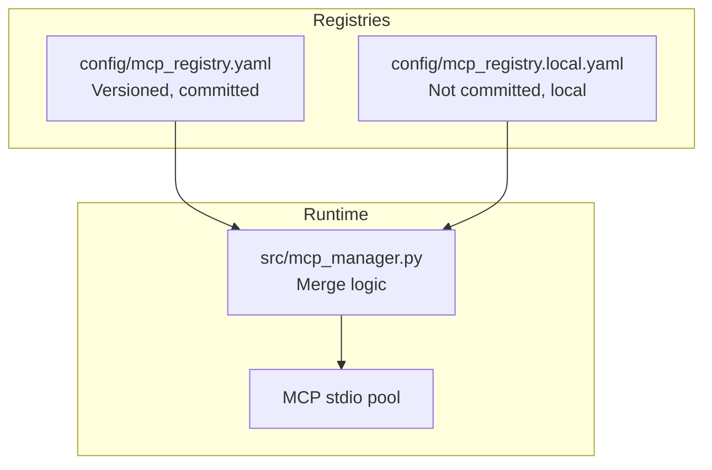
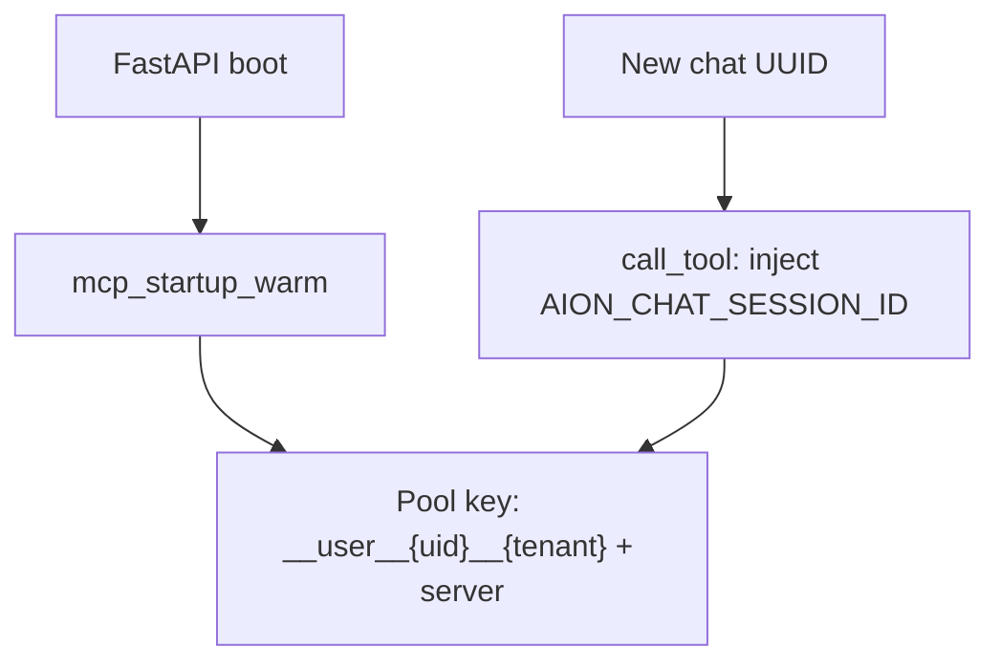

# MCP registry

AION connects tools and connectors to the agent through **MCP (Model Context Protocol)**, an open standard for plugging external tools into large language models (LLMs). The **MCP registry** is the list of MCP servers AION knows about: what command starts each one, which environment variables it gets, and whether it runs locally or remotely. This page explains how the registry is built and merged, how AION keeps MCP processes warm, and how they are isolated. It is meant for administrators and developers/operators who install, configure or troubleshoot MCP servers.

## Why MCP?

MCP is a standard way to integrate external tools with LLMs.

### Benefits

| Reason | Explanation |
|--------|-------------|
| **Standardization** | MCP defines a standard contract for tool discovery, instead of a custom wrapper for every tool |
| **Separation of concerns** | MCP servers are external processes, isolated from the Python runtime |
| **Scalability** | New tools are added without changing the main runtime |
| **Security** | Execution happens in an isolated sandbox and cannot affect the main runtime |
| **Interoperability** | Compatible with Claude Desktop, Cursor and other clients |

### Why not plain Python functions?

Calling Python functions directly would cause:

1. **Coupling:** tools become part of the runtime and cannot be separated.
2. **Security issues:** code runs directly, with no sandboxing.
3. **Poor scalability:** every new tool requires a change to the runtime.

**The MCP approach:** external processes talk to AION over stdio/SSE (Server-Sent Events) and stay isolated from the main runtime.

---

## Registry files and merge

### Base + local overlay



### Why more than one registry file?

| File | Contents | Versioned | Purpose |
|------|----------|-----------|---------|
| `mcp_registry.yaml` | Standard servers (prometheus, grafana, etc.) | Template in `config_std/` | Copied to `config/` on first sync; **not** overwritten by `sync_config.py --force`. New slugs from the template are added by `scripts/merge_mcp_registry_from_std.py` (setup, upgrade, Docker entrypoint, `dev-api.sh`) |
| `mcp_registry.local.yaml` | Flat overlay (AION style) | No | Deployment-specific (e.g. `toolbox-mysql`) |
| `mcp_registry.local.json` | Standard overlay `{ "mcpServers": { ... } }` | No | Same merge as `.local.yaml`; Claude/Cursor/VS Code format |

**Rationale:**

1. **Committed base config:** changes to standard servers can be versioned and shared.
2. **Uncommitted local overlay:** deployment-specific settings must not be committed.
3. **Merging allows upgrades:** the base can be updated without losing local settings.

### How the merge works

1. **Full override:** a key in the local file completely replaces the same key in the base.
2. **Removal via `_removed`:** a list of server names to drop from the base.
3. **Only the local file is saved:** `save_registry()` persists the local overlay, never the base.

```yaml
# config/mcp_registry.yaml (base)
prometheus:
  command: python
  args:
    - mcp_servers/prometheus/server.py
  env: {}

# config/mcp_registry.local.yaml (overlay)
mcp_servers:
  prometheus:  # Fully replaces the base entry
    command: python3
    args:
      - /custom/path/prometheus/server.py
    env:
      DEBUG: "1"

_removed:
  - legacy_rag  # Removes this server from the base
```

---

## The stdio worker pool

### The problem: connection overhead

Every new stdio MCP process needs to start, perform the `initialize()` handshake and run `list_tools`. That typically costs **1–6 seconds per server** if repeated for every chat.

### Three-level solution (default since v0.26+)

| Level | Variable | Behavior |
|-------|----------|----------|
| **1. Pool** | `AION_MCP_POOL=1` | Keep the stdio process alive after each tool call |
| **2. User pool** | `AION_MCP_USER_POOL=1` | One worker per `(user_id, tenant, server)`, **shared by all of that user's chats** |
| **3. Startup warm-up** | `AION_MCP_STARTUP_WARM=1` | At API boot (`lifespan`), run the handshake for the servers of the configured profiles |



**Session-scoped servers** (listed in `AION_MCP_SESSION_SCOPED_SERVERS`; the built-in list includes `session_sandbox`, `skills_hub`, `query_memory`, …): the pool key is `(chat_session_id, server)` even with `AION_MCP_USER_POOL=1`, so each conversation gets its own sandbox.

**Legacy env injection** (`AION_MCP_SESSION_ENV_INJECT`, code default `0`): when `1`, the parent process changes `os.environ` before every `call_tool`. Prefer session-scoped pools plus tool arguments.

**Pre-chat from the UI:** `POST /v1/chat/prepare` and polling `GET /v1/chat/prepare/status` reuse the same pool (no respawn if the boot warm-up has already finished).

### One active profile per session

At any moment a chat has **exactly one active profile**; tools, MCP servers and skills are never mixed between profiles.

- **Prepare only with the final profile:** chat-ui calls `/v1/chat/prepare` only once the conversation's profile is resolved (profile list loaded and conversation details read), never with a temporary default.
- **Switching profile in the same chat** (`get_agent` with a different profile):
  - the agent cache drops the session's agents built for other profiles, together with their deferred tools (`tool_search` only searches the `(session, profile)` pool);
  - `warm_session` releases **all** session-scoped workers of the chat, including servers present in both profiles. They read the profile from `AION_CURRENT_PROFILE_SLUG` at spawn time (the `skills_hub` allowlist, the `query_memory` scope, the sandbox container) and are restarted with the new profile. Workers of other chats and per-user pools are not touched;
  - an agent reused from the cache realigns the session's MCP context to its own profile (used by the skill gate).
- **Plan execution** without an explicit profile uses the chat's active profile, not `aion_std`.

### Pool key structure

- **Legacy** (`AION_MCP_USER_POOL=0`): `(chat_session_id, server_name)`, one process per chat.
- **Default** (`AION_MCP_USER_POOL=1`): `(__user__{user}__{tenant}, server_name)`, processes stay warm across chats (except servers in `AION_MCP_SESSION_SCOPED_SERVERS`).
- **Bootstrap:** the synthetic session `__bootstrap__` is used only during the boot warm-up, for credentials/HOME.

**Idle cleanup:** `AION_MCP_POOL_IDLE_SEC` (default `1800`) is the number of idle seconds before a pooled worker is shut down; `0` means never. Per-user pool workers are only cleaned up when `AION_MCP_USER_POOL_IDLE_CLEANUP=1`, so by default they stay warm.

---

## Variables injected by the runtime

### Why inject variables?

MCP servers may need context about the current session:

| Variable | Purpose | Example |
|----------|---------|---------|
| `AION_CHAT_SESSION_ID` | Session identifier | `session_abc123` |
| `AION_CURRENT_PROFILE_SLUG` | Current profile | `prometheus_specialist` |
| `AION_CURRENT_USER_ID` | Current user | `user_456` |

**Why:**

1. **Isolation:** each session has its own context.
2. **Security:** servers cannot reach other sessions.
3. **Personalization:** tools can behave differently per user/profile.

### How they are injected

**At spawn** (once per user-pool worker): MCP credentials, an isolated `HOME`, the bootstrap profile.

**On every `call_tool`** (if `AION_MCP_SESSION_ENV_INJECT=1`): `AION_CHAT_SESSION_ID`, `AION_CURRENT_PROFILE_SLUG`, `AION_CURRENT_USER_ID`, `AION_CURRENT_TENANT_ID`. This lets `session_sandbox` and similar servers see the current chat without a dedicated process per UUID.

```python
# src/mcp_manager.py — spawn + inject per call
env = resolve_env_placeholders(server_env)
# call_tool: os.environ["AION_CHAT_SESSION_ID"] = conversation_id (restored after the call)
```

See also [MCP user isolation and credentials](user-isolation-and-credentials.md) for `${AION_USER_*}` placeholders.

**Steps:**

1. Load env from the YAML config
2. Inject runtime variables
3. Resolve `${VAR}` placeholders from the environment
4. Pass the result to the subprocess

---

## Security model

### Why isolate MCP processes?

**Risk:** an MCP tool could:

1. Read sensitive files
2. Run arbitrary commands
3. Access data from other sessions

**Mitigations:**

1. **Container jail (production):** the `session_sandbox` MCP worker runs in a Podman container with only `data/sessions/<id>/` mounted at `/session` (see [Session isolation](../security/session-isolation.md)).
2. **Env scrubbing:** subprocess tools use a minimal environment (`src/security/session_env.py`); secrets are stripped from child processes.
3. **Session isolation:** one MCP worker (and container) per chat session when `AION_MCP_SESSION_SCOPED_SERVERS` includes `session_sandbox`.
4. **Network:** containers default to `--network=none`; pip/npm enable `slirp4netns` only when the install flags are on.
5. **No shared state:** MCP workers do not share any filesystem outside their session mount.

### Per-session sandbox

```python
# src/session_workspace.py
# Host: data/sessions/{session_id}/
# Container: mounted flat at /session (AION_SANDBOX_FLAT_SESSION_ROOT=1)
```

**MCP tool execution:** tools access only the current session workspace. In container mode the host `.env`, the database and other sessions are not mounted.

### Container mode

Enable with:

```bash
AION_SANDBOX_BACKEND=container
AION_CONTAINER_RUNTIME=podman
AION_SANDBOX_CONTAINER_IMAGE=aion/sandbox:latest
AION_SANDBOX_MCP_JAIL=1
AION_SANDBOX_FAIL_CLOSED=1
```

Build the image: `docker compose --profile sandbox-build build sandbox`

Deployment details: [Podman sandbox deploy](../deployment/podman-sandbox.md)

### Approval system

**Implementation:** `src/security/approval_manager.py` (stub: critical tools return the `ask` action).

**Critical tools include:** `sandbox_run_python_file`, `sandbox_execute_python`.

**Status:** human-in-the-loop (HITL) wiring is partial; full approval in the UI is future work.

---

## Importing configurations from other clients

### Why import?

Users may already have MCP configurations from:

1. **Claude Desktop** (JSON)
2. **Cursor** (JSON)
3. **Other MCP clients** (format variations)

Converting them to YAML by hand is tedious, so `python -m src.mcp_import` does it automatically.

### Import command

```bash
# Convert Claude Desktop config to local MCP registry
python -m src.mcp_import --input /path/to/claude_desktop_config.json
```

**Options:**

| Flag | Purpose |
|------|---------|
| `--output` | Output file path (default: `config/mcp_registry.local.yaml`) |
| `--format` | `yaml` (flat) or `json` (`mcpServers`, recommended for remote/npx servers) |
| `--dry-run` | Preview the conversion without writing |
| `--replace` | Replace the local registry instead of merging |

**Accepted input formats:**

- `mcpServers` (Claude Desktop, Claude Code, Cursor)
- `servers` (VS Code Copilot `mcp.json`)
- `mcp.servers` (nested variants)

**Runtime:** AION loads `config/mcp_registry.yaml` plus the optional `config/mcp_registry.json`, then merges `mcp_registry.local.yaml` and/or `mcp_registry.local.json` on top (`src/mcp_registry_io.py`).

**Sync:** `python scripts/sync_config.py --force` does **not** overwrite the `mcp_registry*.yaml/json` files in `config/` (the local overlay is preserved). Template: `config_std/mcp_registry.local.json.example`.

### Conversion example

**Input (Claude Desktop JSON):**

```json
{
  "mcpServers": {
    "prometheus": {
      "command": "python",
      "args": ["mcp_servers/prometheus/server.py"],
      "env": {}
    }
  }
}
```

**Output (local JSON, the common market standard):**

```bash
python -m src.mcp_import -i claude_desktop_config.json -o config/mcp_registry.local.json
```

```json
{
  "mcpServers": {
    "prometheus": {
      "command": "python",
      "args": ["mcp_servers/prometheus/server.py"],
      "env": {}
    }
  }
}
```

**Output (flat local YAML, optional):** same content without the `mcpServers` wrapper.

---

## Servers shipped with the repository

### stdio servers (run locally)

| Server | Directory | Purpose |
|--------|-----------|---------|
| `prometheus` | `mcp_servers/prometheus/` | Query Prometheus metrics |
| `grafana` | `mcp_servers/grafana/` | Access Grafana dashboards |
| `charts` | `mcp_servers/charts/` | Interactive chart generator (Line, Area, Bar) |
| `memory` | `mcp_servers/query_memory/` | Session search (FTS) |
| `mempalace` | — (Python package) | Hierarchical long-term memory (facts & context) |
| `skills_hub` | `mcp_servers/skills_hub/` | Skill search, list, view |
| `code` | `mcp_servers/code_executor/` | Execute code in a sandbox |
| `session_sandbox` | `mcp_servers/session_sandbox/` | Session workspace operations |
| `ocr` | `mcp_servers/ocr_mcp/` | OCR + document ingest (`doc_ingest`, `ocr_file`, **`pdf_evidence_crop`**) |
| `stt` | `mcp_servers/stt_mcp/` | Speech-to-text of session audio (`transcribe_audio`), remote Whisper or local faster-whisper — see [Speech-to-text](speech-to-text.md) |
| `geocoding` | `mcp_servers/geocoding/` | Forward/reverse geocoding via OpenStreetMap Nominatim (`geocode_place`, `reverse_geocode`) |
| `promo_render` | `mcp_servers/promo_render/` | Promotional graphics React/HTML → PNG |
| `agent_db` | `mcp_servers/agent_db/` | Agent SQLite database for structured memory |
| `aion_subagents` | `mcp_servers/aion_subagents/` | Delegate tasks to isolated subagents |

**`session_sandbox`:** `sandbox_list_files`, `sandbox_read_text_file`, **`sandbox_write_workspace_file`** (only `workspace/`), **`sandbox_edit_workspace_file`** (surgical replace), **`sandbox_apply_patch`** (OpenCode-style multi-file hunks), **`sandbox_install_npm_packages`** / **`sandbox_install_python_packages`** (session venv; gated by `AION_SANDBOX_ALLOW_*`; `AION_SANDBOX_NPM_MAX_PACKAGES` caps npm installs), `sandbox_run_python_file` (`workspace/*.py`), **`sandbox_run_node_file`** (`workspace/*.js` for docx-js; requires Node / `AION_NODE_PATH`). `sandbox_execute_python` is **permanently disabled**: write a file and run it instead. Subprocess **cwd = session root**; Python comes from the session `.venv` when `AION_SANDBOX_AUTO_VENV=1`. Isolation: **`AION_SANDBOX_BACKEND=subprocess`** (Landlock confinement when `AION_SANDBOX_SUBPROCESS_CONFINE=1`) in development, **`container`** (one Podman container per session, see [Session isolation](../security/session-isolation.md)) in production. File delivery is tool-first (no `<aion_artifact>` in the chat stream); see [Agent pipeline](../api-and-runtime/agent-pipeline.md#tool-first-file-delivery-opencode-style).

### SSE servers (remote)

| Server | Type | Purpose |
|--------|------|---------|
| `khub_rag` | `sse` | Advanced semantic search in company documents (RAG) |
| `mem0` | `sse` | External memory service bridge |
| `mempalace` (remote) | `sse` | Long-term memory (alternative external service endpoint) |

:::note
SSE servers need no local process, only a configured URL.
:::

---

## Troubleshooting

### "The MCP server is not detected"

**Possible causes:**

1. The server is not in the registry
2. The server was removed via `_removed`
3. Wrong path to the server

**Check:**

```python
# Debug: list registered servers
from src.mcp_manager import mcp_manager
print(mcp_manager.list_servers())
```

### "The MCP server does not start"

**Possible causes:**

1. Wrong path to the process
2. Missing execute permissions
3. Missing dependencies

**Check:**

```bash
# Test manual launch
python mcp_servers/prometheus/server.py
```

### "Tool discovery fails"

**Possible causes:**

1. The MCP process does not answer the handshake
2. Timeout too short
3. The process crashed

**Check:**

```python
# Test connection
from src.mcp_manager import mcp_manager
tools = await mcp_manager.list_tools("prometheus")
```

---

## Full configuration example

```yaml
# config/mcp_registry.yaml (base)

prometheus:
  command: python
  args:
    - mcp_servers/prometheus/server.py
  env: {}

grafana:
  command: python
  args:
    - mcp_servers/grafana/server.py
  env: {}

mempalace:
  type: sse
  url: http://mempalace:8080/sse
  env:
    API_KEY: "${MEMPALACE_API_KEY}"

_removed:
  - deprecated_server
```

```yaml
# config/mcp_registry.local.yaml (overlay)

prometheus:
  command: python3
  args:
    - /custom/path/prometheus/server.py
  env:
    DEBUG: "1"

custom_server:
  command: python
  args:
    - mcp_servers/custom_server/server.py
  env: {}
```

---

## MCP environment variables

| Variable | Default | Purpose |
|----------|---------|---------|
| `AION_MCP_POOL` | `1` | Persistent stdio pool (required for warm-up) |
| `AION_MCP_USER_POOL` | `1` | Workers shared per user/tenant across chats |
| `AION_MCP_SESSION_ENV_INJECT` | `0` (code) / `1` (`.env.example`) | Inject session/profile on every `call_tool` |
| `AION_MCP_SESSION_SCOPED_SERVERS` | `session_sandbox,promo_render,ocr_mcp,stt,skills_hub,aion_subagents` (`.env.example`) | Servers pooled per chat session (isolated sandboxes even with `AION_MCP_USER_POOL=1`). Values are added to a built-in list (`session_sandbox`, `promo_render`, `ocr`, `ocr_mcp`, `stt`, `skills_hub`, `query_memory`, `aion_subagents`, `smb_files`) that is always session-scoped |
| `AION_MCP_STARTUP_WARM` | `1` | Warm MCP servers at API boot |
| `AION_MCP_STARTUP_WARM_ASYNC` | `0` | `1` = warm up in the background (healthcheck passes before warm-up ends) |
| `AION_MCP_STARTUP_WARM_PROFILES` | `aion_std,generic_assistant` | CSV of profiles, or `*` = all |
| `AION_MCP_STARTUP_WARM_ALL` | `0` | `1` = every stdio server in the registry |
| `AION_MCP_STARTUP_WARM_USER_ID` | `default` | User whose credentials are used at boot |
| `AION_MCP_STARTUP_WARM_USER_IDS` | — | CSV of users whose MCP pool is pre-warmed |
| `AION_MCP_POOL_IDLE_SEC` | `1800` | Seconds before idle workers are killed (`0` = never) |
| `AION_MCP_USER_POOL_IDLE_CLEANUP` | `0` | `1` = also apply idle cleanup to user-pool workers (default `0` = always warm) |
| `AION_MCP_WARM_TIMEOUT_SEC` | `20` | Warm-up timeout per server in `warm_session` |
| `AION_MCP_WARM_FAIL_COOLDOWN_SEC` | `600` | Cooldown before retrying a warm-up that failed |
| `AION_MCP_WARM_RETRY_TIMEOUT_SEC` | `3` | Timeout for retries after the first failure |
| `AION_MCP_LIST_TOOLS_TIMEOUT_SEC` | `30` | Tool discovery timeout in `get_agent` |
| `AION_MCP_REGISTRY_PATH` | `config/mcp_registry.yaml` | Base registry path |
| `AION_MCP_REGISTRY_LOCAL_PATH` | Auto | Local overlay path |
| `AION_MCP_TOOL_RESULT_TIMEOUT` | `120` | Tool execution timeout |
| `AION_MCP_INIT_TIMEOUT` | `60` | stdio `initialize()` handshake timeout |
| `AION_MCP_WORKER_SHUTDOWN_TIMEOUT` | `15` | Worker shutdown timeout |
| `AION_MCP_USER_HOME_ISOLATION` | `1` | Isolate HOME/XDG per MCP process (recommended for multi-user) |
| `AION_MCP_USER_CREDENTIALS` | `0` | Enable the per-user credential store (`${AION_USER_*}`) and the `/v1/integrations` API |
| `AION_MCP_ADVISE_TIMEOUT` | `120` | Timeout of the AI advice in the MCP Hub wizard |
| `AION_MCP_ADVISE_MAX_TOKENS` | `16480` | Max output tokens of the AI advice in the MCP Hub wizard |
| `AION_MCP_ADVISE_DISABLE_REASONING` | `1` | `1` = disable LLM reasoning when generating the advice |

---

## Related documents

- [Source tree](../architecture/source-tree.md) — directory structure
- [Environment variables](../configuration/environment.md) — configuration
- [Office and legacy Word](../configuration/office-and-legacy-word.md) — `.doc` conversion and MCP registry merge
- [Agent profiles](../configuration/profiles.md) — how profiles use MCP servers
- [Orchestration and HITL](./orchestration.md) — built-in `mark_task_completed` on every profile; `orchestration` server (`type: in_process`), approve API, TaskPlanManager UI
