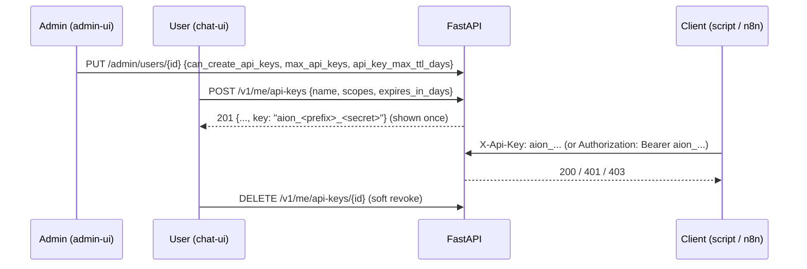

# API keys

An API key lets a script, an automation (n8n, SDK, cron outside AION) or another service call AION **on behalf of one user**. Each key belongs to exactly one user and acts **as that user**: same conversations, same allowed profiles, never more. On top of that the key is limited by its own **scopes**: it can reach only the endpoints that explicitly accept one of them (deny by default).

Keys are created by each user from **chat-ui → Settings → API keys**. The administrator never creates keys; from **admin-ui → Users** they decide, per user, whether the feature is enabled, how many active keys are allowed and the maximum lifetime.

## Lifecycle



| Event | Effect |
|---|---|
| User creates a key | Row in `api_keys` with `user_id`, SHA-256 `hash`, `scopes`, mandatory `expires_at`. The full key is returned **only once**. |
| User revokes a key | `revoked_at` is set; the row stays visible as history. |
| Key reaches `expires_at` | Rejected with `401 api_key_expired`; no longer counts toward the quota. |
| Admin disables the feature for a user | All the user's active keys are revoked immediately. |
| Admin lowers `max_api_keys` / `api_key_max_ttl_days` | Existing keys are kept; only new creations are limited. |
| Admin deletes the user | All the user's keys are deleted. |

## Format and storage

- Format: `aion_<prefix8>_<secret32>` (~165 bits of randomness).
- Stored as `sha256(full_key)` in `api_keys.hash` (unique index `ux_api_keys_hash`): lookup is a single indexed query, no bcrypt, no event-loop blocking. `prefix` is only for display (`aion_ab12cd34_…`).
- The key can be sent as `X-Api-Key: aion_…` or `Authorization: Bearer aion_…`. For SSE endpoints that accept `?access_token=`, a value starting with `aion_` is treated as an API key too.

## Validation

Every request carrying a key goes through `authenticate_api_key()` (`src/api/auth/api_key.py`), **also when `AION_CHAT_PASSWORD_AUTH=0`** (open mode): a presented key is always validated and always resolves to its owner.

| Check | Failure |
|---|---|
| Format `aion_<8>_<32>` | `401 api_key_invalid_format` |
| Hash exists | `401 api_key_invalid` |
| `revoked_at` is null | `401 api_key_revoked` |
| `expires_at` set and in the future | `401 api_key_expired` |
| Owner exists and `can_create_api_keys` is true | `401 api_key_owner_disabled` |
| Endpoint accepts API keys | `403 api_key_not_allowed` |
| Key has one of the endpoint's scopes | `403 missing_scope` |
| Profile allowed for the owner | `403 profile_not_allowed` |

Unknown or legacy scopes stored on a key are ignored. `last_used_at` is updated at most once per minute.

## Scopes

| Scope | Endpoints |
|---|---|
| `chat` | `POST /chat`, `/chat/stop`, `/sessions/{id}/charts`, `GET /profiles`; `/v1/chat`, `/v1/chat/stream`, `/v1/chat/stream/reconnect/*`, `/v1/chat/prepare` (+ status), `/v1/chat/stop`; `/v1/models*`, `/v1/chat/completions`; `/v1/llm-providers`; `POST /a2a/invoke` |
| `conversations:read` | `GET /chat-ui/conversations*`, `/sessions/{id}/tool-ledger`, `/sessions/{id}/events/stream`; `GET /v1/conversations*`, steps |
| `conversations:write` | `POST/PATCH/DELETE /chat-ui/conversations*`; `POST/PATCH/DELETE /v1/conversations*`, `POST` steps |
| `files:read` | `/sessions/{id}/files`, `/sessions/{id}/download`; `GET /v1/conversations/{id}/files` |
| `files:write` | `/sessions/{id}/upload`; file uploads under `/v1/conversations/{id}/files` |

Every other endpoint **rejects** API keys with `403 api_key_not_allowed`, including user memory, MCP integrations and credentials, cron jobs, runtime settings, `/v1/me/api-keys` (a key cannot create keys) and the whole `/admin/*` router. There is no `admin` scope.

## Identity and profiles

A key resolves to `ChatAuthIdentity(via="api_key", user_row_id=<owner id>, identifier=<owner identifier>, roles=[])`. `effective_user_id` returns the owner's identifier, so conversations created through a key appear in the owner's chat-ui sidebar. The key never carries the `admin` role, even if the owner is an admin.

If the owner is restricted to some profiles (`user_profile_access`), the same restriction applies to the key. A request for the default profile `aion_std` falls back to the first allowed profile; any other disallowed profile gets `403 profile_not_allowed`.

## User API (`/v1/me/api-keys`)

Requires a chat token (`Authorization: Bearer <chat token>`); API keys get `403`.

| Endpoint | Purpose |
|---|---|
| `GET /v1/me/api-keys` | `{policy: {enabled, max_keys, active_count, max_ttl_days, allowed_scopes}, keys: [...]}`; `status` is `active`, `expired` or `revoked` |
| `POST /v1/me/api-keys` `{name, scopes, expires_in_days}` | `201` with the key object plus `key`. Errors: `403 api_keys_disabled`, `409 api_key_quota_exceeded`, `422 invalid_scopes`, `422 invalid_expiration` |
| `DELETE /v1/me/api-keys/{id}` | Soft revoke; `404` if the key is not the caller's |

## Admin policy

`GET /admin/users` returns, per user, `can_create_api_keys`, `max_api_keys`, `api_key_max_ttl_days` and `api_keys_active`. `POST /admin/users` and `PUT /admin/users/{id}` accept:

| Field | Default | Range |
|---|---|---|
| `can_create_api_keys` | `false` | |
| `max_api_keys` | `5` | 1–100 |
| `api_key_max_ttl_days` | `90` | 1–3650 |

## Verification

`scripts/security/check_api_key_scopes.py` (stdlib only) runs against a live backend with keys you create by hand.

1. Enable API keys for a user in admin-ui (quota of at least 6).
2. As that user, in chat-ui, create six keys: one per scope and one with every scope.
3. Paste them into `API_KEYS` at the top of the script. Optionally, paste an already revoked key into `REVOKED_KEY`.

The script first checks that each key has exactly the scopes of its variable and that all keys belong to the same user (exit `2` otherwise). It then checks:

- the three key transports;
- owner identity: header/body `user_id` is ignored;
- every operation of the app against the scope map above;
- bad-format, unknown and revoked keys.

```bash
python scripts/security/check_api_key_scopes.py --base-url http://localhost:8001
```

Add `--detail` to print, for each of the 44 scoped operations, the URL called and one line per key: key label and prefix, expected result and actual response.

In the matrix, operations with a scope are probed with all six keys. Every other operation is probed with the all-scopes key only: scopes only add permissions, so if that key is rejected, every key is. It is sent both as `X-Api-Key` and as `Authorization: Bearer`, because some handlers read only `Authorization`.

Exit code `1` means a `LEAK` (a key accepted where it should not be), a `BROKEN` (a key with the right scope rejected) or a failed check. Use a development instance: matrix requests use random ids and an invalid body, so accepted endpoints answer 404/422, but an endpoint that wrongly accepts a key still runs.

`src/test/test_api_key_scope_matrix.py` runs the same matrix in-process over `app.routes`. It fails when an endpoint is added or changed without updating `EXPECTED_SCOPE` in the script, and that map must stay aligned with the table in [Scopes](#scopes).

## Upgrade notes

- Migration `y7z8a9b027` (and the SQLite schema patch at startup) adds the columns above and **revokes every pre-existing key**: legacy keys have no owner. Users must create new keys from chat-ui after the admin enables them.
- `AION_API_KEY_BOOTSTRAP` is gone; remove it from `.env`. It is still stripped from sandbox environments.
- `GET/POST/DELETE /admin/api-keys` and the admin-ui "API keys" page are removed.
- Scopes `admin` and `chat:scoped` no longer exist.
