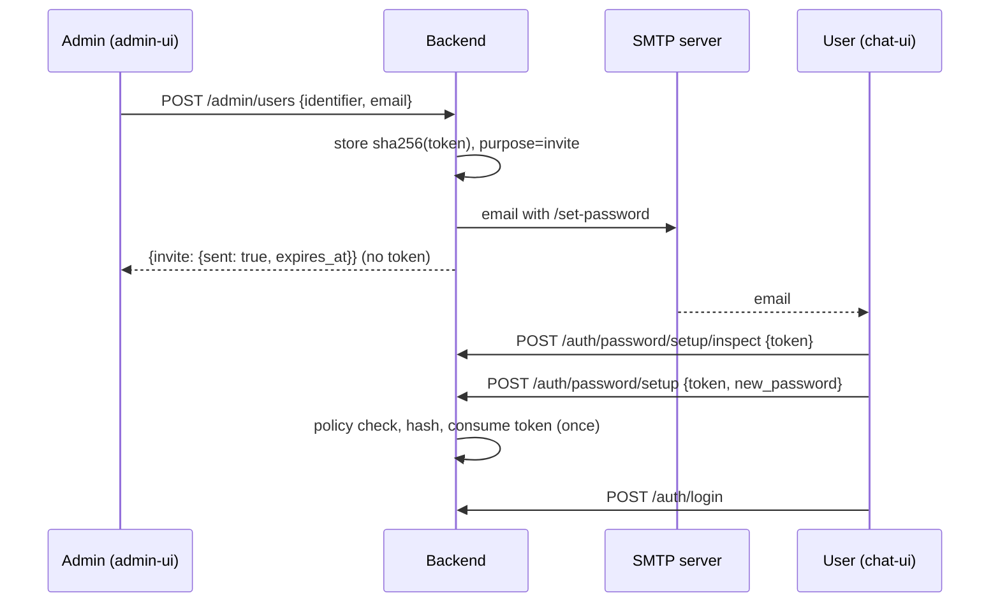

# Password setup by email

Administrators **never see, choose or receive a user's password**. That holds when an account is created, when a password is recovered and during an SSO migration. Instead, the platform emails the user a one-time link. The user opens it in chat-ui (`/set-password`) and picks a password that satisfies the policy.

The admin gets only the outcome of the delivery ("sent", "failed: SMTP authentication", "no email address"). The link and its token never appear in an API response, in admin-ui or in the audit log.

## Flows

| Flow | Trigger | Link purpose | Default validity |
|------|---------|--------------|------------------|
| New user | `POST /admin/users` (email required) | `invite` | `AION_PASSWORD_INVITE_TTL_HOURS` (72 h) |
| Resend / reset by admin | `POST /admin/users/{id}/password-link` | `reset` if the user has a password, otherwise `invite` (`migration` during an SSO migration) | 60 min / 72 h |
| Self-service "Forgot password?" | `POST /auth/password/forgot` | `reset` (or `invite` / `migration` when the user has no password yet) | `AION_PASSWORD_RESET_TTL_MINUTES` (60 min) |
| SSO migration | `PUT /admin/auth/login-mode`, `POST /admin/auth/setup-links`, unlink of an identity | `migration` | `AION_SSO_TEMP_PASSWORD_TTL_DAYS` (7 days) |

After setting the password the user signs in normally, so 2FA and the SSO-link requirement still apply. For `migration` links, the [SSO link modal](./sso-migration.md#1-migration-flow-user-perspective) appears right after that first login.



## Tokens

- **Storage.** Tokens are random (`secrets.token_urlsafe(32)`) and stored in `password_setup_tokens`, **hashed** with SHA-256 only (`src/auth/password_setup.py`).
- **One active link per user.** Issuing a new link invalidates the user's previous unused ones.
- **Single use.** The token is consumed atomically (`UPDATE … WHERE consumed_at IS NULL`), so it works exactly once.
- **Fragment URL.** The link carries the token in the URL fragment (`/set-password#token=…`), so it does not end up in server logs or `Referer` headers. chat-ui reads it once and removes it from the address bar.
- **Base URL.** It comes from `AION_PUBLIC_CHAT_URL` / `AION_CHAT_URL`, or from the request host. Set it in production so links are correct.
- **Successful setup.** The password must satisfy `src/data/user_password.py::password_policy_violations`, otherwise the request fails with `422 password_policy` and `violations`. On success `must_change_password` and any legacy temporary-password expiry are cleared.
- **SSO users.** A user who already confirmed an SSO identity can't set a password this way (`sso_user`).

## Public endpoints

Prefix `/auth/password`, rate limited per IP:

- `POST /setup/inspect {token}` → `{valid, purpose, identifier, display_name, expires_at}`, or `400` with `token_invalid` / `token_expired`. It doesn't consume the token.
- `POST /setup {token, new_password}` → `{status: "ok", identifier, is_admin}`. It opens no session.
- `POST /forgot {identifier}` (username or email) → **always** `202 {status: "accepted"}`, whether or not the account exists.
  - The email is sent in the background, so response time doesn't reveal whether the account exists.
  - It is rate limited by `AION_PASSWORD_FORGOT_LIMIT_PER_IP` (10/h) and `AION_PASSWORD_FORGOT_LIMIT_PER_ACCOUNT` (3/h).
  - It sends only when password login is visible, SMTP is configured, the user has an email and no confirmed SSO identity.
- `GET /auth/status` exposes `password_reset_available`. chat-ui and admin-ui show "Forgot password?" only when it is true.

## SMTP configuration

admin-ui → **Settings → SMTP** (`/settings#smtp`), stored per tenant in `smtp_settings`:

| Field | Notes |
|-------|-------|
| Enabled | Off = no email is sent; admin-ui blocks invites and resets |
| Host / port | Port default follows security: STARTTLS 587, SSL/TLS 465, none 25 |
| Security | `starttls`, `ssl`, `none` (dev only, e.g. Mailpit) |
| Username / password | Password is **write-only**: encrypted with `AION_CREDENTIAL_ENCRYPTION_KEY` (AES-GCM), never returned (`password_present` only). Empty = keep the saved one |
| From address / name, Reply-To | Sender of every email |
| Email language | `it` or `en` (templates in `src/notifications/templates/<lang>/`) |

Admin endpoints (role `admin`):

- `GET /admin/smtp`: the settings without the password, plus `configured` and the `last_test_*` result.
- `PUT /admin/smtp`: saves the settings. Validation errors: `invalid_host`, `invalid_security`, `invalid_from_address`, `invalid_reply_to`, `invalid_language`.
- `POST /admin/smtp/test {to?}`: sends a test email to `to`, or to the admin's own address. Returns `{ok, error, to}`; `error` is one of `smtp_auth_failed`, `smtp_connection_failed`, `smtp_send_failed`.

Delivery uses stdlib `smtplib` in a worker thread with a 15 s timeout (`src/notifications/mailer.py`). Errors are mapped to `smtp_not_configured`, `smtp_auth_failed`, `smtp_connection_failed` or `smtp_send_failed`. A failed delivery is recorded on the token (`send_error`). admin-ui shows it as an "Invio fallito" badge with a resend action.

### Local testing

```bash
docker run -p 1025:1025 -p 8025:8025 axllent/mailpit
```

Configure host `127.0.0.1`, port `1025` and security `none`, then read the emails at `http://localhost:8025`.

## Audit

Every admin action is written to `audit_logs` (`src/data/audit.py::record_admin_action`). That covers creating a user, sending invite, reset or migration links, changing SMTP settings and sending an SMTP test. The payload holds user ids and delivery counts only, never tokens or passwords.

## Out of scope

- **Break-glass CLI.** `python -m src.auth.recover set-password <user>` still prints a generated password to whoever has shell access to the server. See [SSO migration → Break-glass](./sso-migration.md#break-glass).
- **Default admin bootstrap.** `admin`/`admin` with `must_change_password` is the admin's own credential, not a user's.

## Configuration

| Variable | Default | Purpose |
|----------|---------|---------|
| `AION_PASSWORD_INVITE_TTL_HOURS` | `72` | Validity of invite links |
| `AION_PASSWORD_RESET_TTL_MINUTES` | `60` | Validity of reset links |
| `AION_SSO_TEMP_PASSWORD_TTL_DAYS` | `7` | Validity of migration links |
| `AION_EMAIL_PLATFORM_NAME` | `AION` | Platform name in email subject and body |
| `AION_PASSWORD_FORGOT_LIMIT_PER_IP` | `10` | "Forgot password" requests per IP per hour |
| `AION_PASSWORD_FORGOT_LIMIT_PER_ACCOUNT` | `3` | Emails per account per hour |
| `AION_PUBLIC_CHAT_URL` / `AION_CHAT_URL` | — | Base URL of the links (set it in production) |
| `AION_CREDENTIAL_ENCRYPTION_KEY` | — | Encrypts the SMTP password at rest |
